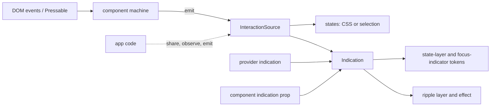

# Components and style registry: design doc

Status: accepted. Supersedes layer 3 ("copy-paste delivery") of
`docs/design/multi-config-ui-library.md` §3.

## 1. Goals

1. **Share everything that isn't framework glue.** Behavior, anatomy, prop contracts,
   state-to-style mapping, and test ids live in framework-free packages. A Solid, React, or
   React Native binding is a thin layer of reactivity and JSX.
2. **One config, everywhere.** `pureform.config.ts` is the single source. Build tools
   (Panda, Tailwind, the CSS adapter, Metro) import it, and runtime code gets the glue
   generated from it (§4, §6), so they can't drift.
3. **Static and runtime theming.** Themes compile to static CSS where possible, and switch
   or override at runtime through `dynamic` tokens and providers, with no rebuild.
4. **Pay for what you use.** Unused components ship neither JS nor CSS. Package layout does
   most of it; a bundler plugin does the rest.
5. **Styles come from a registry.** Components never import a recipe. They ask the
   registry for a slot's styles given a component, its variants, and its state. Panda,
   Tailwind, plain CSS, and React Native each fill the registry with their own factories.
6. **Components focus on behavior.** Accessibility, keyboard, focus, state, stable test
   ids, overridability. Compound anatomy: `Button.Root`, `Button.Label`, `Button.Icon`.
7. **Solid 2.0 first.** Zag.js for behavior where Material fits it; our own machines where
   it doesn't.

Non-goals: shadcn-style copying of source (§10).

## 2. Bet: registry lookups are cheap

Components get their styles by calling a factory from the registry with their selection
(§5). This only works if the call is a few property reads. The design keeps it so:

- Variant and state selection is precomputed at build time into a flat table per
  component, keyed by a small integer or short string (§5.4).
- Lookups are memoized per instance by Solid's fine-grained reactivity: the style
  expression reruns only when a variant or state signal it read changes.
- On the web, a lookup returns a class string (static) plus, when instance tokens exist, a
  style object of CSS variables. No style objects are built per render.
- On React Native, the lookup returns a cached, frozen style object per selection. Today
  `rn-adapter`'s `useComponentState` memoizes per instance and selects again when a
  variant or state changes, over resolved styles cached per theme; the factory moves that
  cache to one shared table per component.

**Measured** (button, default config, median of 15 runs of 10,000 lookups, on a desktop
Ryzen 5 5600 under Node 26; `--jitless` stands in for Hermes, which has no JIT):

| Lookup                                                   | With JIT | Without JIT |
| -------------------------------------------------------- | -------- | ----------- |
| Web today: the CSS adapter's `componentClasses`, 4 slots | 1.5 µs   | 4.0 µs      |
| Web, cached per selection (key string and `Map.get`)     | 0.10 µs  | 0.18 µs     |
| Native today: `selectWithTransitions`, uncached          | 11.7 µs  | 52 µs       |
| Native, cached per selection (frozen, `Map.get`)         | 0.11 µs  | 0.21 µs     |

- **The bet holds with a per-selection cache, and only with it.** On the web a press or
  hover makes no lookup at all (§5.1), so lookups happen on mount and on a variant change;
  even uncached, 1,000 mounts cost about 4 ms without a JIT. On React Native every state
  change is a lookup, and uncached selection would cost about 52 ms for a 1,000-item list
  without a JIT, before a phone's slowdown. So the native factory caches every selection
  it has computed, keyed by its variants and states; the web factory caches too, since
  it's cheap.
- **The cache fills lazily.** Precomputing every combination isn't needed: a key's first
  lookup selects and freezes, and every later one is a `Map.get`.
- **The original gate**, 10,000 lookups per frame under 1 ms on a mid-range phone, was
  stricter than any real frame needs: even cached lookups take 1 to 2 ms per 10,000 on
  this desktop. With the cache, a lookup costs a fraction of a microsecond even without a
  JIT, so a measurement on a real phone isn't planned.

## 3. Package layout

```
@pureform/core              AST, config types, defineComponent (exists)
@pureform/theme, material   contracts, providers (exist)
@pureform/preset            Material components as AST (exists)
@pureform/css-lowering,     shared CSS lowering, the framework-free ripple, and helpers
  js-effects, utils,        (exist)
  type-utils

@pureform/styling           NEW. Types and a tiny registry: ClassFactory, StyleFactory,
                            Selection, instance tokens. Framework- and target-free.
@pureform/anatomy           NEW. Per component: parts, their roles, data attributes,
                            test ids, prop contract, state shape. Pure TS, no framework.
@pureform/machines          NEW. Behavior: Zag.js machines re-exported, plus our own
                            (ripple, state layer, morphing shapes, Material-specific
                            controls). Framework-free.

@pureform/*-adapter         Exist. Each gains a `/codegen` subpath (§5.2), run at build
                            time by `@pureform/generate`, that emits ClassFactory (web) or
                            StyleFactory (native) modules into `.pureform/`.

@pureform/binding-core      NEW (p2a). What every binding shares without a framework:
                            provider options and nesting, selections over defaults,
                            keyed part values, controllable state, reduced motion,
                            icon slot style. No DOM, HTML, CSS, or Zag: the web half
                            (part attributes, class and props merging, Zag/HTML props)
                            is @pureform/binding-web, over @pureform/web-contracts.

@pureform/solid             NEW. Solid 2 bindings: provider, useClasses, compound
                            components. Includes internal Zag glue for Solid 2 (§8).
@pureform/react             NEW, built alongside Solid. Same anatomy and machines.
@pureform/react-native      NEW (p8). The components moved out of rn-web-demo, on the
                            same anatomy, over the native StyleFactory.

@pureform/generate          NEW. The build step both tools share, with no bundler or CLI
                            dependency: config loading, calling each adapter's
                            `/codegen`, writing `.pureform/`, hashing for staleness, and
                            the registry index.
@pureform/bundler           NEW. Vite/Rollup/esbuild/Metro plugin (unplugin) over
                            `@pureform/generate`: virtual registry module, dev
                            regeneration, style pruning.
@pureform/cli               NEW. The `pureform` bin (§10) over `@pureform/generate`.
```

Rule for where code goes: if it compiles without importing a framework, it's not in
`@pureform/solid`. Each component's Solid file should read as "wire anatomy to machine to
registry", typically under 80 lines.

Adapters (`panda-adapter`, `css-adapter`, `tailwind-adapter`, `rn-adapter`) stay build-time
compilers, and their `/codegen` subpath turns their own output into factory modules, so
class names and the code using them change together. Small helpers the generated modules
need at runtime, such as joining classes, live in `@pureform/styling`. The rule: adapters
are build time, `styling` is runtime, and a production bundle never imports an adapter.

## 4. `pureform.config.ts`

```ts
import { defineConfig } from "@pureform/core";
import { pureform } from "@pureform/preset";

export default defineConfig(pureform({ themes: { teal: {/* … */} } }));
```

The config is the design system as pure data: tokens, themes, shapes, components. It
says nothing about how it's built. Whatever consumes it decides that, through its own
options:

```ts
import { compilePreset } from "@pureform/panda-adapter";

// panda.config.ts
import config from "./pureform.config";
export default defineConfig({
    presets: [compilePreset(config, { prefix: "pf" })],
});

// vite.config.ts
import pureform from "@pureform/bundler/vite";
export default defineConfig({
    plugins: [
        pureform({
            config: "./pureform.config.ts",
            target: "panda", // "panda" | "tailwind" | "css"; Metro implies "native"
            components: ["button", "checkbox"], // optional allow-list (§7)
        }),
    ],
});
```

- **Build options belong to the build tool.** The target, var and class prefixes, and the
  allow-list are options of the adapter or the bundler plugin, not fields of the config.
  The same config can then feed a Panda web app and a Metro app at once.

- **Import rules.** The config must be importable by Node (build tools) and by the browser
  bundle. It may only import pureform packages and pure data. No `fs`, no env reads at top
  level. `@pureform/generate`'s `loadConfig` checks it on every load (built in p4a): it
  walks the config's relative imports with `oxc-parser` and fails on a Node built-in, a
  package outside `@pureform/*` (unless the build allows it), or an environment read at top
  level. Each adapter's tests can call the same check.
- **Loading.** Build tools load it with jiti (already used by Metro's `withPureform`).
  `panda.config.ts` imports it for `compilePreset(config)`; on the CSS and Tailwind targets
  the bundler plugin (or `pureform generate`) loads it and writes `.pureform/styles.css`,
  which the app's CSS imports (since p5a, which retired the adapters' own Vite plugins).
- **Runtime.** Runtime code never imports the full config. It imports the generated
  registry module (§6), which carries only what runtime needs: selection tables, dynamic
  token names, theme names, defaults. The full AST stays at build time.

## 5. Style registry

### 5.1 Two kinds of factory (`@pureform/styling`)

Web frameworks already apply class strings well, and a class string is the cheapest thing
a lookup can return. React Native has no classes. So the registry serves two kinds of
factory over one selection type:

```ts
type Selection<C> = Variants<C> & { tokens?: InstanceTokens<C> };

/** Web: class strings per slot, plus CSS vars for instance tokens. */
type ClassFactory<C> = (selection: Selection<C>) => {
    [S in SlotOf<C>]: { class: string; style?: Record<`--${string}`, string> };
};

/** React Native: resolved style objects per slot; states are part of the selection. */
type StyleFactory<C> = (selection: Selection<C> & States<C>) => {
    [S in SlotOf<C>]: { style: object; drawing?: Drawing };
};
```

`Variants<C>`, `States<C>` (`hover`, `pressed`, `focusVisible`, `disabled`, `selected`,
…), `SlotOf<C>`, and `InstanceTokens<C>` are typed from the AST via `defineComponent`'s
inference, reusing the AST's condition names.

Built (p1e) in `@pureform/styling`: the generic types take a component's name, a key of the
`ComponentRegistry` interface that generated declarations augment with each component's
`variants`, `slots`, `states`, `tokens`, and `lazy`, or that shape inline. `defineComponent`
doesn't infer variant types, so the generator writes them from the config. `StyleFactory`
takes the style and drawing types as parameters, since `styling` can't import `rn-adapter`.
`selectionCache` is the per-selection cache of §2, and `withTokenStyle` adds instance tokens
as CSS vars. `componentClasses` moved here from the CSS adapter (which re-exports it);
`themeVars` stays in `css-lowering`, which it needs, and `@pureform/styling-web/theme-vars`
re-exports it. Since the platform-boundary refactor, `styling` keeps only the neutral types, the
registry, and the caches, and depends on `core` alone; `ClassFactory` and its output types,
`withTokenStyle`, `componentClasses`, runtime CSS themes, the web registry's theme attribute and
var prefixes, and `/theme-vars` live in `@pureform/styling-web`.

On the web, interaction states are not part of the selection. The browser and the
bindings mark them on the element, and the generated CSS matches them, so a press changes
one attribute and calls nothing. Only a variant or token change calls the factory again.
On React Native there are no selectors, so states are in the selection, and each change is
one `Map.get` returning a cached, frozen object (measured in §2).

**How the web matches a state, in order of preference:**

1. **A native pseudo-class** (`:hover`, `:active`, `:focus-visible`, `:checked`,
   `:disabled`, `:placeholder-shown`, through `:has()` for a state inside the slot). It
   works before hydration, without our JS, and for plain-CSS and Tailwind users.
2. **An ARIA attribute** (`aria-checked`, `aria-selected`, `aria-pressed`,
   `aria-current`, `aria-expanded`, `aria-invalid`, `aria-disabled`, `aria-readonly`).
   Accessibility needs it set anyway, and it's a standard name, not a behavior library's.
3. **Our own `data-pf-*` attribute**, only where neither covers the state. The bindings
   set it; Zag's `data-*` attributes aren't matched, so swapping or upgrading Zag can't
   change styling.

State classes computed in JS were considered and rejected: they'd style nothing before
hydration, need our JS for plain-CSS users, cost a JS update per hover and press, and push
each state to every slot that reads it, where a descendant selector does that today.

Review of `css-lowering`'s lowering against these rules (the condition table, and the
slot-state table the preset mostly uses):

| State           | Native                                     | ARIA                                            | `data-pf-*`        | Change from today                                                                         |
| --------------- | ------------------------------------------ | ----------------------------------------------- | ------------------ | ----------------------------------------------------------------------------------------- |
| `hover`         | `:hover`                                   |                                                 | `data-pf-hover`    | `data-hover` → `data-pf-hover` (hover driven by another element, such as a label)         |
| `pressed`       | `:active`                                  |                                                 | `data-pf-active`   | Condition matched `data-active`, slot state `data-pressed`; one name now (keyboard press) |
| `focusVisible`  | `:focus-visible` (`:has()` within)         |                                                 |                    | Drop `data-focus-visible`                                                                 |
| `focusWithin`   | `:focus-within`                            |                                                 |                    | Drop `data-focused`; condition `focus` drops `data-focus`                                 |
| `dragged`       |                                            |                                                 | `data-pf-dragging` | `data-dragging` → `data-pf-dragging`                                                      |
| `filled`        | `:not(:placeholder-shown)` on an input     |                                                 | `data-pf-filled`   | `data-filled` → `data-pf-filled` (a select's value isn't in an input)                     |
| `checked`       | `:checked`                                 | `aria-checked=true`                             |                    | Drop `data-checked` and `data-state="checked"`                                            |
| `indeterminate` | `:indeterminate`                           | `aria-checked=mixed`                            |                    | Drop `data-indeterminate`                                                                 |
| `selected`      |                                            | `aria-selected`, `aria-pressed`, `aria-current` |                    | Drop `data-selected`                                                                      |
| `expanded`      |                                            | `aria-expanded`                                 |                    | Drop `data-expanded`                                                                      |
| `descending`    |                                            | `data-pf-descending`                            |                    | New (f1d, f2d): the binding marks it; the machine's `data-direction` isn't matched        |
| `invalid`       | `:invalid` (condition only; not on fields) | `aria-invalid=true`                             |                    | Drop `data-invalid`                                                                       |
| `disabled`      | `:disabled`                                | `aria-disabled=true`                            |                    | Drop `data-disabled` and `[disabled]`; the slot state gains `aria-disabled`               |
| `readOnly`      | `:read-only`                               | `aria-readonly=true`                            |                    | Drop `data-read-only`                                                                     |

- **Panda** maps conditions to its built-in keys (`_hover`, `_checked`, …), whose
  selectors include Zag's attributes. pureform's recipes stop using those keys and emit
  the same selectors as the other targets; an app's own `_hover` keeps Panda's meaning.
- **The `data-pf-*` names** are exported as `STATE_ATTRIBUTES` from `@pureform/web-contracts`
  (`hover`, `pressed`, `dragged`, `filled` to their attributes); `css-lowering` builds its
  selectors from them and the bindings set them.
- **Output changes on purpose**, so it's checked against fixtures (an element in each
  state, marked each allowed way, plus Zag's attributes alone, which must not match)
  rather than the before-and-after equivalence check. Shorter selectors also shrink the
  CSS.
- **Interaction states come from an interaction source** (§9.8). A state from the element
  itself matches its pseudo-class; the bindings write `data-pf-*` only for a state forwarded
  from somewhere else, such as another component sharing the source.

### 5.2 Generated factories per target

**Panda:** a thin wrapper over Panda's own `sva`. Panda's static extractor can't see
through it, so the generator also emits `staticCss` for every variant of every registered
component (or only the allow-listed ones, §7); accepted until pruning lands.

```ts
// .pureform/web/button.ts (generated)
import { button as recipe } from "../../styled-system/recipes";
export const button: ClassFactory<"button"> = (s) => recipe(s);
```

Built (p2c), hand-written in `apps/solid-demo/.pureform/` until p4b-panda generates it: Panda's
recipe returns a class string per slot, so the factory maps each to `{ class }`, caches one
frozen result per selection with `selectionCache`, and adds instance tokens with
`withTokenStyle`. The `staticCss` entries live in `.pureform/panda.ts`, a build-time module
`panda.config.ts` spreads in, apart from the runtime modules, which import `styled-system/`.

Built (p4b-panda): `@pureform/panda-adapter/codegen` generates those modules for every
allow-listed component, single-slot recipes included (their class string becomes the root's).
Each imports its recipe from the file Panda names after it (`recipes/icon-button`), and passes
groups of `"true"` and `"false"` to it as booleans, since Panda compares them strictly. Its
options are Panda's `outdir` and the preset's var `prefix`. `panda.ts` also lists every theme
in `staticCss.themes`, since the theme is picked at run time too.

**CSS and Tailwind:** plain lookup tables with no runtime dependency. Tailwind also gets
`@source inline(...)` so it keeps the classes. This exists in part today: the CSS
adapter's Vite plugin (which the Tailwind adapter's reuses) generates each component's
class function from a manifest and serves it as `virtual:pureform/components`, typed from
the config, over `componentClasses` in `@pureform/css-adapter/runtime`. It returns a class
string per slot; the factory adds `style` for instance tokens and moves into `.pureform/`.

```ts
// .pureform/web/button.ts (generated; class names as the CSS adapter writes them, here
// with `classPrefix: "pf"`)
const base = { root: "pf-button__root", label: "pf-button__label" };
const variant = {
    filled: { root: "pf-button__root--variant_filled" },
    outlined: { root: "pf-button__root--variant_outlined" },
};
export const button: ClassFactory<"button"> = ({ variant: v = "filled" }) => ({
    root: { class: `${base.root} ${variant[v].root}` },
    label: { class: base.label },
});
```

Built (p4b-css): `@pureform/css-adapter/codegen` generates a module per allow-listed
component, and `styles.css`, the stylesheet compiled for those components only (tokens,
themes, and keyframes always). Every slot of a CSS adapter component carries
`<slot class>--<group>_<value>` for every group, so rather than a table per value the module
writes each slot's classes as a template over the selection, inside `selectionCache` (one
frozen result per selection) with `withTokenStyle` for instance tokens. It imports only those
two helpers from `@pureform/styling`, which the registry needs anyway: no class name runtime
and no manifest. The classes equal `componentClasses`' for every selection of the preset.
Its options are `CssOptions` (`classPrefix`, `prefix`, …). The Vite plugin and
`virtual:pureform/components` stay until the bundler plugin replaces them.

Built (p4b-tailwind): `@pureform/tailwind-adapter/codegen` writes the CSS adapter's modules
unchanged (the Tailwind stylesheet keeps its class names), and `styles.css`, `compileTailwind`
for the allow-listed components, which the app imports after `tailwindcss`. Its options are
`TailwindOptions`. It writes **no `@source inline(...)`**: that was a Tailwind v3 need, when
custom rules in `@layer components` were dropped unless the scanner saw their classes. Tailwind
v4 keeps every rule outside its utilities as written and makes utilities only from what it
scans, so the factories' classes survive without being listed (checked through Tailwind's
compiler with no candidates), and listing them would only make utilities of a class that
shares a utility's name.

Built (p5a): both demos, `css-demo` and `tailwind-demo`, render `@pureform/solid`'s components
over these registries through the bundler plugin, and the adapters' own Vite plugins
(`pureformCss`, `pureformTailwind`, `virtual:pureform/components`, `buildCss`) are gone. The
shared suites (§9.7) run every component on Panda, CSS, and Tailwind.

**Native:** a precomputed table. Metro's `withPureform` already precomputes each theme's
resolved component styles, which `rn-adapter`'s `useSelected` selects from at runtime;
the factory adds the per-selection table on top. Token tweening (`useMovingTokens`)
wraps it.

```ts
// .pureform/native/button.ts (generated)
import { table } from "./button.table"; // key → frozen styles
export const button: StyleFactory<"button"> = (s) =>
    table.get(
        `${s.variant ?? "filled"}|${s.pressed ? 1 : 0}|${s.disabled ? 1 : 0}`,
    )!;
```

Built (p4b-rn): `@pureform/rn-adapter/codegen` writes `native/<name>.ts` per allow-listed
component, a `NativeFactory<"name">` (`nativeFactory` from `@pureform/rn-adapter/factory`) over
that component's own precomputed templates and values, parsed from a JSON string, and
`native/theme-values.ts`, the themes' token values and formulas every module shares. Rather than
a table written out, the module fills `selectionCache` lazily (§2): the key is each group's value
and a bit per state the component's rules read, which the generated declarations list as its
`states`. The theme isn't in the selection, so the environment a provider holds (theme, scheme,
overrides, SVG drawing, and which width and container conditions hold) picks a table:
`factory.for(environment)(selection)`; calling the factory itself is the base theme's light
scheme. Each slot gives `style` and `drawing`, plus its `transitions`, `animation`, and `parent`,
which token tweening and the animated hooks need. Instance tokens resolve the component again
with them, cached per value. `rn-adapter`'s hooks select through the same factories, built over
the provider's styles (`componentFactory`), so `useMovingTokens` works on them unchanged; the
equivalence is checked against selection for every preset component and in the browser suite.

Built (p8): `@pureform/react-native`'s provider hands `rn-adapter`'s hooks the registry's
factories, and `rn-web-demo` renders from them, generated by the bundler's Vite plugin with the
`native` target. Each slot also carries its icon fill (§9.6).

### 5.3 Hooks

Each binding offers a pair: a hook components use, and a lower-level hook that returns
the factory itself. Both read the same registry entry.

|                | Web (Solid, React)                           | React Native                               |
| -------------- | -------------------------------------------- | ------------------------------------------ |
| Components use | `useClasses(name, selection)` → slot classes | `useStyles(name, selection)` → slot styles |
| Lower level    | `useClassFactory(name)` → the factory        | `useStyleFactory(name)` → the factory      |

- `useClasses` memoizes the call: in Solid it takes an accessor and returns a memo; in
  React it takes the selection object and uses `useMemo`. Components can't forget the memo
  or get it wrong.
- `useClassFactory` is for calling the factory outside rendering: tests, event handlers,
  scripts. Several selections at once, such as one preview per variant in a picker, call
  `useClasses` once per selection instead, so they work with lazy entries too:

    ```tsx
    <For each={variants}>
        {(v) => (
            <Preview slots={useClasses("button", () => ({ variant: v }))} />
        )}
    </For>
    ```

**Static and lazy entries.** Each registry entry's kind is fixed when `.pureform/` is
generated, not by whether its chunk has loaded, so the server and the client always take
the same path and hydration sees the same shape of value (§5.7).

```ts
// Solid, roughly
function useClasses(name, selection) {
    const entry = useRegistry().entry(name);
    if (entry.kind === "static")
        return createMemo(() => entry.factory(selection())); // sync, no boundary
    return createMemo(async () => {
        const s = selection(); // tracked before the await
        return (await entry.load())(s); // resolves to classes, which serialize
    });
}
```

- **`useClasses`, static entry:** a plain memo. Nothing suspends, and no boundary is
  needed.
- **`useClasses`, lazy entry:** always an async memo, even when another component has
  already loaded the chunk. The component's code doesn't change; it needs a `<Loading>`
  (Solid) or `<Suspense>` (React) boundary somewhere above it.
    - Server: waits for the chunk and streams the classes.
    - Solid client: adopts the serialized classes, and loads the chunk the first time the
      selection changes.
    - React client: React doesn't serialize the value, so `use(promise)` holds that
      boundary's hydration until the chunk loads, then hydrates with the same classes.
      There is no flash or mismatch, but hydration waits on the chunk.
- **`useClassFactory`, static entry:** returns the factory; works everywhere.
- **`useClassFactory`, lazy entry:** client-only, since a function can't be serialized.
  It's a separate hook, `useLazyClassFactory`, which suspends with
  `ssrSource: "client"`: the server renders the boundary's fallback, and the client loads
  the chunk after hydrating. The generated registry types `useClassFactory` to accept only
  static names, so the client-only behavior shows where it's called, and in development
  `useLazyClassFactory` warns when it runs during a server render.
- **Preloading:** `registry.preload(name)` starts loading a lazy entry early, from a
  router loader or on hover, so its first change doesn't wait on the network.
- **Built (p2a), Solid:** as sketched. `useClasses` also lays the selection over the
  provider's `defaults` for the component (`withDefaults` in `@pureform/binding-core`), and
  reads the entry's kind once per instance. `useLazyClassFactory` boxes the factory in an async
  memo with `ssrSource: "client"`. Components rarely call `useClasses` directly: Root calls
  `useComponent(anatomy, { selection, testId, unstyled })`, which makes the one call and builds
  every part (§9.2). With nothing registered (a binding's own build), `Selection` takes any
  group and `tokens`, and every group and token takes `undefined` for its default.
- **Built (p2b), React:** `useClasses(name, selection)` takes a plain object and memoizes the
  factory call on the selection's value (`selectionSignature` in `@pureform/binding-core`), so
  an inline object is fine. A lazy entry goes through `use(entry.load())` (the registry's
  promise is shared and stable). `useLazyClassFactory` throws on the server, React's way of
  rendering a `<Suspense>` boundary's fallback there and the content on the client.
- **Components don't read the theme.** The theme, `overrides`, and `hydrate` reach components
  as CSS on the provider's element, so a switch mustn't run them again. Both bindings resolve the
  fields components read (registry, `dir`, `motion`, `defaults`, `slotProps`, the indication and
  its focus indicator color) over the parent's same fields alone, apart from the theme's, so a
  theme change here or above leaves them as they are; `usePureform()` still reads the whole
  state. React's `PureformProvider` provides them in a second, internal context: with 200
  buttons in a production build, a switch went from 9 ms to 0.3 ms (41 ms to 1 ms at 4x CPU
  throttling), and mounting cost the same. Solid's state has a memo behind each field, so a
  component depends on the fields it reads; resolving the two apart keeps a switch from building
  the merged `defaults` and `slotProps` of nested providers that both set them again, which ran
  every component reading them. With 200 buttons under two such providers, a switch went from
  4.7 ms to 0.1 ms (17.6 ms to 0.1 ms at 4x), and mounting cost the same, with the same reactive
  nodes per provider and the same server HTML.
- **Built (p8), React Native:** `useStyleFactory(name)` returns the entry's factory in the
  provider's environment (`factory.for(environment)`: theme, scheme, overrides, the engine's SVG
  drawing, the widths around the caller), not the bare factory, which is the base theme's light
  scheme. `useStyles(name, selection)` calls it with the provider's defaults, `rtl`, and
  `reducedMotion` added; a repeated selection returns the same frozen object, so it needs no
  memo. A lazy entry suspends both through `use()`; there's no server, so no
  `useLazyClassFactory` counterpart. Components use `useComponentSlots(name, selection, state)`,
  which selects through `rn-adapter`'s hooks: the provider fills `rn-adapter`'s
  `StylesProvider` with a source over the registry's entries, so the animated hooks, ripples,
  SVG drawing, and token tweens run on the generated factories unchanged. Instance tokens are
  named as the component names them (`{ value: 40 }`) and tween. The provider compares
  `registry`, `defaults`, `engine`, and `indication` by identity and `overrides` by value, so an
  app keeps the former stable; an inline `defaults` renders every styled component again. A
  mounted interactive list item costs about 0.4 to 0.5 ms in development (0.7 to 1 ms before
  still slots took plain views), so long lists go in a `FlatList` keyed by value, with memoized
  rows.
- **Built (still slots), React Native:** a slot renders with the engine's animated views only
  where the component's styles ever move it: each factory's `moving` (`movingSlots` in
  `rn-adapter`) names the slots with a transition of a style property or a keyframe animation in
  any rule, whatever its variants, states, or conditions, and `useComponentSlots` gives each slot
  its views (`views.<slot>.View`, `.Text`, `.Pressable`, `.TextInput`): the engine's for those,
  React Native's plain ones for the rest. The decision is the component's, never its state or
  variants, so a slot never changes views (and remounts, losing focus or a press) while it's on
  screen. A scheme change tweens colors only through a slot's transitions, so a still slot jumped
  before too. A `Glyph` follows its icon slot's style (animated text only where a value in it is
  animated), since a text glyph holds no state. Animated's transitions also make their animated
  values on a value's first change rather than at mount. Overlays given `open` render their root
  with the engine's view, which their enter and exit need. In a 200-row list (development, React
  Native Web, Animated), a still list item's mount went from about 0.45 to 0.3 ms and an
  interactive one's from 0.65 to 0.45 ms; most of it was the animated values, about a quarter
  the views.

```tsx
// Solid
function Root(props) {
    const api = useButtonMachine(props); // aria-*, data-pf-active, data-pf-hover
    const slots = useClasses("button", () => ({ variant: props.variant }));
    return (
        <button
            {...api.rootProps}
            class={[slots().root.class, props.class]}
            data-testid={testId(props, "root")}
        >
            <Ctx value={{ api, slots }}>{props.children}</Ctx>
        </button>
    );
}

// React Native
function Root(props) {
    const api = useButtonMachine(props);
    const slots = useStyles("button", {
        variant: props.variant,
        pressed: api.pressed,
        disabled: props.disabled,
    });
    return (
        <Pressable {...api.rootProps} style={[slots.root.style, props.style]} />
    );
}
```

|                                      | Web                             | React Native                  |
| ------------------------------------ | ------------------------------- | ----------------------------- |
| Selection type, slot names, test ids | shared                          | shared                        |
| Factory                              | `ClassFactory`: class strings   | `StyleFactory`: style objects |
| States                               | data attributes, matched in CSS | part of the selection         |
| Instance tokens                      | CSS vars in `style`             | merged into styles, tweened   |
| Cost of a state change               | none                            | one `Map.get`                 |

### 5.4 Selection encoding and instance tokens

Each component's variants (and on native, states) are enumerated at build time, and the
key is built from them in a fixed order. For components whose variant product is large,
the generated factory composes per-variant fragments instead of storing the full product:
a class string concat on web, a shallow merge cached per key on native.

Built (p4a, p4b): no factory stores a product. The web factories write each slot's classes as
a template (or call Panda's recipe) and the native ones select from the precomputed styles,
both only for keys looked up, inside `selectionCache`.

`dynamic` component tokens (`components.circularProgress.value`) are props on the
component, passed as `selection.tokens`. On the web, the factory returns them as CSS vars
for the root's `style` (registered with `@property` when they have a `valueType`, so they
transition). On native, they're merged into the styles and tweened. The component code
doesn't know which.

### 5.5 Fewer compound variants: tokens a style sets

Most compound variants pair two variant groups that each set half of a value, such as a
color group and a fill. A style can instead set the component's own `dynamic` tokens, and
other variants read them:

```ts
color: { error: { root: { tokens: { accent: sys("error"), onAccent: on("error") } } } },
variant: { filled: { root: { backgroundColor: token("accent"), color: token("onAccent") } } },
```

- **Typed:** in a typed recipe, `tokens` takes the component's own token names, with
  autocomplete, in base styles, variants, compounds, and states. The builder stores them
  by path (`components.button.accent`) and only allows them on a root slot.
- **Web:** each becomes its custom property in that rule, inherited by every slot.
- **React Native:** selection takes them out, and the component is resolved again with
  them, under the instance's own tokens (`withSetTokens`), cached per set of values.
- **Precedence:** the theme's default, then variants and states, then the instance.
- **Button, as built:** 7 color variants and 5 fills replace 35 compounds. Every
  combination resolves identically on React Native (5,250 selections) and computes
  identically in Chromium (21,000 slot styles), and the CSS is 35.7 KB smaller.
- **Density:** components with sizes get a `densityOffset` token, the theme's by default.
  Each `density` step sets it and each size adds it
  (`height: add(token("height"), token("densityOffset"))`), so one rule per size covers
  every step. `inherit` sets it back to the theme's offset, so a component inside a denser
  one doesn't inherit its parent's token.
- **Across the preset:** compounds went from 223 to 12, with output identical on both
  targets. Built CSS is about 28% smaller raw (7% gzipped) on the CSS target and 34% (9%)
  on Tailwind; React Native's precomputed styles are 12% smaller.
- **What stays compound:** cases that need both conditions at once: the FAB's size with
  its shape (4), the anchored badge's offset per size (2), each text input's fill with a leading icon, primary tabs with an icon,
  interactive cards per fill (3), and each fill's toggle colors on the button and icon button
  (5 each), whose selected colors read the `color` group's tokens. Wavy progress needs no compound:
  wave travel belongs to the wavy variant for both determinate and indeterminate modes. c4a added
  4; r4-findings drew the wave clips from the `height`/`thickness` and `amplitude` tokens, and
  item 12 removed the indeterminate-only linear wave compound. c5a's docked date picker and date input each add the
  text field's one (fill with a leading icon), and c9a's number field too. 28 across the preset, counting every
  `compoundVariants` entry of every component in `pureform()` (`packages/preset/src/doc-counts.spec.ts`
  checks this number against the code).
- **Flags for two groups (M3 Expressive):** when a value depends on two groups, one sets a
  literal token and the other a 0/1 flag token, and `blend(from, to, flag)` picks between
  them: the size sets `squareRadius` and `corner: square` sets `square`; `width` sets
  `narrow`/`wide`; `inset` sets `insetStart`/`insetEnd`. A FAB that isn't extended is square
  through `aspectRatio: 1`, not a width per size.
- **No chained tokens:** a variant must not set a token to another token that a variant sets
  (`a: token("b")`). CSS resolves the chain on the element, but React Native resolves `b` from
  the theme's default before the variant's, so the targets disagree. Read such tokens in styles
  instead, and read theme- or instance-set tokens (per-size tokens) directly.
- **No overlapping groups (r4-findings):** two groups never set the same property (or token) on
  one slot, since Panda doesn't emit variant classes in definition order. The preset's
  `variant-overlap.spec.ts` checks it. The circular progress's `color` sets `activeColor` and
  `trackColor`; the icon button's `shape` sets a `shaped` flag its outline's border blends with;
  the card's fill sets `container` and the shadows, which `interactive` reads; the app bar's
  content inset blends from `expanded` (flexible sizes) and `search` flags; the side sheet's
  `modal` sets `layer` and `coplanar` a flag.

#### Provided tokens: a container's tokens for the components inside it

A recipe sets only its own component's tokens. A container that recolours what it holds (a vibrant
toolbar's icon buttons, an app bar's actions, as Compose's `LocalContentColor` does) declares
it as data instead, with `providedTokens` next to `tokens` on the slot that holds them (here the root):

```ts
color: {
    vibrant: {
        root: {
            tokens: { container: sys("primaryContainer"), content: on("primaryContainer") },
            providedTokens: { iconButton: { accent: ref("content") } },
        },
    },
},
```

- **What it is:** values for another component's own tokens, by component and token name (the
  builder stores them by path, `components.iconButton.accent`, like `tokens`). They apply to
  every component of that kind inside the slot that provides them, in it or passed in as
  children. Any slot may provide (the app bar's `leading` and `trailing` give their icon buttons
  their own colors), since providing changes nothing in the container's own resolution.
- **Resolved at the container:** a value may read the container's tokens, including the ones its
  own variants set (`ref("content")` above), and the theme's. It is resolved where the
  container is, so the nested component receives a finished value and never a chain through its
  own variant-set tokens (the chained-token rule above still holds inside each component).
- **Web (CSS, Tailwind, Panda):** each becomes the nested component's custom property on the
  providing slot's rule (`--pf-components-iconButton-accent: var(--pf-components-toolbar-content,
  …)`). Custom properties inherit, and `var()` in a custom property resolves on the element
  that declares it, so the nested component reads the container's value. None of the nested
  component's own tokens are registered as non-inheriting (`@property`) for this to hold; a
  provided token must not be one with a `valueType`.
- **React Native:** selection takes them out of the container's styles (`Selected.providedTokens`,
  by slot, then theme key), and the binding gives each slot's to what it renders in that slot
  through the `ProvidedTokens` context.
  A nested component takes them as overrides under its own: they go into `withSetTokens` where
  the provider's overrides go, so its variants' tokens and its instance tokens resolve over
  them, as on the web.
- **Solid and React:** styled containers need nothing, since the cascade carries the values. The
  bindings have the same `ProvidedTokens` context and `useProvidedTokens(component)` hook (the
  type and merge rules in binding-core), for code that renders without that cascade: a
  component merges what the context gives it as instance tokens, under its own `tokens` prop.
  An unstyled container draws none of its own colours, so it provides nothing.
- **Scope:**
    - A container may provide any component's dynamic tokens. Provide only to components it
      holds, and only tokens without a `valueType`.
    - The nearest provider wins: a container inside another provides over the outer one's values,
      per token, and a container that provides nothing passes the outer values through.
    - The nested component's own styles win: on the web, the tokens its own variants set on its
      root (an icon button with `color: "secondary"` sets `accent`), and its instance tokens. A
      selection equal to its defaults sets nothing, so it follows the container. On React Native
      the same order comes from the overrides layer.
    - A provided token travels with the DOM on the web and with the React tree on React Native,
      so a nested component portaled out of the container (a menu's items) doesn't follow it on
      the web, and on React Native only where the portal keeps React's context. Keep provided
      tokens to parts rendered in place.

- **Container tokens (slot-props standard):** a ready-made's `tokens` is its own recipe's.
  Tokens for what it draws go in `<component>Props.tokens` (`listItemProps.tokens`,
  `buttonProps.tokens`), replacing `listTokens`, `groupTokens` and `setTokens` (§9.3).

### 5.6 Themes

- **Static:** each target scopes themes the way it natively does, and the factory exposes
  that as `themeAttributes(name)`, so components and providers never hard-code a selector:
    - Panda: its own `themes` config and `data-panda-theme`, with `getTheme`/`injectTheme`
      for themes loaded at runtime.
    - Tailwind v4: theme vars in `@theme`, scoped overrides under a `@custom-variant` on a
      data attribute, the convention Tailwind's docs use.
    - CSS adapter: `[data-theme=<name>]`, the attribute set by its `themeAttribute`
      option, since plain CSS has no native scope. The Tailwind adapter uses the same
      option for its `@custom-variant`.
    - React Native: a context value; no selectors.
      Switching a theme is an attribute (or context) change.

    Built (p5a): `themeAttributes(name)` is on the registry, `registry.themeAttributes("teal")`,
    rather than on each factory: the attribute is the target's, not a component's. Each
    adapter's codegen returns its `themeAttribute` (`data-panda-theme`, or the CSS and Tailwind
    `themeAttribute` option, default `data-theme`; none on React Native), a web target's
    generated index passes it to `createWebRegistry` (`@pureform/styling-web`), and
    `PureformProvider`'s `theme` writes the attributes on its element (an inherited theme writes
    nothing, its ancestor's attribute already scopes it).

    Nested themes combine: a theme's block holds only the tokens that differ from the base (the
    preset's `themes`), so a theme for shape inside one for color draws both. React Native's
    precomputed styles hold each theme resolved whole, so its provider combines them itself: a
    nested provider with a `theme` selects with that theme and inherits, as overrides, everything
    the outer themes and overrides changed from the base except what its theme changes (each
    theme's changes are the tokens whose resolved values differ from the base's). The outer
    provider's result is unchanged, and the precomputed path recomputes only the values those
    tokens reach. As on the web, the inner theme wins over the outer `overrides` of the same
    tokens.

- **Runtime:** `<PureformProvider theme overrides>` sets theme scope and may override any
  `dynamic` token, writing CSS vars on web or a context value on native. Nested providers
  scope. Both halves exist today: `rn-adapter`'s `PureformProvider` takes `overrides`, and
  `css-lowering`'s `themeVars` turns a config's tokens into CSS vars. The bindings bring
  them under one provider. (`@pureform/theme`'s "providers" are something else: the
  token sources a config is composed from.)
- **Runtime-only themes** (generated from a seed color at runtime): the provider calls
  `@pureform/material`'s generators in the browser and writes vars. Opt-in import, so
  apps that don't use it don't ship the color math.

    Built (p5b): a provider's `theme` takes a name or a `RuntimeTheme`, `{ source, input }`, made
    by a function `defineRuntimeTheme(name, load)` returns (now `@pureform/styling-web`). The source loads
    its generator on demand and shares it across inputs; the generator turns the input into CSS
    vars per scheme, `{ light, dark }`, named by the registry's new `vars` (`{ prefix, tokenPrefix
  }`, which each codegen returns as `CodegenOutput.vars`). `@pureform/material/runtime-theme`'s
    `seedTheme({ seed, customSeeds?, overrides? })` is a few lines; its generator (the palette,
    `resolveTheme`, `themeVars`) is a separate chunk. It writes every color token and role, so a
    seed draws as a named theme with the same `materialColor` does (the suites check it against
    teal), and nothing else. `overrides` take React Native's keys (`"colors.primary"`,
    `"components.button.container"`, or a `--var`), named by `tokenVar` from
    `@pureform/styling-web/theme-vars`; only the provider's own are written, and a token declared from
    an overridden one at the root keeps its value. `useThemeVars()` in each binding gives the
    nearest runtime theme's generated vars.

### 5.7 Server rendering

Goal: the server's HTML has every class, attribute, and CSS var the client would render,
so hydration changes nothing and the first paint is styled, in either color scheme.

- **Factories are pure.** A factory reads only its selection: no DOM, no globals, no
  state between calls. The server and the client get the same classes and vars from the
  same input. A contract test calls each generated factory in Node and in the browser and
  compares.
- **The registry is static by default; lazy entries suspend.** A static entry gives a
  component its factory on its first render, on the server and while hydrating. A lazy
  entry works too, as long as the lookup waits rather than returning nothing:
    - The lookup is an async memo that resolves to the **classes**, not the factory.
      Solid 2 serializes every async memo's result for hydration, and a factory is a
      function, which can't be serialized: resolving to it crashes the server render.
      Classes are plain data.
    - With Solid's default `ssrSource: "server"`, the client adopts the server's classes
      and doesn't load the entry while hydrating. It loads the entry the first time the
      selection changes.
    - The component needs a `<Loading>` boundary around it.
    - `useClasses` takes this path for every lazy entry, and `useClassFactory` accepts
      only static ones (§5.3).
    - A lazy entry behind a synchronous lookup renders without classes on the server and
      patches them in after loading: an unstyled flash, and Solid doesn't warn about it.
- **Code splitting is per component.** A component module imports its factory
  statically, and the app splits with the framework's `lazy()`. The factory travels in
  the component's chunk, so this needs no async lookup and no extra request.
- **Verified in Solid 2** (rc.15, `@solidjs/vite-plugin` start mode, streaming render): a
  static entry, a lazy entry with the async lookup, and a `lazy()` component whose factory
  is a static import all render their classes on the server, hydrate with the same classes,
  respond to clicks, and log nothing. The async lookup's chunk loaded only when its variant
  changed after hydration. The sync lookup over a lazy entry rendered no class on the
  server.
- **Nothing is module-level.** The registry, theme, and overrides come from
  `PureformProvider`'s context, so concurrent requests can't leak into each other.
- **Interaction states start off.** Machines render their initial state on the server
  (`data-disabled`, `aria-checked` from props). Hover, press, and focus states are set
  only by client events, so the server never guesses them.
- **Ids match.** Zag ids and the `aria-*` links between parts come from the framework's
  hydration-safe ids (Solid's `createUniqueId`, React's `useId`).
- **Client-only effects stay in effects.** Ripples, `matchMedia`, and measuring run after
  mount (`onSettled`, `useEffect`) and never change what was first rendered.

**Color scheme.** The server doesn't know the system preference, so nothing styles by
scheme in JS. The stylesheet already follows the system with
`@media (prefers-color-scheme)` and lets `.light`/`.dark` on the root override it. An
app that stores the user's choice reads it from a cookie on the server and renders the
class. No script runs before paint.

**Runtime themes and overrides** (§5.6) are written so either scheme works without JS:

- **Small overrides** (a few tokens, scheme-independent): an inline `style` with CSS vars
  on the provider's element, rendered on the server.
- **Whole themes** (from a seed color, or loaded at runtime): the provider generates both
  schemes' vars, on the server too, and writes one `<style>` block under the same scheme
  conditions the stylesheet uses, scoped to the target's theme attribute with the hash as
  its name (`[data-theme="pf-<hash>"]`, or `data-panda-theme` on Panda). The hash is of
  the theme's input (the seed and options), so the server and client agree on it without
  generating anything, and two providers with the same theme share one block. The block
  goes into `<head>` through the framework's own API, keyed by the hash so it's
  deduplicated:
    - Solid 2: `useHead` from `@solidjs/web`, which keeps head tags in step through
      hydration. `@solidjs/meta@1.0.0-next.2` (peer `solid-js ^2.0.0-rc.0`) is a thin
      `<Style key>` over it; the binding calls `useHead` directly, so apps don't need
      `@solidjs/meta`.
    - React 19: `<style href={hash} precedence="pureform">`, which hoists and dedupes.
    - Panda's `injectTheme` touches the DOM, so the Panda factory exposes the theme's CSS
      as a string and the provider renders it the same way.
- **Hydrating a runtime theme: both options.** `PureformProvider`'s `hydrate` option
  picks how the client gets a server-rendered theme:
    - `"reuse"` (the default): the client keeps the server's `<style>` block and
      generates nothing while hydrating; it only needs the hash, which comes from the
      input. The generators load lazily, the first time the theme changes on the client.
    - `"regenerate"`: the client runs the generators again while hydrating. They're pure,
      so the vars match. Use it when code reads the theme's values in JS, or when the
      server doesn't render the block (client-only routes).

**Built (p5b):** the scope is `pf-<hash>`, a 53-bit hash (base 36) of the source's name and the
input serialized with sorted keys, written under the registry's theme attribute (`data-theme` when
it has none). The block is `[attr="pf-<hash>"]` with the light vars, then the dark ones under
`.dark [attr=…]` and `@media (prefers-color-scheme: dark) { :root:not(.light) [attr=…] }`, as the
stylesheet's element rules; it's unlayered. Solid writes it with `useHead({ tag: "style", key:
"pureform-theme:<scope>", props: { "data-pf-theme": scope, children: css } })`; React renders
`<style href={scope} precedence="pureform">`. Panda's `getTheme`/`injectTheme` aren't used: every
target takes the same path, since the vars are named the same. What differs from the plan:

- **The server needs the generator loaded first** (`await preloadTheme(theme)` in the request
  handler): rendering is synchronous, and the generator loads lazily. Without it the server
  renders the attribute and no block, and warns once in development; the client then generates.
- **Reuse reads the server's block.** Solid's `useHead` adopts an existing head tag only when its
  text matches, and React adopts by `href` but can't change a hoisted style later, so with
  `"reuse"` the client takes the block's text from the page (`serverThemeCss`) as its own and
  generates nothing. Without a server block it generates, loading the generator after mount.
- **"Pure" isn't bitwise across engines:** Node and Chromium gave different last digits for the
  same palette, so `seedTheme` rounds its numbers to 10 significant digits. If two engines still
  disagree, Solid replaces the block with the client's (it looks the same) and React keeps the
  server's.
- **React never removes a hoisted style**, so a runtime theme the app switches away from stays in
  the head, unused. Solid removes it when no provider uses it.
- Overrides are inline vars on the provider's element, rendered on the server; scheme-independent
  only (per-scheme values need a runtime theme).

**Instance tokens** become inline CSS vars from the factory, so they render on the
server. `@property` registrations are in the static stylesheet, so transitions work from
the first paint.

**React Native Web.** `StyleFactory` is pure as well, so RN-web's server-side style
extraction works as it does today. Animated tweens start once mounted, from the rendered
values.

**Testing.** Solid doesn't warn when hydration changes an attribute, so the suite compares
the DOM itself. It renders each component on the server, hydrates it, and fails on any
hydration warning or on any class, `style`, `data-*`, or `aria-*` attribute
that differs between the server's HTML and the hydrated DOM. It runs for each web target
and in both color schemes, plus once with a runtime theme.

**Built (p3c):** a browser command renders the scene in Node through a Vite server in SSR mode
with the binding's plugin (`tests/component-suites`); the test puts the HTML in the page,
hydrates it, and fails on any console warning or error, any element replaced, or any attribute
changed (all of them, not only the four kinds). It runs in both color schemes on the Panda
target; the other targets (p5a) and a runtime theme (p5b) were `todo` then, and run now on every
target. Solid's client code must
compile hydratable (`solid({ ssr: true })`, and in Vitest `solid: { hydratable: true }`, since
the plugin compiles tests non-hydratable). An app that server-renders `@pureform/solid` keeps it
in the server bundle (`ssr.noExternal`), since the package ships JSX.

**Built (p6c), overlays:** the menu, tooltip, and dialog render in place, inside an unstyled Root
element, not in a portal. A portal at the end of the body would leave the provider's element, and
with it the theme's scope attribute, `dir`, and the runtime theme's block selector, and server
rendering would have to place it elsewhere than the tree it hydrates. Closed overlays render on the
server and hydrate unchanged (their positioners `hidden`); an open floating overlay can't, since
Zag places it in the browser by writing its inline style, so the suites render open overlays in the
browser only. The cost: an ancestor that clips or stacks can cut a menu or tooltip off
(`positioning.strategy: "fixed"` escapes clipping, not a transformed ancestor), and the dialog's
fixed layer sits in its ancestors' stacking context. The native top layer (`<dialog>`,
`popover`) would escape both without a portal; it's left for later, since Zag's dialog and menu
manage focus, dismissal, and hiding the page themselves.

**Built (overlay stacking and motion):** the theme's layout carries a stacking scale
(`LayoutContract.zIndices`, default `MATERIAL_STACKING = stack(STACKING_ROLES)`: `base` 0,
`raised` 100 for what an app places over its content, `menu` 200, `scrim` 300, `dialog` 400,
`snackbar` 500, `tooltip` 600), lowered to `config.zIndices` and so to `--z-index-<name>`, Panda's
`zIndex` tokens, and Tailwind's `z-<name>`. The preset's menu (and so the select's list), tooltip,
dialog, scrim, and snackbar roots take their layer through `zIndex(name)`. In place, a surface's
`z-index` stacks it only inside its positioner, so the positioner takes it: Zag's popper copies the
content's computed `z-index` into the floating positioner's `--z-index` (menu, select, tooltip),
and `stackPositioner` in `@pureform/binding-web` does the same for the dialog's fixed
positioner once it shows, in the next animation frame. Read at once, as it was first, the surface's
style forced a recalculation of the whole page, after Zag's dismissable layer had forced one to
mirror the same `z-index` onto the backdrop and positioner; `@pureform/machines/dialog` turns that
mirroring off, and the frame's read costs only the recalculation the frame does anyway (one full
recalculation per open instead of two; about 40 to 70 ms at 4x CPU throttling in the demo). Nested overlays need no order of their own: a select's list in a dialog
stacks inside the dialog's positioner. Without this, a later positioned sibling (a chip with its
ripple layer) painted over an open list. An app's bars and FABs take `raised` themselves; the preset
gives no layer to what it doesn't place.

On React Native there's no positioner to take the layer: `zIndex` orders a view only among its
siblings (and React Native Web gives every `View` `position: relative` and `z-index: 0`), so a
surface's layer never leaves the view around it. An overlay the app places itself takes the layer
on its outermost wrapper, `useLayer(name)` in `@pureform/react-native` reading the theme's
`zIndices.<name>`; a `Modal`, as the select's menu uses, is over everything already.

**Built (React Native portal host):** the ready-made overlays (a menu or tooltip given a
`trigger`, `useSnackbar()`'s queue) don't render in place: React Native has no DOM portals, and in
place a clipping or later view covers them. The root `PureformProvider` holds a `PortalHost` (unless
the app placed one around it), which renders its children and then, while any portal is open, one
absolutely filled layer (`pointerEvents: "box-none"`) over the view it's in. A `Portal` hands its
children to the nearest host, which renders them in that layer sorted by a key: the theme's
z-index for the portal's layer and the order it opened in, after the keys of the portals it's
inside, so an overlay opened from another sorts over it, as an element inside a stacking context
does on the web. A tooltip draws over a snackbar over a menu, whatever order they opened in. The
host's own layer takes the highest z-index among them. What the host renders keeps the provider it
was declared under (`usePureformScope` captures the provider's state and reduced motion, and
`PureformScopeProvider` gives them again around the entry): registry, scheme, nested themes,
overrides, direction, motion, indication, and engine. A container's width and the app's own
contexts don't cross. A small dependency (`@gorhom/portal`) was passed over: it carries no
context either, orders hosts by name rather than by layer, and the host is about a hundred lines.
A `Modal` is a window of its own on a device, which a root layer can't draw over, so the dialog's
`Modal` holds a host of its own; an app's own `Modal` that opens overlays places one too.

### 5.8 Reduced motion

Today the web follows `prefers-reduced-motion` in CSS, and the ripple checks it in JS;
React Native only follows a `reducedMotion` prop on its provider, which defaults to off.
The design makes one setting, followed by everything that moves, on every target:

- **One setting, the system's by default.** `PureformProvider` takes
  `motion="system" | "reduce" | "full"`, defaulting to `"system"`, so an app can offer
  its own switch and nest it like a theme.
    - Web: the stylesheet's `reducedMotion` condition becomes
      `@media (prefers-reduced-motion: reduce)` on `:not([data-pf-motion="full"])`, or
      `[data-pf-motion="reduce"]` on an ancestor, the same pattern as `.light`/`.dark`
      (§5.7). The provider writes the attribute only when it isn't `"system"`.
    - React Native: `"system"` reads `AccessibilityInfo.isReduceMotionEnabled()` and
      follows its `reduceMotionChanged` event; the existing prop maps to `"reduce"` or
      `"full"`.
- **One hook for JS motion.** `useReducedMotion()` in each binding combines the provider's
  setting with the media query (web) or the OS (native). The ripple, Animated token tweens,
  and our own machines read it; nothing calls `matchMedia` on its own.
- **What reduces: movement only**, which is what `prefers-reduced-motion` asks for:
    - Stops: anything that moves, resizes, or reshapes. Transitions of `transform`,
      position, size (a progress bar's `width`), and `clip-path` (shape morphs); ripples;
      and token tweens of lengths, angles, and numbers, such as a progress value.
    - Keeps: color, opacity, and elevation (`box-shadow`) fades, so state changes stay
      as smooth as without the setting; and token tweens of colors.
    - Keeps: indeterminate progress, since its motion is the only sign that work is
      going on.
    - Zag's enter and exit animations need no change: Zag's presence logic finishes at
      once when no animation runs.
    - Built (overlay motion; m2 moved its timings to springs and added the popups' shrink on
      exit, see §5.8.1): the preset animates each overlay with keyframes on Zag's
      `data-state` (`overlayMotion` in `components/overlay.ts`, `OVERLAY_KEYFRAMES` added by
      `pureform()`), every duration and curve a motion token. The menu, select list, tooltip, and
      snackbar grow from 80% and fade in (`short3`, emphasized decelerate; from the positioner's
      `--transform-origin` for the floating ones) and fade out (`short2`, emphasized accelerate),
      as Compose's `DropdownMenu`, tooltip, and snackbar host do. Compose's scale and fade won
      over material-web's height reveal: transform and opacity need no layout, and reduced motion
      leaves a plain fade. The dialog comes down 48px and fades in (`long2`) and goes back up
      (`short3`), as material-web's does; the scrim fades (`long2` in, `short3` out, linear).
      Under `reducedMotion` each moving keyframe gives way to a fade of the same timing. The
      exits hold their last frame (`forwards`) until the overlay hides, so a scrim that ends
      first stays gone. The rules are `rawRules.css`, which React Native drops; it runs the same
      motions through its engine (below).
    - Built (presence): both bindings run Zag's presence machine (`@zag-js/presence`, re-exported
      as `@pureform/machines/presence`) on the surface through `usePresence(open, onShow?)`; a
      part shows while `overlayPresent(open, present)` and hides after (`presentProps`, over Zag's
      `hidden: !open`), so the exit animation runs to its end. With no animation (unstyled) it
      hides on the next frame. Closed overlays still render hidden on the server, as before; focus
      stays in a closing overlay until it hides. One change to Zag's machine: only the exit's own
      animations end it. Zag's takes any `animationcancel` on the surface as the exit's end, and
      the enter's cancel, when an overlay closes as it enters, can arrive a frame after the exit
      started, so the overlay would vanish without its exit.
    - Built (React Native overlay motion and presence): React Native drops the raw rules, so
      `@pureform/react-native` holds the same motions (`OVERLAY_MOTIONS`, `OVERLAY_KEYFRAMES` in
      `presence.ts`, a spec checks them against the preset's), resolves their durations, curves,
      and the dialog's 48px from the theme's tokens, times the provider's `timeScale`, and swaps
      each moving step for a fade under reduced motion. Each engine runs them through a
      `PresenceDriver` from `@pureform/rn-adapter` (`presence()` on `MotionEngine`):
      `animatedPresence` drives a progress per step with `Animated.timing` (native driver on a
      device) and reports `finished`; `reanimatedPresence` gives each step a CSS keyframe
      animation (the exit `forwards`) and reports `onCSSAnimationEnd`. `usePresence(open,
      motion)` keeps the overlay present until the exit's end is reported, never on a timer; an
      interrupted step reports nothing, and the next starts from its own first frame, as the
      web's keyframes do. The select's `Modal` closes once its menu has faded out; the menu,
      dialog, snackbar, tooltip, and scrim take `open` and render nothing once gone. Scaling has
      no positioner origin on React Native: the select's menu grows from its top left, a menu or
      tooltip given a trigger from the point of its box nearest the trigger's center (as Zag's
      `--transform-origin`), the others from their center. The ready-made overlays (below, §8)
      leave their portal, and the dialog its `Modal`, once the exit has ended.
    - In the preset, the gate moves from the whole `transition` to each tween:
      `STATE_TWEENS` (colors and elevation) always run, and `tweens(...)` gates only the
      moving properties it's given. This changes output on purpose, so it's checked
      against expected values rather than the before-and-after equivalence check.
    - Built (p1b): `transitionMoves` and `valueTypeMoves` in `@pureform/core` decide what
      moves, and the preset's `motionTransition(...parts)` drops those parts under
      `reducedMotion` (`none` when nothing is left). The web rule is
      `REDUCED_MOTION_RULES` in `@pureform/css-lowering`; a `full` provider nested in a
      `reduce` one wins, for two levels. The Panda preset's `motionReduce` condition and the
      Tailwind adapter's `motion-reduce` variant are replaced with it, so an app's own
      reduced-motion styles follow the provider too.
- **Server rendering.** The web rule is CSS, so the first paint is right. JS motion runs
  only after an interaction, so the hook can start from the provider's setting on the
  server and pick up the system value after mount without a mismatch.
- **Testing.** Browser-mode tests emulate `prefers-reduced-motion` and set each
  `data-pf-motion` value, checking computed `transition` is `none` and that a ripple and a
  token tween don't run; React Native tests mock `AccessibilityInfo`.
- **Built (p2a):** the provider resolves `motion` as the CSS does: the nearest `"reduce"` or
  `"full"`, else `"system"`, so an explicit `"system"` inside a `"reduce"` provider keeps
  `"reduce"` (it writes no attribute, and the CSS can't say "system"). `useReducedMotion()`
  starts from `false` for the system and subscribes after mount (`subscribeReducedMotion` in
  `@pureform/binding-web`).
- **Built (p8):** React Native's provider takes the same `motion` and resolves it the same way;
  under `"system"` it reads `AccessibilityInfo.isReduceMotionEnabled()` after mount and follows
  `reduceMotionChanged`, and passes the result to every selection as `reducedMotion`. The old
  `reducedMotion` prop stays on `rn-adapter`'s styles-based provider only.

#### 5.8.1 Springs

Material 3 Expressive times spatial motion with springs. Built (m1): the plumbing; m2 migrates
the components.

- **Components (m2a).** Each takes the role Compose Material 3's `MotionSchemeKeyTokens` gives it:
  `effectsDefault` for the corner and clip-path morphs of buttons, icon buttons, FABs and split
  buttons (`cornerTransition`, Compose picks an effects spring so they never bounce);
  `spatialFast` for chips' and the FAB menu toggle's corners (`spatialCornerTransition`, beside
  `cornerTransition` in `components/shared.ts`), the button group's corners, padding and width, the switch handle, the slider's handle and track
  on keyboard steps, and the split button's chevron turn; `spatialDefault` for the navigation
  indicator's growth (its fade on `effectsDefault`), the tabs' indicator slide and the time
  picker's hand. Colors stay on their `short3` tweens (`springTweens` in `components/shared.ts`).

- **The node.** `SpringNode { type: "spring", stiffness, damping, mass }` in `@pureform/core`:
  damping is the ratio ζ (1 critical, below bounces), mass defaults to 1. `spring({ stiffness,
  damping, mass? })` builds one; `spring({ duration, bounce })` converts a perceptual duration
  and bounce at build time (SwiftUI's and Motion's formula). It isn't an easing: a spring sets a
  motion's duration and curve together, so a transition part or a keyframe animation takes a
  `Timing`, `{ duration, easing?, delay? }` or `{ spring, delay? }`. Giving a spring a duration
  or easing is a type error, and `validateConfig` throws `MotionConfigError` for an untyped
  config (so does stiffness or mass not above 0, or a negative damping). A new easing kind,
  `linear` (`linearEasing(...)`, CSS's `linear()`), carries sampled curves.
- **Sampling.** `sampleSpring(node)` is the one sampler every web target uses: the closed-form
  solution of the damped spring released from rest, run until it stays within 0.001 of its
  target (the settle time, whole ms), sampled at 1000 points and simplified (Ramer–Douglas–
  Peucker, vertical error) to within 0.002, at most 48 points, ending exactly at 1. A spec checks
  the curve against the physics, and the settle time against the tolerance.
- **Tokens.** `CoreConfig.springs` (and a theme override's) holds spring tokens, read with
  `alias("springs", name)`, or the theme's `spring(role)`. The motion contract has
  `SPRING_ROLES`: `spatialFast`, `spatialDefault`, `spatialSlow`, `effectsFast`,
  `effectsDefault`, `effectsSlow`. Spatial springs move things and may bounce; effects springs
  (critically damped) fade.
- **Web (CSS, Panda, Tailwind).** A spring token is two vars, `--springs-<name>-duration` and
  `--springs-<name>-easing` (the sampled `linear()`); Panda nests them under the `springs`
  category, and Tailwind's stylesheet carries them through the CSS adapter's tokens. A
  transition or animation timed by a spring token reads both
  (`transform var(--springs-spatial-fast-duration) var(--springs-spatial-fast-easing)`), so a
  theme or runtime theme retimes it; a literal spring is sampled in place.
- **React Native.** A theme holds each spring as five values: the sampled duration and curve, and
  the physics as engines take them, stiffness, mass, and the damping coefficient
  `c = 2ζ√(k·m)`. A spring timing lowers to the sampled `duration` and `easing` plus
  `spring: { type: "spring", stiffness, damping, mass }`. The Animated engine runs transitions,
  token tweens, shape morphs, and overlay steps with `Animated.spring` (resting within 0.001);
  keyframe animations (several frames, iterations) run over the sampled duration and curve, an
  Animated easing interpolated through the `linear()` points. The Reanimated engine runs CSS
  animations and transitions, which have no springs, so it takes the sampled duration and
  `linear()` curve (Reanimated's `linear(...)` easing), the same as the web; `withSpring` would
  leave its CSS animation model. `timeScale` slows a spring by dividing its stiffness by the
  scale squared and its damping coefficient by the scale (and the sampled duration times it).
- **Component tokens.** A component token can hold a spring, a literal or an alias to a role
  (tabs `indicatorSpring`, time picker `handSpring`, both `spatialDefault`; f1f), and a timing
  reads it with `ref(token)`. The web writes it as two vars, `<token>-duration` and
  `<token>-easing`: the timing reads `var(--components-tabs-indicatorSpring-duration,
  var(--springs-spatial-default-duration))` and the easing alike, and a theme's or a style's
  `tokens` override sets both, as the role's vars when it aliases one, so a theme's change of
  that role still reaches it. React Native gives each of the five values its own key
  (`components.tabs.indicatorSpring.stiffness`, and so on) falling back to the role's, so the
  engine still runs a real spring. A theme override may also alias another component's spring
  token (`alias("components", "tabs", "indicatorSpring")`), and it resolves as a spring on
  both (f2e). A factory instance passes one as a spring
  (`tokens: { indicatorSpring: spring({ ... }) }`): the web factory writes it as the two vars,
  React Native's as the five keys (f2e), or a role by name (`tokens: { indicatorSpring:
  "spatialSlow" }`): the role's two vars on the web, its five values on React Native. The
  generated registry records which tokens are springs (`springs` beside `tokens`), so only a
  spring token takes a spring or a role, and a spring on another token is a type error (f2).
  At runtime too, React Native's factory takes a string as a role only on a spring token (the
  codegen passes the shape's `springs`); any other string stays a string. The web factories name
  a role's vars under the registry's `tokenPrefix`, which the Panda codegen defaults to Panda's
  own `prefix` (`pandaPrefix`), so they match Panda's token vars (r8). Whether a token is a
  spring is core's `isSpringToken(node, { config, target })` everywhere: generate's shape (every
  platform choice has to be one), css-lowering's `isSpringValue` (the target's choice) and
  React Native's `springFieldNodes` (through core's `tokenAt`).
  Spring tokens have no `valueType`, so they're never
  registered with `@property`.
- **Reduced motion.** A spring times a motion; it doesn't decide whether it moves. So the rule
  above holds unchanged: a spring on a property that moves is instant under reduced motion (its
  part drops out, `transitionMoves`), and a spring on a fade keeps running; an overlay's moving
  keyframes give way to a fade on the same timing, spring or not. Spatial springs never run
  under reduced motion; effects springs do.
- **Schemes.** `materialMotion({ scheme })` takes M3's `standard` (default) or `expressive`
  springs, from Compose's `StandardMotionTokens` and `ExpressiveMotionTokens`. Standard: spatial
  1400/700/300 stiffness at ζ 0.9; expressive: spatial 800 at ζ 0.6, 380 and 200 at ζ 0.8; both:
  effects 3800/1600/800 at ζ 1 (fast/default/slow). The preset's `tweens(...)` and
  `timedAnimation` and each overlay step (`OverlayMotionStep`) take a spring role in place of a
  duration and easing.
- **Built (m2b, overlays).** An overlay step that moves is two animations: the movement on a
  spring and the fade alongside on its own duration and curve (`fade` on `OverlayMotionStep`;
  `animations(...)` in `@pureform/core` puts several keyframe animations in one `animation`
  value, CSS's comma list, through `AnimationNode.alongside`). The movement keyframes
  (`dialogSlideIn`/`Out`, the sheets') set only `transform`; `overlayGrowIn`/`overlayShrinkOut`
  set only the `scale` property, which composes with an overlay's own transform (f2c: a toast's
  stacking, so the toast exits with `overlayShrinkOut` too). Roles follow
  Compose: the menu, select list, tooltip and snackbar grow on `spatialFast` (`Menu.kt`,
  `Tooltip.kt`, `SnackbarHost.kt`, `FastSpatial`); the sheets slide in on `spatialDefault` and out
  on `effectsFast` (`BottomSheet.kt`, `NavigationDrawer.kt`), and the dialog follows them. Decided
  at the m2 merge: every fade runs on an effects spring, as Compose's do (`effectsFast`; the scrim
  `effectsDefault`, `ModalBottomSheet.kt`), and the menu, tooltip and snackbar shrink back to 80%
  on `spatialFast` as they fade out (`overlayShrinkOut`; Compose's `ClosedScaleTarget = 0.8f` in
  `Menu.kt`, `Tooltip.kt`, `SnackbarHost.kt`). Zag's presence (ours, `@pureform/machines/presence`)
  lets an exit go once the last of its animations ends. A bottom sheet let go of after a drag
  settles back on `spatialDefault` (`SHEET_SETTLE`, a transition of the `translate` the drag
  sets); on React Native the sheet follows the drag and settles with `Animated.spring` from the
  release's velocity (`settle` in `@pureform/rn-adapter/animated`). React Native's presence
  steps carry the fade's own timing (`PresenceStep.fade`): Animated runs the two in parallel,
  Reanimated as two CSS animations, ending the step when both have. The toast moves and resizes
  in its stack on `spatialFast` and fades on `effectsFast`. Reduced motion is unchanged: each moving
  step gives way to its fade alone, and the settle is instant.
- **Containers (m2c).** Every chevron that turns (the expand indicator of the list item,
  accordion and tree, the select's arrow) turns on `spatialFast` (`chevronTransition`), its color
  on its tween; the field label floats on `spatialFast`, as Compose's `FastSpatial`, overshooting
  under expressive (f2b; f1b had it on `effectsDefault`), its colors on their tween. A swipeable list item's `swipeOffset` follows
  the drag at once and settles on `spatialFast` after release; on React Native the spring starts
  at the release velocity (`useComponentSlots`' `velocities`, `Animated.spring`'s `velocity`).
- **Table sort arrow (f1d).** The arrow is always ↑ and turns over on `spatialFast` while its
  arrow points descending: its column is sorted that way, or is unsorted and a press would sort it
  that way (`sortStart`, f2d). The `descending` state is `data-pf-descending` on the web (the
  binding sets it on the arrow) and a state the React Native binding passes; the opacity runs on
  its tween, and the turn keeps `spatialFast`'s overshoot under expressive. Reduced motion keeps
  only the fade.
- **Shared helpers (r7).** In the preset's `components/shared.ts`: `springTweens(role, moving,
  fades)` for a spring with tweened colors, `chevronTransition` (its `spatialFast` turn with the
  color tween), `turnedOver(condition)` for the 180° turn itself (the expand indicator, the split
  button's chevron and the sort arrow; the select's arrow also moves by `translateY`, so it
  writes its own), and `shapeTransition(role, property)` for the corner (`cornerTransition`,
  `spatialCornerTransition`) and clip-path morphs. The spring's closed-form motion is core's
  `springState(spring, velocity, t)` (position and speed; `springAt` is its motion from rest);
  rn-adapter's `springProgress` is the same for a spring whose damping is the coefficient. On
  React Native, `springTo` (`animate/curve.ts`) starts every `Animated.spring` (`animate()` in
  progress units resting within 0.001, `settle()` in pixels resting within 0.5), and
  `springFieldNodes` gives a spring value's five per-field nodes for the theme and lowering.
  On the web, `swallowNextClick(element)` (`@pureform/binding-web`) drops the click a drag
  ends with (the sheet's handle, the list item's swipe in both bindings).
- **Emphasized.** M3's emphasized easing is a two-segment path, which `cubic-bezier()` can't
  draw; with `linear()` it can. `MATERIAL_EASINGS.emphasized` samples the path from
  material-components-android's tokens with `sampleCubicPath` (each segment densely along its
  parameter, simplified to within 0.001), about 45 stops, in place of the standard curve it used
  to copy.

### 5.9 Direction

The preset already uses logical properties (`paddingInline`, `insetInlineStart`) almost
everywhere, and the AST has `ltr`/`rtl` conditions that lower to
`:where([dir=rtl], :dir(rtl))` on the web and to `I18nManager.isRTL` on React Native.
What's missing is one source of direction for JS, and a few styles that don't flip.

- **Where direction comes from.** `PureformProvider` takes `dir="ltr" | "rtl"`,
  inherited by nested providers, `"ltr"` at the root by default:
    - Web: the provider writes `dir` on its element, so CSS and the browser agree with
      JS. Apps that set `<html dir>` pass the same value; it's a prop, so the server and
      client render the same thing (§5.7).
    - Zag: every machine gets `dir` from the provider, which drives arrow keys in tabs,
      radio groups, menus, and navigation. The slider's native range input takes its
      direction from the `dir` the provider writes.
    - React Native: the root default is `I18nManager.isRTL`, and selection gets
      `rtl` (the adapter's existing `rtl` state).
- **Styles flip without JS.** Logical properties do it on both targets. Where there's no
  logical property, the style says so with the `rtl` condition:
    - The switch's handle and state layer sit with `left` and center with
      `translate(-50%)`; they move to `insetInlineStart` with the translation flipped
      under `rtl`.
    - The linear progress's indeterminate keyframes run along `translateX`; an `rtl`
      set runs them the other way.
    - Symmetric uses stay: `left: 0` with `right: 0` or `width: 100%` (a control's
      native input, an outline layer), and centering with `left: 50%` and
      `translate(-50%)` (the touch target). The ripple is placed from pointer
      coordinates, which are physical anyway.
- **Icons that point.** The icon slot takes `mirror`, which sets `data-pf-mirror` and
  flips the icon with `scaleX(-1)` under `rtl`. Back arrows and chevrons set it; most icons
  don't. The icon slot contract decides the rest. Built as the portable `mirrored`
  condition (`STATE_ATTRIBUTES.mirrored`), which every icon slot reads under `rtl`.
- **Guarded by a test.** A preset spec fails on a physical horizontal property
  (`left`, `right`, `marginLeft`, `translateX`, …) unless it's symmetric or under a
  direction condition.
- **Decided in building it:** the switch's centering is `when("rtl", translate(50%, -50%),
  translate(-50%, -50%))`; the linear progress's `rtl` keyframes are
  `linearProgressSlideRtl`, picked with `when("rtl", …)` on `animation`. The spec is
  `packages/preset/src/direction.spec.ts`; besides symmetric and direction-conditioned
  styles it takes an `ALLOWED` list of exceptions with reasons (the ripple, placed from
  pointer coordinates). A control's native input resets its margins, since the browser's
  default checkbox margins are physical. The mirrored-box helpers live in
  `tests/browser-e2e-tests/src/mirror.ts`.
- **Testing.** Each component renders in Chromium both ways, and every slot's box in
  `rtl` must mirror its `ltr` box across the root (`x' = width - x - w`). React Native
  does the same through selection with `rtl`. Keyboard suites run in both directions.
- **Built (p8), React Native:** the provider's `dir` defaults to `I18nManager.isRTL` at the root
  and is inherited; `"rtl"` adds `rtl: true` to every selection (left to right adds nothing, so
  it selects as before). React Native lays the whole app out in one direction, so a nested
  provider's `dir` changes what the styles read, not the layout. The icon parts' `mirror` is the
  component's `mirrorIcon` props, setting the `mirrored` state for the whole component.

## 6. The generated registry

`pureform generate` (also run by the bundler plugin in dev and build) writes the factory
modules of §5.2 to `.pureform/`, and an index, also served as the virtual module
`virtual:pureform/registry`. It succeeds today's `virtual:pureform/components` from the
CSS and Tailwind adapters' Vite plugins:

```ts
// generated: do not edit (a web target; a React Native one calls createRegistry from
// "@pureform/styling" with `{ version }` alone)
import { createWebRegistry } from "@pureform/styling-web";

import { button } from "./web/button";
export const registry = createWebRegistry({ button }); // static, for server rendering (§5.7)
export const themes = ["teal"] as const;
export type Components = "button" | "checkbox"; // augments typing
```

- Per-component modules keep it tree-shakable. The index imports them statically by
  default, so the first render needs no await, on the server too. A lazy entry is an
  option, looked up asynchronously (§5.7).
- A `.d.ts` augments `@pureform/styling`'s `ComponentRegistry` interface, so `Button`'s
  variant props type-check against the user's config, not the preset's defaults.
- Generated files live in `.pureform/`, like Panda's `styled-system/`.

**Committing it is the app's choice; the advice is not to.** It's derived from the
config and the installed packages, so committing it only adds diffs to review. Either way:

- **Not committed (recommended):** add `.pureform/` to `.gitignore`. The bundler plugin
  writes it when dev or build starts; for steps without a bundler (`tsc`, lint, tests),
  run `pureform generate` first, for example from the `prepare` script.
  `pureform generate` doesn't edit `.gitignore` itself; it prints the line to add when
  it finds the folder unignored in a git repository.
- **Committed:** `pureform generate --check` exits non-zero when the folder differs from
  what it would write, for CI.
- **Staleness.** Every generated file starts with a header holding a hash of the config,
  the build-tool options, and the pureform package versions. The plugin and `generate`
  rewrite only when it differs, so an unchanged registry doesn't trigger a rebuild, and `--check`
  compares hashes before contents.
- **Missing generated registry.** If `.pureform/` is missing, importing it fails with a message
  naming `pureform generate` and the bundler plugin, rather than a bare module-not-found.

Built (p4a) in `@pureform/generate`: `generate(options)` loads the config, runs the target's
adapter (`@pureform/<target>-adapter/codegen`), and writes the adapter's modules and files,
`index.ts`, and `registry.d.ts`. The header is two comment lines, `Generated by pureform: do
not edit…` and `pureform-hash: <16 hex>`; the hash covers the config, the target, the
adapter's options, the allow-list and lazy list, and the installed train and binding
versions. The index also exports `version`, the train's version, and passes it to
`createRegistry` for the development check of §11. Write mode rewrites only files whose
contents differ and removes generated files no longer wanted; check mode compares the
index's and every file's hash first (stale without running the adapter), then contents.
The missing-output message is `missingOutputMessage`/`assertGenerated`, raised by whatever notices
first: the bundler plugin when it resolves an import into the missing folder (p4c), the
CLI, or a test setup. `generate` also returns a hint when the app's `tsconfig.json` doesn't
include the folder, since TypeScript's globs skip dot folders.

Built (p4c-bundler) in `@pureform/bundler`: one unplugin plugin (`/vite`, `/rollup`,
`/rolldown`, `/esbuild`) with the options of `generate` (`target`, `options`, `components`,
`lazy`, `config`, `outDir`, `root`) plus `watch`. In Vite it generates in the `config` hook, so
the generated registry exists before any plugin's `configResolved` (Panda's reads
`.pureform/panda.ts` there); elsewhere in `buildStart`. It regenerates on `watchChange` of the
config or a file it imports, resolves `virtual:pureform/registry` to `<outDir>/index.ts` (types
from `@pureform/bundler/client-web` on a web target, `@pureform/bundler/client` on React Native),
and raises the missing-output error for that id or a relative import into a missing folder.
Metro gets `withPureform(config, options)` from `/metro` instead of
a plugin: it generates before Metro starts, keeps a watcher, and adds the id to
`resolveRequest`. The regeneration loop (`createGenerateRunner`, `watchGenerate`) lives in
`@pureform/generate`, for the CLI's `--watch` too. No app in the repo commits `.pureform/`
now; the committed path and `--check` stay supported for apps that want them. The hash covers the evaluated config, which the preset
computes slightly differently under Bun and Node (a shape morph), so one app should generate
under one runtime.

The app registers it once:
`<PureformProvider registry={registry}>`. Components read it from context. Tests can pass
a fake registry.

## 7. Tree shaking

Three layers, cheapest first:

1. **Package layout.** One subpath export per component in every package
   (`@pureform/solid/button`, `.pureform/web/button`), `sideEffects: false`, no
   barrel re-exports in runtime entries. The root `@pureform/solid` re-exports for DX,
   and is fine under modern bundlers because nothing has side effects.
2. **Allow-list.** The bundler plugin's `components` option limits what's generated:
   CSS, Panda `staticCss`, the Tailwind stylesheet, and registry entries. Default:
   everything.
3. **Usage-based pruning (bundler plugin).** In build mode, `@pureform/bundler`:
    - collects which components are imported from `@pureform/solid` (module graph, after
      tree shaking, via `moduleParsed`/`generateBundle`),
    - collects statically known variant props (`<Button.Root variant="filled">`) through a
      light JSX scan; any dynamic value marks that variant "all",
    - regenerates the registry and the CSS for only those components and variants.
      Dev mode skips pruning (everything available, fast HMR).
      CSS and Tailwind targets: emit the pruned stylesheet (Tailwind has no `@source inline`
      to narrow, §5.2). Panda: narrows `staticCss`. Native/Metro: narrows the precomputed
      tables.

Pruning is a safety-off switch: if the scan fails or sees `useClassFactory(dynamicName)`, it
keeps everything and warns.

Built (p7): `@pureform/bundler`'s `prune` option, on by default in bundler builds (never in dev
servers or watch builds; Metro only with `prune: true`). The usage is read **before** the build,
not from the module graph after it: Panda reads `staticCss` in `configResolved` and Tailwind
reads the stylesheet while transforming, both before any module graph exists. The scan
(`scanUsage`, with `oxc-parser`) reads every script under the root (or `prune.include`) and what
they import by relative path, skipping `node_modules`, dot folders, output folders, the generated
registry, and tests; unused files under the root count as used. It reads component subpath imports
(each draws the registry entries `@pureform/binding-core/usage`'s `COMPONENT_USAGE` lists), their
JSX's written-out variant props, `useClasses`/`useStyles` selections, the factory hooks,
`useComponent` with an anatomy, `registry.entry("…")` on the generated registry, and the
provider's `defaults`. A value it can't read keeps that group's values; a component used other
than as a JSX tag keeps all of its own; a name it can't read stops pruning with a warning. Groups
a component computes itself (a FAB's `extended`) keep every value, and defaults always stay.
`generate` takes the result as `usage` (`{ components, variants }`), narrows the components,
and hands adapters `context.variants`: Panda narrows `staticCss` rules, the CSS and Tailwind
targets compile the stylesheet from `narrowConfig` (values and their compound variants dropped),
and the native target precomputes from it. Factory modules and declarations don't change. A
pruned build writes the pruned registry to `.pureform/` in place, as Panda writes `styled-system/`;
the next dev server or `pureform generate` writes the full registry back (the hash covers what
pruning narrowed), so an app that commits the folder sets `prune: false`. Escape hatches:
`prune.keep` (whole components), `prune.variants: false`, `prune: false`, and the allow-list.

## 8. Behavior: Zag.js and Solid 2

Checked October 2026: `solid-js@next` is `2.0.0-rc.15`; `@zag-js/solid` `latest`
(1.46.0) and `next` (2.0.0-next.3) both peer on `solid-js >=1.1.3` and depend on
`@solid-primitives/keyed`, i.e. they target Solid 1's API (stores, `createEffect` shape,
`mergeProps`/`splitProps`). Solid 2 changes those.

Decision: **use the framework-free Zag packages** (`@zag-js/core` plus each machine, e.g.
`@zag-js/checkbox`) and **port the Solid adapter into `@pureform/solid/internal/zag`**.
The adapter is small: `useMachine` (bind service, props, effects, refs), `normalizeProps`,
`mergeProps`. Port it to Solid 2 primitives, with unit tests that run Zag's own anatomy
tests through it. Drop the port when `@zag-js/solid` ships Solid 2 support; keep the same
internal API so the swap is local.

**Built** (`packages/solid/src/internal/zag`, from `@zag-js/solid` 1.46.0):

- `useMachine` starts the machine in `onSettled` (Solid 1's `onMount`), and builds state
  and events as plain objects instead of `mergeProps` results, keeping the bindable's
  `ref` getter live.
- `createBindable` reads `ref.current` through a getter rather than an effect that lags
  a write, and boxes its signal's value, since Solid 2 treats a function passed to
  `createSignal` as a computation.
- `createTrack` uses Solid 2's split `createEffect(compute, effect)`. Since then a machine's
  watches also run right after its own writes (a sent event, a context write, its start), in
  the same batch and reading the bindables' latest values, as Zag's vanilla adapter does. As
  effects only, what a watch writes (a select's highlighted item, from its highlighted value)
  reached readers a flush after what it follows, which Solid's development diagnostics report as
  `EFFECT_RELAY_TEAR`. The effects remain for what changes from outside, such as a prop; a watch
  that follows a controlled prop still writes a flush later, so nothing a reader shows may come
  from such a watch. The select's machine in `@pureform/machines` is built that way (below).
- `normalizeProps` also maps Zag's React-style camelCase attributes (`tabIndex`,
  `readOnly`, `autoComplete`, …) to Solid 2's lowercase names, and keeps Zag's mapping of
  `defaultChecked`/`defaultValue` to `checked`/`value`, since Zag passes the current state
  there.
- `useMachine` accepts `undefined` for any prop, which the repo's
  `exactOptionalPropertyTypes` would otherwise reject, so components pass their optional
  props straight through.
- **Same exports as v1:** `useMachine`, `normalizeProps`, `mergeProps`, `PropTypes`,
  `useSyncExternalStore`, and `Key`, with v1's module names and signatures, so swapping
  to `@zag-js/solid` later is an import change. `Key` keeps its props but is built on
  Solid 2's `<For keyed>`, dropping the `@solid-primitives/keyed` dependency. The one
  addition is the `MachineProps` type that `useMachine` accepts.
- Browser-mode tests run Zag's checkbox, switch, and radio group through the port in
  Chromium, wired as the preset wires them (§9.5): pointer and keyboard input, focus
  visibility, controlled props that only ask to change, callbacks, and `FormData`.

Mapping of preset components:

| Component                                                                                            | Behavior                                                                                                                                                                                                                                                                    |
| ---------------------------------------------------------------------------------------------------- | --------------------------------------------------------------------------------------------------------------------------------------------------------------------------------------------------------------------------------------------------------------------------- |
| checkbox, switch, radio group, tabs, menu, dialog, tooltip, select, combobox (not in the preset yet) | Zag                                                                                                                                                                                                                                                                         |
| slider                                                                                               | own: the preset draws it over a native `<input type="range">`, which already handles dragging, the keyboard, forms, screen readers, and direction; Zag's slider expects to own the pointer and a focusable thumb instead. A range slider with two thumbs would revisit this |
| button, icon button, FAB, chip (assist/filter/input/suggestion)                                      | own (simple; press, focus, toggle)                                                                                                                                                                                                                                          |
| linear and circular progress                                                                         | own (no interaction; `role=progressbar` and value props)                                                                                                                                                                                                                    |
| ripple, state layer                                                                                  | own: the ripple is already framework-free in `@pureform/js-effects`; the demo's hand-wired `Ripple` was the Solid wiring to port                                                                                                                                            |
| navigation bar/rail, segmented button (not in the preset yet)                                        | Zag `toggle-group`/`tabs` where it fits, else own                                                                                                                                                                                                                           |
| text field                                                                                           | Zag-free own machine: Material's floating label states don't map to Zag's                                                                                                                                                                                                   |

Our own machines use the same shape as Zag's (`machine`, `connect` returning part props),
so bindings treat them uniformly.

**Built (p6a):** the switch and radio group from `@pureform/machines` are Zag's with one effect
swapped (`withFieldsetRule`): their fieldset tracking follows the browser's rule
(`trackFieldsetDisabled`), and they no longer reset during the form's `reset` event. Zag's radio
group read only the closest fieldset, so hydrated in the first legend of a disabled fieldset it
came out disabled; Zag's switch reset by sending an untrusted change, which React reported twice.
The chip, icon button, and FAB run the button machine (the FAB with `toggle: false`).

**The select's selected items are derived.** Zag's select keeps them in context
(`selectedItemMap`), rewritten by watches on the value and the collection, and reads them from
there (`selectedItems`, `valueAsString`, and the items `onValueChange` reports). A watch on a
controlled value or on the items prop runs a flush after the prop changes, so in Solid every
reader of the selected items ran twice per change (`EFFECT_RELAY_TEAR` on the demo's
router-controlled filter), and in React the select rendered twice. pureform's select machine moves
that record out of the context into the machine's refs: `selectedItems` is a computed over the value
and the collection, falling back to the ref only for a selected value that's no longer in the
collection. The same watches keep the ref, which notifies nobody; what they write is what readers
already see (an item still in the collection is read from it), so nothing has to run again. Zag's
behaviour for items that leave the collection stays: a selected item that leaves keeps its last
label until it's deselected, and is forgotten then. One difference: a controlled select whose owner
turns down a change keeps its value's remembered item, where Zag's dropped it while recording the
change it proposed. React's select also rendered twice when its value emptied or filled, in
development and production alike: the hidden select's callback ref depended on whether the value
was empty, so React detached and reattached the element, and the state that ref sets rendered Root
again. The callback now reads that through a React ref and stays the same.

**Built (p6b):** the text field machine is pureform's own (`@pureform/machines/text-field`),
shared by the text field and the text area: the value with Zag's controllable semantics (its
bindable is `sync`, so React renders the owner's update before the input event's microtask
ends), `idle` and `focused` states, the browser's fieldset rule, and validation (`invalid`,
`error` as the input's custom validity, `validate: "native"` once the user commits a change or
the form checks its controls). The input keeps its own text; the machine writes back only a value
that changed from outside. The select is Zag's, re-exported with `withFieldsetRule` on its hidden
native select. In the Solid port, a machine's context and refs are set up untracked, since Zag's
select reads its props there.

**Built (p6c):** the menu, dialog, and tooltip are Zag's, re-exported unchanged (no form rules to
swap). The snackbar has its own machine (`@pureform/machines/snackbar`): `open` with Zag's
controllable semantics and a `reason` in its details (`timeout`, `action`, `close`, `escape`), a
`duration` (5 s by default, `null` to stay) whose countdown holds while the pointer or focus is in
it and starts again once both leave, and `onAction`. Zag's toast was passed over: it's a toaster
store with a queue and placement, where the preset's snackbar is one element an app places.

**Built (p6d):** the tabs are Zag's, re-exported unchanged; their arrow keys follow `dir` (Zag
reads them through `getEventKey` with the direction). The navigation bar and rail share pureform's
own `navigation` machine rather than Zag's tabs or toggle group: their destinations are links or
buttons that Tab reaches in turn, with the current one marked `aria-current`, which neither Zag
machine models. It holds only the controllable `value` and stops a click on a disabled
destination. The list and list item have no machine.

**Built (p6e):** the slider's machine is pureform's own (`@pureform/machines/slider`), as planned:
the native range input takes the pointer, the keyboard, and the form, and the machine holds the
controllable `value`, snaps a value to the step from `min`, writes a value from outside back to the
input, follows the fieldsets by the browser's rule, and marks a drag while the pointer is down
(`dragging`, which the binding shows as the root's pressed state). `readOnly` takes no change, and
the binding puts the input back, since a range input has no `readonly`. The linear and circular
progress indicators have no machine: their contract gives `role="progressbar"` and the value
attributes, and the value's percentage is the preset's `value` token. The search bar runs the text
field machine. The ripple component runs the ripple machine with the binding's
`useReducedMotion()` and the `ripple` slot's class. The card and the single-part components have
no machine.

**Built** (`@pureform/machines`, p1g): every machine is a namespace in Zag's shape
(`machine`, `connect`, `anatomy`, `props`, and its types), from the root or its own subpath.
Zag's checkbox, switch (as `switchControl`, since `switch` can't be an import name), and radio
group are re-exported; the rest follow with their components. Own machines: `button` (states
`idle` and `pressed`; focus, hover, and an optional toggle on `selected`), `ripple` (the
js-effects ripple attached to the layer's parent, reading its props at each press), and stubs
for `textField` and `slider`. The specs run them through Zag's vanilla adapter in Chromium.

**Built (React Native overlays):** React Native runs no Zag machine for its overlays. Zag's menu,
tooltip, and dialog need the DOM: they find their parts by id (`@zag-js/dom-query`), place the
floating ones with Floating UI's DOM platform, and the dialog hides the page and traps focus with
DOM APIs. pureform's snackbar machine is DOM-free, but running it takes a Zag adapter, which
`@pureform/react-native` doesn't have (`@zag-js/react` renders to the DOM), for a timer and two
holds. So each overlay keeps a little state of its own, with the web's props and behavior
(binding-core's `Controllable<"open">`, `OverlayPositioning`, the tooltip's delays, the snackbar's
`duration` and reasons), and renders through the portal host (§5.7's notes) or, for the dialog, a
`Modal`:

| Overlay                                              | Opens                                                                                                                                                        | Closes                                                                                                                                                                                                         |
| ---------------------------------------------------- | ------------------------------------------------------------------------------------------------------------------------------------------------------------ | -------------------------------------------------------------------------------------------------------------------------------------------------------------------------------------------------------------- |
| Menu (`trigger` given)                               | The trigger's press; anchored to the trigger's view (`measureInWindow`, from the view its `interactionSource` last saw), `bottom-start`, flipped and shifted | A press outside (a layer under the menu takes it, as a native popup does), picking an item (`closeOnSelect`), Escape on the web, Android's back button; on the web focus goes to the first item and back after |
| Tooltip (`trigger` given)                            | The pointer resting `openDelay` (400 ms), keyboard focus at once, a long press (`onLongPress`, which keeps the trigger from pressing)                        | The pointer leaving (`closeDelay`, 150 ms), blur, a press on the trigger, Escape or back, 1.5 s after a long press ends; a rich tooltip stays under the pointer, and after a long press until a press outside  |
| Snackbar (`useSnackbar()`)                           | `show(options)`: queued per host, one at a time, at the bottom above the host's inset                                                                        | `duration` (5 s, `null` to stay; held while pressed or hovered, counted from the start once let go), its action, its close button, `dismiss(id)`; `onOpenChange` says why                                      |
| Dialog (`trigger`, `onOpenChange`, or `defaultOpen`) | The trigger's press, or `open`                                                                                                                               | A press on the scrim (not an `alertdialog`), Escape, the back button, or `close` given to `actions`                                                                                                            |

The dialog is modal, so it opens in a `Modal` rather than the portal: on a device a `Modal` is a
window that takes every touch, the back button (`onRequestClose`), and assistive technology (with
`aria-modal`, VoiceOver's `accessibilityViewIsModal`); a portal would need a view around the app to
hide it from TalkBack, which the root provider doesn't render. On the web, React Native Web's
`Modal` traps focus and gives it back to the trigger. The cost is that a `Modal` draws over the
root's layer, so the dialog's `Modal` holds a host of its own: a menu, tooltip, or snackbar opened
inside draws over the dialog. Escape and the back button close the topmost overlay first
(`useDismiss` keeps one stack for both; the `Modal`'s `onRequestClose` and a capturing `keyup` on
the window call its top), so a menu in a dialog closes before the dialog. Every overlay enters and
leaves through `usePresence` with the engine, and leaves the host only once its exit has ended.

## 9. Components

### 9.1 Anatomy

```tsx
<Button.Root variant="filled" onClick={save}>
    <Button.Icon>
        <SaveIcon />
    </Button.Icon>
    <Button.Label>Save</Button.Label>
</Button.Root>
```

- One part per AST slot. Anatomy is generated from `defineSlotComponent`'s `slots` and
  `structure`, so the AST and the anatomy can't drift; a test checks it.
- **Two flavors.** Compound parts (`Button.Root`, `Button.Label`) for full control, and a
  ready-made `Button` that is only shorthand for a fixed composition of them. Ready-made
  components stay as flexible as possible by addressing each slot through props keyed by
  slot name:

    ```tsx
    <Button
        label="Save"
        class={{ root: ["wide", { busy: saving() }], label: "caps" }}
        style={{ root: { "margin-top": "8px" } }}
        testId={{ root: "save", label: "save-label" }}
        slotProps={{ icon: { "aria-hidden": true } }}
    />
    ```

    Each slot's `class` accepts the framework's class syntax: Solid 2's built-in
    string/array/object `class`, and in React a string, array or object joined by a small
    class-merging helper (`clsx`-compatible, such as `cnfast`). `testId` also takes a plain
    string as a prefix for every part. Typed: the keys are the component's slot names from
    the AST.

- Parts read a `ButtonContext` created by `Root`: machine API, selection, and every
  slot's classes from one `useClasses` call (on React Native, styles from one
  `useStyles` call).
- **Built (p3a), Solid:** one subpath per component (`@pureform/solid/button`,
  `@pureform/solid/checkbox`). Its export is the ready-made component with the compound parts
  as properties (`Object.assign`), so `Button` and `Button.Root` come from one import. Every AST
  slot is a part, the touch target included (`Button.TouchTarget`). The ready-made button takes
  `label`, `icon` (its part renders only when given), and `mirrorIcon`, not children. Root's own
  props, how they map onto the selection and the machine, and the adjustments to Zag's part
  props live in `@pureform/binding-core` (`src/components/`), so React reads the same lists
  (since the platform-boundary refactor, the Zag/HTML prop adapters are `@pureform/binding-web`'s
  `src/components/`, and binding-core keeps the portable lists and selections).
  Root's `id` is the machine's root id, since the machines find their elements by id. Variant
  props are typed `VariantProp<"button", "variant">`: the app's registered values, or any value
  while nothing is registered.
- **Built (p3b), React:** the same subpaths (`@pureform/react/button`, `@pureform/react/checkbox`),
  export shape, parts, elements, and DOM order, on the same binding-core lists. Slot-keyed
  classes are `className`, content props take `ReactNode`, and parts take a `ref`. Components
  call a `useMachine` wrapper that lets each machine prop be `undefined`, as Solid's port does.
- **Built (p6a):** `switch`, `radio-group`, `chip`, `icon-button`, and `fab` subpaths in both
  bindings, the same way. The preset's `radio` is one radio, so the radio group's element is a
  composite the generator doesn't write: `radioGroupAnatomy` in `@pureform/anatomy`, unstyled,
  rendered with `useUnstyledComponent` (the same attributes and test id rules, no registry entry).
  Its radios are `RadioGroup.Item` with `ItemTouchTarget`, `ItemInput`, `ItemRing`, `ItemDot`;
  the ready-made `RadioGroup` takes `items` as data, and `slotProps`/`unstyled` keyed by the
  radio's parts. The group's `color`, `density`, and `tokens` are every radio's defaults.
- **Built (p6b):** `text-field`, `text-area`, and `select` subpaths in both bindings. The text field
  and text area share one factory per binding (`createTextInput`) over the same parts (`Root`,
  `Container`, `LeadingIcon`, `Input`, `Label`, `TrailingIcon`, `SupportingText`); their ready-made
  components take `label`, `supportingText`, and the icons as content (an icon turns on the
  preset's `leadingIcon`/`trailingIcon` variant), and the input's own attributes, which go on the
  input. The select's list isn't one of its slots: it's drawn by the menu's registry entry through
  a composite, `selectMenuAnatomy` (`name: "menu"`, the select's scope and test ids), with Zag's
  positioner unstyled. Its `Input` is the preset's read-only combobox `<input>`, and its
  `HiddenSelect` renders an option per item.
- **Built (p6c):** `menu`, `tooltip`, `dialog`, and `snackbar` subpaths in both bindings. The
  preset's menu, tooltip, and dialog are only their surfaces, so the bindings render them through
  composite anatomies (`menuOverlayAnatomy`, …): an unstyled `Root` element around a `Trigger`
  and Zag's `Positioner`, then the surface as `Content` (`data-pf-part="content"`) and the
  preset's other slots. A part may name the slot that draws it (`slot: "root"` on `content`), so
  one `useComponent` call styles the whole overlay and the provider's `slotProps.menu.root` reaches
  the surface. The dialog's backdrop is drawn by the scrim's entry (a second scope, as the select's
  list is the menu's). `Trigger` and the dialog's `CloseTrigger` are `<button>`s that take `as`
  (`as={Button}`), and the ready-mades draw their trigger as the pureform `Button` labeled with
  `trigger`. The snackbar is its generated anatomy, Root being the surface.
- **Built (p6d):** `tabs`, `navigation-bar`, `navigation-rail`, `list`, and `list-item` subpaths in
  both bindings. The tabs render through `tabsCompositeAnatomy`: an unstyled `Root` (Zag's root)
  around `List`, the preset's `root` slot (`slot: "root"`, `data-pf-part="list"`), whose `Tab`s
  hold `Icon`, `Label`, and `Indicator` (in the tab's content since, §9.10), then an unstyled
  `Content` panel per tab. Each tab draws its own indicator (the preset's), not Zag's single
  measured one; it slides between tabs (§9.10). The bar and rail share one
  factory per binding (`createNavigation`) over their identical generated anatomies; an `Item` is
  an `<a>` with an `href`, else a `<button>`. The preset has no list, only the list item, so the
  list is a composite (`listAnatomy`): an unstyled `<ul>` with an unstyled `<li>` (`List.Item`)
  around each list item, whose Root is a `<div>`, an `<a>` with an `href`, or any element with
  `as`. The list's `density`, `color`, and `tokens` are its items' defaults.
- **Built (p6e):** `linear-progress`, `circular-progress`, `slider`, `card`, `search-bar`, `ripple`,
  and the single-part `avatar`, `media`, `separator`, `scrim`, `supporting-text`, `text`, `icon`,
  and `touch-target` subpaths in both bindings, which completes the preset's components. A
  single-part component's export is its Root (`Avatar.Root` is the same component), built by one
  internal factory per binding (`createSinglePart`): its variants, `tokens`, `testId`,
  `unstyled`, `as`, and the element's own props, `class` (React's `className`) and `style` plain
  rather than keyed by slot. The text's `style` variant group is the prop `textStyle`, since
  `style` is the element's.
  The avatar is an `` with `src` and a `<span>` otherwise; the standalone icon is
  `aria-hidden` unless given `label`. The card follows the list item: a `<div>`, a link with
  `href`, or any element with `as`, interactive (with its touch target) when it's a link or a
  button. Since then the card has Material's anatomy and an action area (§9.9). The search bar's Root is the preset's `<label>`; its `Trailing` part isn't hidden, since
  it can hold actions. The ripple's `ripple` part isn't rendered by the binding: it's the class each
  ripple element takes.

### 9.2 What every part does

- Spreads, in order: machine part props, `data-pf-part`/`data-scope`, state data
  attributes, `class` from the registry, then user props.
- **Overrides:** `class` merges (registry first), `style` merges, `asChild`-style
  polymorphism via an `as` prop or render prop (`Button.Root as={A}`), `unstyled` opts a
  part out of registry styles.
- **Stable test ids:** `data-testid` defaults to `pf-<component>-<part>` (`pf-button-root`),
  overridable by `testId` on Root, which prefixes every part (`save-root`, `save-label`).
  Also always present: `data-pf-part`, and the ARIA and `data-pf-*` state attributes
  (§5.1), usable as selectors. Exported `testIds.button.root` constants from
  `@pureform/anatomy` so tests don't hard-code strings.
- **Per-instance styling hooks:** `tokens={{ value: 40 }}` sets instance tokens (§5.4).
- **Decided in building it:**
    - The anatomy is generated: a script in `@pureform/anatomy` writes it from the preset's
      default components as plain data, and a drift test compares it with what the AST
      derives. Deriving at import would bundle the whole preset to learn part names.
    - Attribute values and test ids are kebab case: the `touchTarget` part of `iconButton`
      is `data-pf-part="touch-target"`, `data-scope="icon-button"`, and
      `data-testid="pf-icon-button-touch-target"`; with `testId="save"` on Root it's
      `save-touch-target`. `testIds.iconButton.touchTarget` keeps the AST's names.
    - Each part records whether it's an icon that takes `mirror`: any of its styles reads
      the `mirrored` state.
- **Built (p2a), Solid:** `useComponent` returns a scope whose `part(name, options)` merges the
  sources above, plus the provider's `slotProps` between the registry and the user, and whose
  `render(name, { element, as, machine, states, props })` renders it. Classes join registry
  first (Solid's array form), styles merge (a string style is parsed), handlers all run, other
  keys take the last defined value. `combineProps` in `@pureform/binding-web` holds these
  rules, with the class and style joins passed in, so React shares them. Polymorphism is the
  `as` prop only, no render prop. An icon part provides its element to `useIconStyle()`, which
  measures it after mount and re-reads when the component's attributes change, a transition in
  it ends, or it resizes.
- **Built (p2b), React:** the same `useComponent` scope, with values instead of accessors. The
  merge order is binding-web's `partSources`, shared with Solid; React joins classes into one
  `className` string with `cx` (`clsx`-compatible, in binding-web) and merges style objects.
  Ready-made components take `className` keyed by slot, not `class`, as React props do.

### 9.3 Configurability

- **Global defaults** per component through the provider:
  `defaults={{ button: { variant: "tonal" } }}`.
- **Slot overrides** through the config (AST level, compiled) or through the provider
  (`slotProps={{ button: { label: { class: "…" } } }}`, runtime).
- **Ownership:** compound parts and slot-keyed overrides replace copying source. An
  `eject` command is deferred (§10).

#### Per-part props of ready-made components (slot-props standard)

Agreed in [slot-props-sketch.md](slot-props-sketch.md); batches in the
[roadmap README](../roadmap-components/README.md).

- **Own parts: flat.** A ready-made takes `className` (`class` on Solid), `style`, `slotProps`,
  `unstyled`, `testId` and `tokens` (`SlotKeyedProps`), keyed by its own parts only.
- **Drawn components: `<component>Props`.** Each component a ready-made draws (a menu, a field, a
  child item, a button) gets one prop named after the component (`menuProps`, `listItemProps`,
  `chipProps`), typed `InnerProps<C>` (the inner component's own `CustomizeProps`, no variants).
  The key names the role instead (`confirmButtonProps`, `prevButtonProps`) only when the
  component is drawn more than once in different roles. Never `itemProps`.
- **Containers** (List, ChipSet, ButtonGroup, Toolbar, RadioGroup, SelectionList) give every child
  their `<component>Props` as defaults, merged with `overDefaults(defaults, own)`: the child's own
  wins, classes join, `style`/`slotProps`/`tokens` merge per part. A child with nothing of its
  own gets the defaults object as-is.
- **Variants stay flat** (`density`, `color`, `size`); a container passes them to children as
  defaults and a child's own wins.
- **Anatomy is unchanged:** no `contains` metadata; what a ready-made draws is declared in the
  binding next to the code that draws it.
- **React Native** takes keyed `style` (`ViewStyle`/`TextStyle` per part), `slotProps`, `testId`
  and `tokens` (no `className`/`unstyled`). `slotProps` follows the web override rule: the
  component wins for state and accessibility props and for what it depends on (`ref`, measuring
  `onLayout`, overlay `pointerEvents`); handlers compose, the component's first.
  Overlays key their parts by the web's names (the surface is `content`, the scrim `backdrop`), so
  one key reaches the same element on every renderer; a text input's `TextInput` props are
  `slotProps.input`.
- **Repeated parts** (cells, steps, rows, stars, slides) take a value or a function of the
  instance (`PerInstance<V, I>`), called once per copy only when passed, in `className`/`class`,
  `style`, `slotProps` and `unstyled` (React Native: `style`, `slotProps`). Each ready-made
  declares its repeated parts and their instance types in binding-core (`RatingInstances`:
  `item` → `RatingStarInstance`; data-driven copies use `ItemInstance<T>`, `{ index, item }`).
  A binding resolves them through `slot(part, instance)` (React), `slots(part, accessor)` (Solid)
  or `slot.style(part, own, instance)` (React Native), and builds the instance only when
  `slot.each(part)` says a function was passed; plain values take the cached path. A container's
  per-copy defaults merge with a child's own per copy (`overDefaults`).
- **A part drawn as `Button`/`IconButton`** (trigger, close, prev/next, Cancel/Confirm) passes its
  part-keyed value to the button's root; the button's own `<component>Props` reach its other parts.
- **A scrim** (dialog and sheet backdrop) is a part of the overlay's own anatomy and takes the
  same keyed props.
- **Keys and names** (from the slot-props audit): provider `slotProps` key by the part's
  registry slot, not its name, so a part with `slot: null` gets nothing and a part can map to
  another slot (the modal date picker's provider `datePicker.root` styles `content`). An
  overlay's `root` is an unstyled wrapper; the styled surface is `content`. A string `testId`
  prefix gives `${prefix}-${part.attribute}` (the attribute, not the part name). Under a nested
  `as={Button}` one key can mix two recipes' parts, and `touchTarget`, `media` and `avatar` are
  both parts and standalone components. `positioning` and `indication` look like slot props but
  aren't.
- **React Native cost:** keyed props add no per-render allocations (memoized on identity, as
  `useSlotProps`); a user key spread over an animated engine style replaces it.

### 9.4 Controlled and uncontrolled state

Every piece of state a user can change takes three props on `Root` (and on the ready-made
component), Zag's shape, identical in Solid and React:

```tsx
<Checkbox.Root checked={agreed()} onCheckedChange={(d) => setAgreed(d.checked)} /> // controlled
<Checkbox.Root defaultChecked name="terms" />                                        // uncontrolled
```

- **Names come from the AST's states**, so the prop and the style state match, and the
  CSS reads the state from the native element or ARIA (§5.1): `checked` →
  `:checked` or `aria-checked` → `slot("root", "checked")`:

    | Prop       | Components                                                                                                                  |
    | ---------- | --------------------------------------------------------------------------------------------------------------------------- |
    | `checked`  | checkbox (`boolean \| "indeterminate"`), switch                                                                             |
    | `selected` | chip, toggle icon button (`toggle: "true"` and `aria-pressed`)                                                              |
    | `value`    | text field, text area, select, slider, radio group, tabs, navigation bar and rail, segmented button (not in the preset yet) |
    | `open`     | menu, dialog, tooltip, select                                                                                               |

- **Controlled means defined.** A prop that isn't `undefined` controls the state; the
  `default*` prop is read once, at creation. Switching between them warns in development.
- **Controlled is strict.** The component asks with `on*Change` and shows the new state
  only once the prop changes. If the owner ignores the call, nothing moves, including a
  native input's value, which the binding writes back.
- **Callbacks report user actions only**, with a details object (`{ checked }`,
  `{ open, reason }`) so fields can be added later. A prop change never calls them. A
  form reset counts as a user action (§9.5).
- **Typed:** a `Controllable<"value", T>` helper writes the three props, and components
  with a value are generic over it (`Select<string[]>` when `multiple`).
- **Own machines match Zag.** `@pureform/machines` uses the same controllable-state
  helper Zag uses (`bindable`), so button toggles, chips, the slider, and the text field
  behave like the Zag-backed ones.
- **Server rendering:** the controlled or default value renders on the server as its
  attributes (§5.7).
- **React Native:** the same props; a `name` does nothing.
- **Built (p2a):** `Controllable<N, T>` and the switch warning live in
  `@pureform/binding-core`. Solid's `useControllable(component, name, props)` hands the machine
  the value, the default read once, and the callback; Zag already uses the same names. The
  warning fires once per instance.
- **Built (p3a):** the browser toggles a checkbox's native input before the machine hears of
  the click, and Zag writes the input only when its state changes, so a controlled checkbox
  whose owner ignored the change kept the toggle. The binding puts the input back
  (`syncCheckedInput` in `@pureform/binding-web`) in a microtask after the click, once the
  machine's send and the owner's update have run.
- **Built (p3b), React:** the restore runs in a microtask after Zag's queued send, but the
  owner's update may render before or after it. So it doesn't read the machine (whose
  uncontrolled value only updates on render); when controlled, it puts the input back to the
  value last committed (read through a ref), and the owner's update, if any, moves it with the
  machine's own sync. Uncontrolled, the browser's toggle already is the new state.
- **Built (p6b), text inputs:** the same rule for typed text. The input keeps its own text (the
  machine passes the value as `defaultValue`, so React doesn't control it), and after each input
  event the binding puts back the value last committed when controlled (`syncTextInput`), leaving
  an equal value, and the caret, alone. The select's value is one string or `null` (Zag's list
  mapped by `selectValueProps`); a controlled select's choice the owner ignores moves nothing,
  since the field shows the machine's value.
- **Built (p6c), overlays:** `open`, `defaultOpen`, and `onOpenChange` on the menu, tooltip,
  dialog, and snackbar, as Zag's (the details are `{ open }`; the snackbar's add a `reason`). A
  controlled overlay asks and moves only with the prop: a click on the trigger, a key, or the
  snackbar's close button each ask once.
- **Built (p6d):** `value` on the tabs (`string | null`; the ready-made selects the first enabled
  tab unless given one, since only the selected tab takes focus from Tab) and on the navigation bar
  and rail (the current destination). A list item's `selected` isn't controllable state: the app
  marks the current item, as it would a link to the current page.
- **Built (p6e):** `value` on the slider (`number`) and the search bar (`string`). A controlled or
  read-only slider's native input is put back after a change it didn't take, as the text inputs'
  are. A progress indicator's `value` is a plain prop: the app sets it, and no user changes it.

### 9.5 Forms

Components take part in a native `<form>` the way native controls do: they submit, reset,
validate, and disable with it, with no form library.

- **Submitting.** A component with `name` submits under it:
    - Text field and text area: the `input` slot is the native `<input>` or `<textarea>`,
      so submitting, autofill, and the browser's validation work as is.
    - Checkbox, switch, radio, and slider: the preset already gives each an `input` slot,
      a native input stretched invisibly over the control that takes every interaction
      (`controlInput`), so the CSS's `:checked` and `:disabled` work. For checkbox,
      switch, and radio group, Zag's hidden-input props go on that slot, without Zag's
      visually-hidden inline style, which the slot's style replaces. Zag drives these
      machines from that input's click and focus events, so this is the path it expects.
      The slider is our own over its native range input (§8).
    - **Verified** in Chromium with Zag 1.46 and its vanilla adapter: pointer clicks and
      the keyboard (Space, arrow keys in the radio group) through the overlaid input
      change the state, fire the callbacks once each, keep `:has(:checked)` in step, and
      submit the right `FormData`.
    - Select: Zag's hidden `<select>`, so autofill fills it too, as an unstyled
      `HiddenSelect` part outside the slots; ready-made components render it themselves.
    - Values: checkbox and switch submit `value` (default `"on"`) when checked, a slider
      its number, a multiple select one entry per value.
- **Props:** `name`, `form` (a form's id, for a control outside it), `required`,
  `disabled`, and `readOnly`, forwarded to the native element, so `:read-only` and
  `:disabled` match (§5.1).
- **Reset.** A form reset puts uncontrolled state back to its `default*` value. On
  controlled state it calls the change callback with `reason: "reset"`, and the owner
  decides. React 19 and Solid 2 form actions reset the form after submitting, so this
  path is common.
    - **The bindings own it, not Zag.** In the same check, a reset did nothing for the
      checkbox and switch: Zag sets the input's `defaultChecked` to the current state on
      every render, so the native reset restores the current value, and Zag's own reset
      tracking changed nothing. For the radio group the native reset cleared both
      inputs while Zag kept its value, so the page and the machine disagreed.
    - So the bindings set the native input's default from the component's `default*`
      prop (not from the current state), listen for the form's `reset` event, and send
      the machine the default themselves, after the browser's reset has run.
- **Disabled fieldsets** disable every control in them. Zag tracks this with
  `trackFormControl` from `@zag-js/dom-query`. Its reset half didn't hold up (above), so
  the fieldset half got the same browser check; our own machines use pureform's
  `trackFormControl` instead, in the same shape (below).
- **Decided in building it** (`@pureform/machines/form`, p1g):
    - `trackFormReset(element, { onBeforeReset, onReset })` calls `onReset` in the task after
      the `reset` event: microtasks can run before the browser resets the controls, so a
      microtask is too early.
    - The native default is what a reset should show: the `default*` value when uncontrolled,
      the controlled value otherwise (the owner decides, and the input mustn't move). The
      binding writes it with `setNativeDefault` after Zag's props, which write the current
      state, and again in `onBeforeReset`, so the browser's own reset already shows it.
    - The fieldset half didn't hold up either: Zag reads only the closest fieldset, missing
      an enabled fieldset inside a disabled one and the first-legend exemption.
      `trackFieldsetDisabled` follows every fieldset around the control by the browser's
      rule, checked against `:disabled`; `trackFormControl` keeps Zag's shape over both.
- **Validation.** Material's error look keys on the `invalid` state. On a text input's
  slots the CSS matches `aria-invalid` on the slot or inside it, and not `:invalid`, so an
  empty required field doesn't show an error before the user acts. Three ways in:
    - `invalid` (boolean): the app decides; nothing else changes.
    - `error` (string): sets `invalid`, shows the text as supporting text, and calls
      `setCustomValidity`, so the browser blocks submitting and its validation APIs agree.
    - `validate="native"`: the native constraints (`required`, `pattern`, `min`, …)
      decide. The binding sets `invalid` once the user has interacted or tried to submit
      (`:user-invalid`'s rule) and shows the browser's `validationMessage`.
- **Before hydration** the server's HTML holds the native and hidden inputs with their
  initial values (§5.7), so a form submits correctly even before scripts load.
- **React Native** has no forms; apps use the controlled props (§9.4).
- **Built (p2a):** Solid's `useFormReset(input, { resetsTo, onBeforeReset, onReset })` and
  `useFieldsetDisabled(input)` wrap the helpers above. Zag's checkbox, switch, and radio group
  still reset themselves during the `reset` event, to their value at creation, which for a
  controlled component isn't the default. So `trackFormReset` now listens in the capture phase,
  and `onBeforeReset` opens a window until the next task in which those callbacks are marked
  `reason: "reset"` when uncontrolled (the value at creation is the default) and dropped when
  controlled; the binding's own send after the browser's reset then reports the real default
  with `reason: "reset"`. Zag's fieldset tracking still runs too; components OR
  `useFieldsetDisabled` into `disabled`, which covers the missed outer fieldset but not the
  legend exemption.
- **Built (p3a), checkbox:** Root is a `<label>` around the native input, as Zag's root props
  expect, so a click on the touch target, outside the control, toggles it. The preset has no
  label slot, so Zag's `aria-labelledby` (pointing at a label part) is dropped: the input is
  named with `aria-label`, which the ready-made checkbox forwards to it, or by a `<label for>`
  pointing at Root's `ids.input`. `readOnly` also sets `aria-readonly`. The marks drop Zag's
  `hidden`, since the CSS shows each in its state with a transition.
- **Built (p6a), switch and radio group:** the switch is the checkbox's shape, with `role="switch"`
  on the input (Zag's hidden input has none). The radio group's native defaults are every radio's
  (`setRadioDefaults`, written only where they differ, since writing one can check a radio the
  user hasn't touched); the form reset follows the first radio, so `form="id"` works; a controlled
  group puts its radios back after a click the owner ignores (`syncRadioInputs`). Zag's root
  props lose `aria-labelledby` (no label part) and its indicator's inline style; its `data-ssr`
  marks are dropped, since they change after hydrating. Arrow keys are the browser's own on the
  native radios, and follow `dir`.
- **Built (p6b), text inputs and select:** the text field and text area reset their input the same
  way (the native default is what a reset shows; the binding sends the machine `RESET` after the
  browser's reset, which also forgets the user's interaction). `setNativeDefault` now keeps what an
  unedited text control or select shows, since writing the default alone moves it. The three ways
  into validation are built as written above; `error` also replaces the supporting text, and the
  ready-made field points `aria-describedby` at the supporting text while it shows. The select's
  hidden `<select>` takes `name`, `form`, `required`, and `autocomplete`, resets the same way, and
  carries `error` as its custom validity; with no value nothing is selected, so `required`
  blocks submitting. Its sideways arrow keys follow `dir` (Zag reads them by the list's vertical
  orientation, which doesn't flip), so the binding swaps them under `rtl`.
- **Built (p6e), slider and search bar:** the slider's range input takes `name`, `form`, and
  `disabled`, submits its number, and resets the same way; its native default is the `default*`
  value, else `min` (a range input with no default resets to the middle). It has no `required`
  (a range input always has a value). The search bar is a text input in all of this: `name`,
  `form`, `required`, and the reset, with no `error` or supporting text.

### 9.6 Icons

pureform ships no icon set. An icon is whatever the app renders: an SVG component, a
Material Symbols glyph, an image. The icon slot owns its size, color, and direction; the
icon only has to follow them.

- **Web contract: `1em` and `currentColor`.** The icon slot (`iconBox`) sets `width`,
  `height`, and `font-size` to the icon size, and each component sets the slot's color.
  An SVG with `width="1em" height="1em" fill="currentColor"` (what Iconify and
  `unplugin-icons` produce) or a font glyph such as Material Symbols then fits with no
  props. Raw Material Symbols SVG files carry only a `viewBox`, so they're imported
  through such a tool or given those attributes. The AST has no
  child selectors, and none are added for this.
- **React Native contract: a hook.** Nothing inherits there, so the icon part provides
  `useIconStyle()` → `{ size, color }`, and icon components take them as props
  (`<MyIcon size={size} color={color} />`). The web bindings offer the same hook for icon
  libraries that want numbers.
- **Material Symbols' axes.** Material draws some states with a filled icon, such as the
  active navigation destination. Icon slots get a `fill` token (0 or 1) that those states
  set, written as `font-variation-settings: "FILL" <fill>` for icon fonts. SVG icons can't
  read it, so `useIconStyle()` also returns `filled`, for apps that swap the SVG.
- **Placement.** Compound parts (`Button.Icon`, `TextField.LeadingIcon`), or props on the
  ready-made component (`icon`, `leadingIcon`, `trailingIcon`) taking any element. A slot
  renders only when given, and the component sets the matching variant
  (`leadingIcon: "true"` on the fields, `icon: "true"` on tabs), which the remaining
  compounds read (§5.5).
- **Direction:** `mirror` flips an icon that points under `rtl` (§5.9).
- **Decided in building it:**
    - The fill token is each component's `iconFill` (`0`), read by every icon slot through
      `iconBox` as `fontVariationSettings: fontVariations({ FILL: … })`, a new AST value
      (`fontVariations`). Only root slots can set tokens, so a state doesn't set `iconFill`;
      the icon slot switches to a second token while the state holds: `activeIconFill` on
      the current navigation destination, `selectedIconFill` on a selected icon button, both
      `1`. The standalone `icon` sets no fill unless `filled: "true" | "false"`, so it
      follows the slot it sits in. React Native drops the property.
    - `mirror` is an attribute, not a variant: a component can hold two icons and only one
      points. The binding sets `data-pf-mirror` (web) or the `mirrored` state (React
      Native) on the icon part; the `mirrored` condition matches it, and every icon slot
      flips with `scaleX(-1)` under `rtl` after its own transform.
    - A toggle icon button takes `toggle: "true"`: Material draws an unselected toggle
      differently from a plain icon button, so the binding sets the variant whenever
      `selected` or `defaultSelected` is given, and marks the state with `aria-pressed`. The
      unselected and selected colors per fill follow Material's toggle icon buttons through
      the color group's tokens; `elevated`, which Material doesn't toggle, selects to the
      group's color.
- **Accessibility.** Icons in a slot are decorative: `aria-hidden="true"`. The standalone
  `Icon` takes `label`, which makes it `role="img"` with that name. Icon-only components
  (icon button, FAB without text) require `aria-label` or `aria-labelledby` in their
  types, and in development they warn if both are missing at runtime.
- **Built (p6a):** the icon button's binding selects `toggle: true` from `isToggle(props)` (`toggle`,
  else `selected` or `defaultSelected` given), and the machine sets `aria-pressed`. `IconOnlyName`
  types the ready-made icon button and an unlabeled FAB; the warning (`missingNameMessage`) fires
  from the icon button's Root and from the ready-made FAB when it has no `label`. The ready-made
  FAB sets `extended` from its `label` unless given.
- **Built (p6b):** the ready-made select draws Material's drop-down arrow as a small inline SVG
  (`1em`, `currentColor`) unless given a `trailingIcon`: the arrow is part of the component, not
  an icon set.
- **Built (p6e):** the standalone `Icon` takes `label` (then `role="img"` with that name, else
  `aria-hidden`), `mirror`, and the preset's `size`, `color`, and `filled`; as an icon part, it
  provides `useIconStyle()` to what it holds.
- **Built (p8), React Native:** `rn-adapter` lowers `fontVariationSettings`' `FILL` axis to a
  private key that selection moves out beside the style (`Selected.iconFills`,
  `NativeSlot.iconFill`), so the fill a state switches to is known without a font axis. Each icon
  part provides `useIconStyle()` → `{ size, color, filled }` from its slot's selection (size the
  slot's font size, color its color, `filled` the fill at 1). `Glyph` draws a text glyph in the
  slot's type and color, moving with them; a string given as an icon is drawn as one.

### 9.7 Testing

- **Machines and anatomy:** Vitest unit tests, no DOM.
- **Solid components:** Vitest browser mode (existing setup), with
  `@solidjs/testing-library`; each component has an accessibility check (axe) and
  keyboard tests. A shared suite checks the rules of §9.4 for every stateful component:
  uncontrolled state changes on its own, controlled state doesn't change until the prop
  does, each callback fires once per user action and never for a prop change, and a form
  reset restores the default. A forms suite submits a form and compares its `FormData`,
  resets it, disables a fieldset, and checks that `required` and `error` block submitting.
- **E2E:** `tests/browser-e2e-tests` selects by `testIds` and roles; a shared contract
  suite runs the same specs against the Solid build and, later, React and RN-web, so
  bindings stay behaviorally identical.
- **Built (p3c):** the shared suites are `tests/component-suites`. Two Vitest projects (Solid,
  React) run the same files; each aliases `#binding` to its harness, which mounts a scene (a
  component, its props, the provider's `dir`) anywhere in the page, sets props as an owner would,
  and hydrates server HTML. Each component is one framework-free case
  (`src/components/<name>.ts`: examples, state, form, keyboard, unmirrored parts) that every
  suite reads: controlled and uncontrolled state, forms, axe in both directions, the keyboard
  (arrow keys in both directions), mirrored boxes and `dir` on every part, and server rendering.
  The selection-by-test-id contract suite against RN-web stays in `tests/browser-e2e-tests`.
- **Built (React Native overlays):** `@pureform/react-native`'s unit tests render through React
  Native Web in Chromium: `portal.spec.tsx` (a portal renders at the host after the page, sorted by
  layer and then by order, nested portals over their parent; the declaring provider's nested
  themes, overrides, direction, and engine carry through; an app's own host), and
  `overlays.spec.tsx` with both engines (placement, flip, and shift; the menu over a view that
  clips it, picking, a press outside, Escape, controlled `open`, and the web's focus and arrow
  keys; the snackbar queue's order, timeout, holds, action, and provider; the tooltip's hover,
  long press, and keyboard focus; the modal dialog's scrim, Escape, actions, an alertdialog, and a
  menu inside it closing first; a menu, snackbar, and tooltip stacked by layer).
  `apps/rn-web-demo`'s smoke test opens and dismisses each overlay on the demo page.
- **Built (p5a):** six projects, one per binding and web target (`solid/panda`, `solid/css`,
  `solid/tailwind`, and React's three). Each aliases `#registry` to its target's registry and loads
  that target's stylesheet; the CSS and Tailwind registries are generated from the demo's config
  before the run. A themes suite checks `themeAttributes` and that a provider's theme draws as
  the attribute set by hand does, and server rendering hydrates a themed provider.
- **Built (p6c):** a case's `opened` renderings (overlays open) run in the axe and direction
  suites in the browser alone; `keyboard.disables: false` marks a component with no disabled state
  of its own, and `keyboard.focused` the state focus moves it to (a tooltip opens on Tab).
- **Built (p6d):** cases for the tabs, the navigation bar and rail (one case factory), the list, and
  the list item (rendered `as: "button"`, so it has focus and a disabled state). Contract helpers
  read named props only: spreading a Solid props object reads its `children` and renders them
  outside their Root, which the server rendering suite caught.
- **Built (p6e):** a case may leave `keyboard` out, for a component focus never reaches: the
  keyboard suite checks that Tab passes over it. `themed: false` marks a component the scheme
  doesn't color (text, the touch target, the scrim, the ripple), which skips "draws differently in
  teal" and the runtime theme. The direction suite measures a component with no inner parts by its
  root's box in its host (which takes the direction too), and holds animations at one time, since
  indeterminate progress animates under reduced motion; the themes suite measures both renderings
  where the pointer can't hover them.
- **Test fixtures, not demos:** both browser suites take their Panda setup from
  `tests/panda-fixture` (the config every target and adapter is compiled from, the Panda preset,
  the generated registry, the stylesheet, and the visual suite's page), not from a demo, so a
  demo can change, prune, or rebuild without changing what the suites test. Each web demo has
  its own smoke test instead (its `test:e2e`: the page renders in Chromium without an error).
- **Axe exceptions:** the Tree's stories turn off `label-content-name-mismatch`: a branch takes
  its name from its row, but axe also counts its children's text. React Native branch rows use
  `tabIndex={-1}` because React Native Web ignores `focusable={false}`.
- **Select and autocomplete ARIA:** typing to find a match opens the select's list (APG; Zag's
  select picks without opening); the autocomplete marks the highlighted option `aria-selected`,
  not the chosen one. Text comes from each component's `translations`; there are no app-wide
  locale messages.

### 9.8 Indication

Indication is how an interactive surface answers the user: the **state layer** (hover, focus,
press, drag), the **ripple**, and the **focus indicator**, in Material's names. Compose models
the same thing as an `Indication` that draws from an `InteractionSource`, with a default from
the composition (`LocalIndication`); pureform takes that shape, so it's one concept apps can
swap, not three styling details spread over the preset.

**Why: what exists today.**

- The state layer is styling only. Most components mix it into the background of the root
  (button, chip, card, list item, tab) or another slot (the icon button's and FAB's
  `container`, the navigation item's `activeIndicator`, a control's root circle); only the
  switch and the slider have a `stateLayer` slot.
- The ripple is wired on React Native (`useInk` in button, chip, FAB, icon button, list item,
  menu item, and navigation destinations) but on no web component: apps place `<Ripple />`
  themselves.
- The focus indicator is the preset's `focusRing()` helper, with its width, offset, and color
  written as literals.
- Each machine tracks interactions its own way. The web button machine writes Zag-style
  `data-hover`, `data-active`, and `data-focus-visible`, which no CSS matches; `data-pf-hover`
  is set only on highlighted menu and select items.
- Nothing lets an app turn any of it off or replace it, at the provider or per component.
  Removing the `ripple` component at build time is the only switch.

**The model.**



1. **An `InteractionSource`** carries what happened to a component, in Compose's terms: a
   press (with its origin point, or the center for a keyboard press, and the pointer kind),
   its release or cancel, hover enter and exit, focus (with whether it's visible) and blur,
   drag start and stop. It holds the resulting state and notifies subscribers. It's
   framework-free.
2. **An `Indication`** turns a source into feedback on a surface. It has a static half, the
   tokens it sets, and a live half, an effect that runs after mount. The static half keeps
   §5.1: on the web, the state layer and the focus indicator stay CSS, matched by
   pseudo-classes, and the indication only picks their token values. The live half draws
   the ripple.
3. **The provider holds the default**, inherited and overridable by a nested provider like
   `motion` and `dir`; **each interactive component takes an `indication` prop** that
   overrides it for that component.
4. **The anatomy names where indication draws**, so the bindings wire it the same way for
   every component and an app's custom indication doesn't need to know the preset's slots.

#### Interaction source

```ts
type PointerKind = "mouse" | "touch" | "pen" | "keyboard" | "virtual";

/** Every kind of interaction, by `type`. pureform's are typed here; apps add their own by
 *  augmenting the interface, as the registry's types are augmented (§5.1). */
interface InteractionKinds {
    press: {
        id: number;
        origin: { x: number; y: number } | "center";
        pointer: PointerKind;
    };
    release: { id: number };
    cancel: { id: number };
    hoverEnter: {};
    hoverExit: {};
    focus: { visible: boolean };
    blur: {};
    dragStart: {};
    dragStop: {};
}

type Interaction = {
    [K in keyof InteractionKinds]: { type: K } & InteractionKinds[K];
}[keyof InteractionKinds];

interface InteractionState {
    hovered: boolean;
    focused: boolean;
    focusVisible: boolean;
    pressed: boolean;
    dragged: boolean;
}

interface InteractionSource {
    readonly state: InteractionState;
    subscribe(
        listener: (
            interaction: Interaction,
            state: InteractionState,
            origin: unknown,
        ) => void,
    ): () => void;
}

interface MutableInteractionSource extends InteractionSource {
    /** `origin` is the element (or native view) the interaction happened on. */
    emit(interaction: Interaction, origin?: unknown): void;
}

function createInteractionSource(): MutableInteractionSource;
```

- **Open kinds, typed defaults.** pureform's kinds are a typed, discriminated union, so a
  `switch` on `type` narrows and autocompletes. An app adds a kind by augmenting
  `InteractionKinds`:

    ```ts
    declare module "@pureform/binding-core/interaction" {
        interface InteractionKinds {
            "app:longPress": { id: number; duration: number };
        }
    }
    source.emit({ type: "app:longPress", id: 1, duration: 600 });
    ```

    Its kinds reach every subscriber with the same typing. The built-in state ignores kinds it
    doesn't know, so an app derives its own state from its kinds, as Compose's consumers do.
    App kinds take a prefix (`app:` or the library's name), so they can't collide with a kind
    pureform adds later.

- **Who emits.** A component's machine, which already tracks presses, hover, and focus
  visibility, emits to the component's source; the bindings don't listen for events a second
  time. Touch never emits hover. A component that becomes disabled ends what's in progress
  (a cancel, a hover exit, a blur), as Compose does, so nothing stays pressed.
- **Hoisting.** Every interactive component takes `interactionSource`. Without one, it
  creates its own. With one, it uses the app's, which lets an app observe a component (show
  something while a button is pressed) or share one source between components, so pressing a
  list row also shows the press on a surface inside it.
- **Created eagerly, promised neutrally.** A component creates its own source when it mounts
  on the client, and none on the server, where nothing emits. A source is a small plain
  object (its state and a listener list), well under 1% of mounting a component beside its
  Zag machine, so creating it on the first interaction, as Compose 1.7 does, isn't worth the
  "not created yet" paths it needs in every binding. The contract doesn't promise either way:
  a source is always a value (never `null` in a type), a subscriber that attaches late sees
  ordinary events (any replay is invisible), and an indication's `web` runs after mount, at
  the latest before the first interaction reaches it. Going lazy later, if p9e's measurement
  asks for it, is then an internal change.
- **Measured: the indication stays eager.** On one ready-made interactive list item row in a
  production build, the indication's internals (the resolved indication's memo and the host's
  configure effect, the forwarded-state signal, the attach effect, and the element signal) cost
  about 5.5 µs of a 377 µs row (1.5%) and 5 of its 144 reactive nodes; the layer's `Show` stays
  either way, since it's markup. Creating them on the first interaction would save little and
  add the "not created yet" paths above (a shared source's first emit, focus, reduced motion,
  hydration), so they stay eager.
- **Shared sources on the web.** A state that came from the element itself is matched by its
  pseudo-class, as today, and costs no JS. A hover or press that came from somewhere else
  (another element sharing the source, or the app emitting) can't match a pseudo-class, so
  the binding writes `data-pf-hover` or `data-pf-active` (§5.1) on the receiving component's
  trigger, the case those attributes exist for. Focus is never forwarded: it stays with the
  element that has it, so a page never shows two focus indicators, and no new attribute is
  needed. The attributes are written after mount only, never in hydrated markup (§5.7).
- **React Native.** `Pressable`'s callbacks feed the machine, which emits; the source's state
  goes into the selection, replacing `usePress`'s own tracking.
- **The machines' unmatched attributes go.** The button machine's `data-hover`,
  `data-active`, and `data-focus-visible` are dropped; the button API's `pressed`, `hovered`,
  and `focusVisible` stay, read from the source.
- **Hooks**, the same names in every binding, returning each framework's usual shape:
    - `createInteractionSource()` (Solid) and `useInteractionSource()` (React, React
      Native) make a stable source.
    - `useInteractionState(source)` returns the state, as an accessor in Solid and a value in
      React (through `useSyncExternalStore`).

**Built (p9a):** `@pureform/binding-core/interaction` and `/indication` hold the types above, and
`createInteractionSource`, `createInteractionSources` (one source per key, for a composite's
items), and `defineIndication`. What differs from the sketch:

- **Listeners get the emit's origin** as a third argument (the element or native view), so a
  binding can tell a state from its own element (matched by a pseudo-class) from a forwarded one.
- **The state counts**: a press holds until its id's release or cancel, hover while more enters
  than exits have come (a shared source hears several), and a drag likewise. "Touch never hovers"
  is kept twice: machines emit no hover for a touch pointer, and the state isn't hovered while a
  touch press is in progress.
- **A press's origin** is in viewport coordinates (`clientX`, `clientY` on the web).
- **`IndicationTokens`** are the component tokens' names (`stateHoverOpacity`, …,
  `focusIndicatorThickness`, `focusIndicatorOuterOffset`, `focusIndicatorColor`).
  **`NativeIndicationProps`** are the source, the surface's resolved style and drawing, `centered`,
  `reducedMotion`, `dir`, and the registry. `native` is typed structurally (a function or class
  component taking those props), so binding-core doesn't depend on React.
- **Composites take a source per item**: the radio group, tabs, menu, select, and navigation
  machines take `itemInteractionSource(value)`; the button, checkbox, switch, and slider take
  `interactionSource`. A highlight's hover has no origin element. Enter or Space on a menu's or
  select's highlighted item presses and releases it at once, since the key chooses it as it goes
  down.
- **Only the machine's own `disabled`** ends what's in progress; a disabled item (a tab, a radio)
  takes no new interaction. A menu or select ends everything when it closes, and every machine
  when it stops.
- **Not emitting yet**: the card and list item have no machine, and the snackbar's action and
  close buttons aren't on the button machine, so nothing emits for them until p9c wires them.

#### Indication

```ts
interface Indication {
    /** Identifies the indication, for development messages and equality. */
    readonly name: string;
    /** Token values it sets: the state layer's opacities and the focus indicator's thickness,
     *  offset, and color. Static, so the server renders them. */
    readonly tokens?: IndicationTokens;
    /** Whether the surface holds a layer element for the effect to draw in. */
    readonly layer?: boolean;
    /** Web: runs after mount, at the latest before the first interaction reaches it (never
     *  promised to run at mount, nor on the first interaction); returns its cleanup. */
    readonly web?: (
        target: IndicationTarget,
        source: InteractionSource,
        context: IndicationContext,
    ) => () => void;
    /** React Native: rendered inside the surface. */
    readonly native?: ComponentType<NativeIndicationProps>;
}

interface IndicationTarget {
    trigger: HTMLElement;
    surface: HTMLElement;
    layer?: HTMLElement;
}

interface IndicationContext {
    /** Ripple from the surface's center rather than the press origin. */
    centered: boolean;
    reducedMotion(): boolean;
    dir(): "ltr" | "rtl";
    /** The ripple component's registry entry, for an indication that draws Material's ripple. */
    registry: Registry;
}

function defineIndication(indication: Indication): Indication;
```

- **Built-ins**, from each binding package (each fills in its platform's half):
    - `materialIndication({ ripple?: "ink-well" | "ink-sparkle" | false })`, the default:
      Material's state layer, the ripple through the ripple machine (web) or the motion
      engine's `useRipple` (React Native), and the focus indicator.
    - `noIndication`: state-layer opacities of 0 and no ripple. It keeps the focus indicator.
- **The ripple reads the source.** Material's ripple draws from the source's presses rather
  than adding its own pointer listeners to the surface, as the js-effects ripple does today,
  so a surface has one set of listeners, the machine's. Its controller and drawing state are
  created on the first press.
- **The focus indicator is never dropped by a built-in.** A custom indication can set its
  thickness to 0, and pureform warns once in development, since keyboard users need a
  visible focus (WCAG 2.4.7).
- **Writing one.** A custom indication sets tokens, draws in the layer, or both. An app's
  own design can tint with its own opacities, scale the surface on press from `web`, or
  render a `native` component that animates with Reanimated. It gets the source, so it
  draws from interactions rather than from guessed events.
- **App surfaces.** For a clickable element of the app's own, `useIndication(source,
  { centered })` returns the props for the surface and the layer element to render, so the
  app gets the provider's indication without a pureform component.

#### Tokens: how the static half works without JS

- **State-layer opacities become component tokens.** Each interactive component gets
  `stateHoverOpacity`, `stateFocusOpacity`, `statePressedOpacity`, and `stateDraggedOpacity`,
  defaulting to the theme's `stateHover`, `stateFocus`, `statePressed`, and `stateDragged`.
  `stateLayer()` and `slotStateLayer()` read the component's tokens instead of the theme's.
- **The focus indicator gets tokens**, in Material's names: the theme's
  `focusIndicatorThickness` (3) and `focusIndicatorOuterOffset` (2), and a component token
  `focusIndicatorColor` (`secondary`). `focusRing()` reads them instead of its literals.
- **The provider's indication writes theme-level tokens** on the provider's element as CSS
  vars, the same way runtime overrides do (§5.6), so the change reaches every component
  below it. On React Native they join the selection's overrides.
- **A component's `indication` prop writes component tokens** on that component's root, as
  instance tokens do (§5.4). They reach only that component: each component's base style
  sets its indication tokens back to the theme's on its own root
  (`--…-stateHoverOpacity: var(<theme's stateHover>)`), so a nested component of the same
  kind starts from the provider's values again, while the prop's inline vars win on the root
  that has them. It's plain CSS, so it holds before hydration, for a few declarations per
  component.
- **Output changes on purpose**: the default indication resolves to today's values, so the
  colors stay the same, but selectors read one more var, so it's checked against fixtures
  rather than the equivalence check.
- **Built (p9b):** all seven names are component tokens (`stateHoverOpacity`,
  `stateFocusOpacity`, `statePressedOpacity`, `stateDraggedOpacity`,
  `focusIndicatorThickness`, `focusIndicatorOuterOffset`, `focusIndicatorColor`), so a
  component's `indication` prop can set any of them on its root alone. The theme's thickness and
  offset are the state contract's `focusIndicator` lengths, lowered beside the sizes
  (`--sizes-focus-indicator-thickness`). The helpers take the component's token reader first
  (`stateLayer(ref, { base, content })`, `focusRing(ref, focused?)`, `slotStateLayer(ref, …)`).
  A state layer that follows another slot has no drag state, as before, so those components
  declare `stateDraggedOpacity` without reading it. Since each root sets the tokens, a provider's
  or a named theme's override of a component's indication token (`components.button.stateHoverOpacity`)
  doesn't reach it, as with `densityOffset`; the theme-level tokens do. CSS grows about 3% raw
  (under 1.1% gzipped) for the demo's config.

#### Where indication draws: the anatomy

Each interactive component's anatomy gains an `indication` entry, derived from the preset:

```ts
interface IndicationAnatomy<P extends string> {
    /** The part whose interactions feed the source. */
    trigger: P;
    /** The part the state layer tints and the ripple fills; it clips the ripple. */
    surface: P;
    /** Ripple from the surface's center. */
    centered: boolean;
    /** The part that draws the focus indicator. */
    focus: P;
}
```

The preset declares it once per component with the state layer, so the two can't disagree.
From today's preset:

| Components                                               | Trigger         | Surface                               | Centered |
| -------------------------------------------------------- | --------------- | ------------------------------------- | -------- |
| button, chip, card and list item (when interactive), tab | root (or `tab`) | the same                              | no       |
| card with an action area (§9.9)                          | `actionArea`    | root (its layer in the action area)   | no       |
| menu item, select option                                 | item            | item (highlight forwards as hover)    | no       |
| snackbar action and close                                | the button      | the same                              | no       |
| icon button                                              | root            | `container`                           | yes      |
| FAB                                                      | root            | `container`                           | no       |
| navigation bar and rail destination                      | item            | `activeIndicator`                     | yes      |
| checkbox, radio                                          | native input    | root circle                           | yes      |
| switch                                                   | native input    | `stateLayer`                          | yes      |
| slider (`handleShape: "round"`)                          | `handle` (c1g)  | the handle's state layer (drag emits) | yes      |
| slider (`handleShape: "bar"`, M3 Expressive's default)   | `handle` (c1g)  | none drawn: the handle narrows        | —        |

- **No indication:** text fields and the search bar's field draw their own active indicator;
  dialogs, menus, tooltips, progress, and static components aren't interactive.
- **The layer** is the ripple component's `root` slot, rendered as an unstyled, `aria-hidden`
  part inside the surface when the indication has `layer: true`. The provider's indication is
  known on the server and the client, so hydration matches. The standalone `Ripple`
  component stays, for app surfaces.
- **The layer stays eager for now.** It costs one empty, absolutely placed node per surface,
  the one cost that grows with long lists. Inserting it on the first press would save that,
  but it changes the markup (server HTML, child counts an app's CSS may match), so it's a
  separate decision: p9e measures mounting and style recalculation for 1,000 list items with
  and without it, and the numbers decide.
- **Built (p9b):** a component spec's `indication` (core's `IndicationDeclaration`, typed by the
  spec's slots) holds the declaration, and `ComponentAnatomy.indication` is a list of
  `IndicationAnatomy`, one per interactive surface, since the snackbar has two (its action and
  close). The card and list item declare theirs for when they're interactive. What differs from
  the table: the navigation destination's surface is the pill (`indicator`), not the
  `activeIndicator` inside it, which is drawn only on the current destination; both carry the
  state layer. The search bar draws a state layer (with the tokens) but declares no indication.
  The menu's entry covers the select's options, and the composites that draw the menu's or the
  tabs' parts carry their entries.
- **Pruning** (§7): the usage table counts the `ripple` entry as used by every component
  with an indication entry, unless the provider passes `noIndication` or a custom one with no
  layer and the scan can see it.

**Built (p9c), the web:** `@pureform/binding-core/indication` holds `materialIndication({ ripple })`
(since the platform-boundary refactor, `@pureform/binding-web/indication` adds the web half and
the tokens as CSS; its `web` subscribes to the source and draws through `createRipple` from `@pureform/js-effects`,
which `ripple()` now runs on too; the controller is made on the first press) and `noIndication`, the
tokens as CSS, and `IndicationHost`, which both web bindings use to tie the anatomy's entries to a
component's elements. `useComponent` takes `indication`, `interactionSource`, and `interactive`, and
`render` takes an item's `interactionSource`; every part the entry names is wired from there, so a
component only passes its source. What differs from the sketch:

- **"Over the ripple machine"** is over its drawing code: binding-core can't depend on
  `@pureform/machines` (which depends on it), so the indication draws with `createRipple` directly.
  The standalone `Ripple` component stays on the ripple machine.
- **The layer carries no `data-pf-part`**: it's `<span aria-hidden="true" data-ripple-layer>` with the
  ripple's `root` class, first inside the surface. Marking it the ripple's root part made selectors
  like `[data-pf-part=root]` inside a component match it.
- **A provider's `focusIndicatorColor`** has no theme-level token (it's `secondary`), and each root
  resets the component token, so the provider's color goes on each interactive component's root as an
  instance token, resolved through nesting (`ProviderState.focusIndicatorColor`). The other six tokens
  are theme-level vars on the provider's element, under its `overrides`.
- **Forwarded states** are marked on the element the preset matches them on: the trigger, or the root
  (the label) around a native input (the checkbox, radio, switch, slider), since the preset reads
  hover and press there. An emit is forwarded when its origin isn't one of the surface's own elements.
- **Reduced motion** in the context reads the provider's setting and the media query at the press,
  rather than subscribing per component.
- **The card, list item, and snackbar's action and close** emit through `pressableItemProps` from
  `@pureform/machines/interaction`; the card and list item only while interactive (the binding
  decides, from the element or `interactive`).
- **Pruning** counts the ripple for every component with an indication entry, `useIndication`, and an
  indicated anatomy passed to `useComponent`, and drops it only when every provider and every
  component prop it sees passes a layerless indication.

**Built (p9d), React Native:** `@pureform/react-native` has the same provider `indication`, component
`indication` and `interactionSource` props, `useInteractionSource()`, `useInteractionState(source)`,
and `useIndication(source, { centered })`. What differs from the web:

- **No machine:** `Pressable`'s callbacks (and the slider's responder) emit through
  `@pureform/machines/interaction`'s `InteractionEmitter`, wrapped as `NativeInteraction`. A press's
  origin is its page point (`pageX`, `pageY`), which the native ripple measures its layer against,
  or `"center"` for a key. Nested pressables need no claim: the responder system grants one.
- **`materialIndication`** is binding-core's with a `native` half added (the same names, the same
  object for the same options); binding-core's own Material objects, `DEFAULT_INDICATION` among them,
  resolve to it. The native half is the engine's `useRipple`, driven by the source's presses, in the
  surface's `color` (the theme's `onSurface` where the surface sets none) and corners, clipped to its
  drawing. `"ink-sparkle"` draws the ink well.
- **Tokens are native values** (lengths as numbers): the provider's go into its overrides by theme
  path, under its own `overrides`; a prop's, and the providers' `focusIndicatorColor`, into the
  component's instance tokens, under its `tokens`.
- **`useIndication`** returns `{ surface, layer }`, the callbacks to spread on the app's `Pressable`
  and the native half to render last inside it, and takes the surface's `style` (and `drawing`) for
  the ripple's color and corners. Forwarded states need no attributes: a component that shares a
  source selects with its state.
- **`focusVisible`** holds unless a pointer press is in progress on any surface or ended under 500 ms
  ago (`FOCUS_AFTER_PRESS_MS`), since a browser focuses a tapped element after the touch ends. React
  Native has no global key events, so a programmatic focus more than 500 ms after a press shows the
  indicator, where a browser would remember the pointer.
- **A disabled component or item** selects as idle, even under a shared source, and ends what it
  had in progress, a single tab, radio, or destination too.
- **The search bar** has no indication entry, so no ripple: its source only carries the root's hover
  and press and the input's focus.

- **The layer's part (§9.9).** An entry may name a `layer` part besides its surface: the part that
  holds the layer element. The card's action area does: it stays unpositioned inside the
  positioned container, so its layer (absolutely placed, `inset: 0`, corners inherited) spans the
  whole card, while only the action area is the button. The bindings render the layer in the part
  holding it (`holdsLayer` in binding-web), attach that part with the `layer` role, and the effect
  finds the layer there (`IndicationInstance` reads it at each press). React Native renders the
  layer in its surface, the root, since its absolute views place against their parent.
- **Entries that come and go.** `useComponent` takes `entryActive(entry)`: which of a component's
  entries shows now. The card's root entry shows while Root acts, its action area's otherwise, so
  a card renders one layer and runs one effect; a static card renders none.

#### Behavior rules

- **Reduced motion** (§5.8): the ripple stops; the state layer's fades and the focus
  indicator stay. The context's `reducedMotion()` is the binding's `useReducedMotion()`.
- **Keyboard presses** ripple from the center and show the pressed state layer through
  `data-pf-active`, as today.
- **Nested surfaces** (a button inside an interactive card) ripple once, on the innermost
  surface: the innermost machine claims the press, as the js-effects ripple claims the event
  today, so the outer one doesn't emit it.
- **Server rendering**: tokens and the layer render on the server; effects and forwarded
  attributes start after mount.
- **Direction**: the ripple is placed from pointer coordinates, already an allowed exception
  (§5.9).
- **The focus indicator on React Native** is the same `focusRing()` style, lowered to React
  Native's `outline*` props, which `rn-adapter` already passes through, on the anatomy's focus
  part under `focusVisible`. `focusVisible` holds only for focus that doesn't follow a press
  (a hardware keyboard, a TV remote), the heuristic browsers use, instead of for every focus
  as it does now.
- **Not indication:** press-driven elevation and Material 3 Expressive's press shape morphs
  stay as the preset's state styles. The interface leaves room (tokens and an effect) for a
  later indication to take them over when the expressive components land.

#### Testing

A shared `indication` suite in `tests/component-suites`, reading each case's anatomy entry:

- hovering, pressing, and keyboard focus change the surface's computed color, and drag does on
  the slider;
- a press adds a ripple to the layer, from the center when `centered`, and none under
  reduced motion;
- `noIndication` on the provider leaves the color unchanged but keeps the focus indicator;
- a component's `indication` prop doesn't reach a nested component of another kind;
- a shared source shows a press on a second component through `data-pf-active`, and
  `useInteractionState` reports it;
- disabling a pressed component ends the press;
- an app's own interaction kind reaches subscribers and leaves the built-in state alone;
- server rendering with a custom indication hydrates without warnings.

React Native runs the same rules through the selection, and RN-web in
`tests/browser-e2e-tests`. A benchmark mounts 1,000 list items, with and without the layer
element, and records mount time and style recalculation, for the layer decision above.

**Built (p9e):** `tests/component-suites/src/indication.e2e.test.ts` runs the rules above for every
component whose case has an `indication` (its anatomy, how a source and disabling reach it), on all
six projects, with the real mouse; `tests/browser-e2e-tests/src/rn-indication.e2e.test.ts` runs them
on React Native Web. What they found, now fixed: an opacity given as a number (`noIndication`'s 0)
was written as a bare number, which `color-mix()` rejects, so the surface lost its color (numbers are
fractions, written as percentages on the web); an item disabled alone didn't end its press on the web;
Zag's radio stayed pressed when the pointer came up elsewhere; on React Native a shared source carried
focus to every component on it, the slider couldn't take focus, and the navigation had no `disabled`.
Known, kept as expected failures: the ripple's opacity reads the theme's pressed opacity, not the
surface's `statePressedOpacity`, and an override of a component's indication token above its root
doesn't reach it. **The benchmark** (`indication-benchmark.e2e.test.ts`, 1,000 list items, Panda):
the layer adds about 20% to Solid's mount and 50% to React's, mostly the binding re-rendering each
surface once its layer element is known, with about 3 ms of style recalculation and 7 ms of layout;
sources made beforehand save nothing measurable. So sources stay eager, and the layer's wiring is the
thing to make lazy (find the layer at the first press instead of tracking it from mount), keeping the
element in the markup. **Done since:** the bindings attach only the trigger, the surface, and the state element; the
indication's target finds the layer in the surface when it's read (`surfaceLayer`, at a press), and
React attaches a part's element through its ref instead of state, so a surface renders once as it
mounts (React's 1,000-item mount re-rendered every surface once before).

#### Where it lives

- `@pureform/binding-core/interaction`: the source and its state, framework-free.
- `@pureform/binding-core/indication`: `Indication`, `defineIndication`, the tokens, and the
  built-ins without live halves; no DOM types (`Indication<E>` leaves the element type to
  the platform).
- `@pureform/binding-web/indication`: the built-ins' web halves (the ripple, over
  `createRipple`), `webIndication`, and the `IndicationHost` the web bindings share. React
  Native's halves live in `@pureform/react-native`, over the motion engines.
- `@pureform/machines`: the button, checkbox, switch, radio, slider, menu, and navigation
  machines emit to a source.
- `@pureform/preset` and `@pureform/material`: the tokens, `stateLayer()`, `focusRing()`,
  and each component's indication declaration; `@pureform/anatomy` derives the entry.

### 9.9 The card's anatomy

A card is one subject: its media, a header, its supporting text, and its actions. It can act as a
whole ("the entire card can be a single action"), have actions of its own beside that, or both.
Before this, pureform's card was `root` and `touchTarget`: the whole card acted (a link or a
button) or nothing did, so a card with its own action and a button inside nested one control in
another. On React Native-Web that's a `<button>` in a `<button>` (React warns, and the HTML is
invalid); on iOS and Android a `Pressable` is `accessible`, which groups its whole subtree into one
screen-reader element, so the controls inside couldn't be reached at all.

**What Material's implementations do.**

- **M3 spec** ([cards](https://m3.material.io/components/cards/overview); the anatomy in
  [Material Components Android's Card.md](https://github.com/material-components/material-components-android/blob/master/docs/components/Card.md)):
  container, headline, subhead, supporting text, image, buttons. Elevated, filled, and outlined.
  States on the container: hovered, focused, pressed, dragged; Android adds checked, with a checked
  icon (`checkedIcon`, 24dp, top end) and a secondary stroke. The tokens
  ([material-web `md.comp.elevated-card`](https://github.com/material-components/material-web/blob/main/tokens/versions/v0_192/_md-comp-elevated-card.scss))
  carry the container's color, shape (corner medium), elevation per state (level 1, level 2 on
  hover, level 4 dragged), state-layer opacities, and an icon color and size (primary, 24px), but
  no padding: the layout values (16dp padding, 8dp between buttons) are guidelines.
- **Material Components Web** ([mdc-card](https://github.com/material-components/material-components-web/tree/master/packages/mdc-card)):
  the card has no padding; `__primary-action` is a focusable region with the ripple (`__ripple`)
  around most of the content, and it "recommend[s] avoiding adding other actionable items within"
  it; `__media` (`--square`, `--16-9`) with `__media-content` over it; `__actions` (`--full-bleed`)
  holding `__action-buttons` (start) and `__action-icons` (end).
- **Angular Material** ([card.md](https://github.com/angular/components/blob/main/src/material/card/card.md)):
  `mat-card-header` (`-title`, `-subtitle`, `mat-card-avatar`), `mat-card-title-group` with a
  small, medium, or large image, `mat-card-content`, `mat-card-image`, `mat-card-actions` with
  `align="start" | "end"`, and `mat-card-footer`. The card itself has no padding; its sections pad
  themselves. Accessibility: give the card `role="group"` or `"region"` (or a landmark) when it's a
  meaningful whole, `tabindex` only when the card itself is a primary way to interact, and let its
  content follow its own rules.
- **MUI** ([Card](https://mui.com/material-ui/react-card/), and the CardHeader, CardActions,
  CardActionArea, and CardMedia API pages): `CardHeader` (`avatar`, `title`, `subheader`,
  `action`), `CardMedia`, `CardContent`, `CardActions` (`disableSpacing`), and `CardActionArea`, a
  button base around the part that acts ("supplemental actions … should stand detached from the
  main action area in order to avoid event overlap"); its ripple and focus highlight cover only the
  action area.
- **Jetpack Compose** ([Card](https://developer.android.com/develop/ui/compose/components/card)):
  `Card`, `ElevatedCard`, and `OutlinedCard`, each with an `onClick` overload; the indication covers
  the whole card, whose content is free. **Android's `MaterialCardView`** (Card.md above): checkable
  (`android:checkable`, `setChecked`), a checked icon and gravity, and a dragged state with its
  elevation.

**The design.** MDC's and MUI's structure (an action area beside the other controls, so no
control sits in another), with M3's and Compose's states on the whole container.

| Part          | What it is                                                               | Material's name                                         |
| ------------- | ------------------------------------------------------------------------ | ------------------------------------------------------- |
| `root`        | The container: a `<div>`, or the link or button when the whole card acts | container; `mat-card`; `Card`                           |
| `touchTarget` | As before, while Root acts                                               |                                                         |
| `actionArea`  | The card's own action beside other controls: a link (`href`) or a button | `__primary-action`; `CardActionArea`                    |
| `media`       | Full bleed, a frame for an image, a video, or a `Media`                  | image; `__media`; `mat-card-image`; `CardMedia`         |
| `header`      | A row: `avatar`, `headerText` (`headline`, `subhead`), `headerAction`    | headline, subhead; `mat-card-header`; `CardHeader`      |
| `content`     | The padded body, holding `supportingText` and anything else              | supporting text; `mat-card-content`; `CardContent`      |
| `actions`     | A row of buttons, at its end or start (`actionsAlign`)                   | buttons; `__actions`; `mat-card-actions`; `CardActions` |
| `footer`      | A last section                                                           | `mat-card-footer`                                       |

- **Names.** M3's `headline` and `subhead` (Angular's title and subtitle), `supportingText` as the
  list item and the text field call it, `avatar` and `headerAction` from MUI and Angular,
  `actionArea` from MUI.
- **Dropped:** MDC's `__media-content` (an overlay over the media; the app places its own),
  `__action-buttons` and `__action-icons` (the preset styles a button and an icon button the same
  inside the row, so one row with a gap does; an app pushes icons to the end with a margin), the
  `--full-bleed` and `--square`/`--16-9` modifiers (`Media`'s `aspect` covers the ratios), and
  Angular's title group and its sized images (a header with an avatar covers the common case).
  **Not built: the checked state.** Android's checkable card is a toggle (the card's action
  selects it) with a checked icon, a foreground, and a stroke; on the web that's `aria-pressed` on
  the action area and controllable state (§9.4) in every binding, more than this change. The
  preset's `selected` state is there to build it on.
- **Layout.** The sections pad themselves (16px, the card's `padding` token, at their start and
  sides; the container's bottom padding closes the last), the media bleeds to the edges, and the
  container clips them to its corners. So a card laid out in sections turns off Root's own padding:
  the `padded` variant (`"true"` by default, as before), which the ready-made card sets from its
  content. Tokens: `headerGap` (16px), `actionsGap` (8px), `headlineColor` (`onSurface`, Title
  Medium), `subheadColor` and `supportingTextColor` (`onSurfaceVariant`, Body Medium).
- **Indication (§9.8).** The action area is the trigger; the container is the surface. The
  container follows the action area's states through descendant slot conditions (below): its
  hover, keyboard focus, and press tint the whole container, its hover lifts it a level, a disabled
  action area dims it, and the container draws the focus indicator (M3 shows focus on the
  container). The ripple's layer sits in the action area, which stays unpositioned so the layer
  spans the card. A control beside the action area (in `actions`, or the `headerAction`) is outside
  it in the markup: hovering, pressing, or focusing it shows only its own indication, and it's a
  tab stop of its own.
- **Descendant slot conditions.** A slot can now read a descendant's state, not only an
  ancestor's: the web lowers `slot("actionArea", "hover")` on the root to
  `&:has(> .card__actionArea:is(:hover, [data-pf-hover]))`, along the structure's path child by
  child (so an outer card doesn't follow an inner one's action area), leaving out a state's own
  `:has()` alternatives, since `:has()` can't nest. React Native passes the component's state to
  every slot, as before. The rules sit in the `interactive: "false"` variant, beside the fill's
  colors (each fill sets the `container` and shadow tokens they read), so their cases outrank the
  fill on every target, cascade layers included.
- **Accessibility.** On the web the action area is one link or button, named by its text; the
  container is a plain `<div>` (an app adds `role="group"` or `"region"` where the card is a
  meaningful whole, as Angular advises). On React Native the root is a plain `View`, not
  `accessible`, so the controls inside stay reachable; the action area is the `Pressable`, which
  groups its own content into one element with the card's action.
- **Compatible.** A card with no action area renders as before: `interactive`, `as="button"`,
  `href`, the variants, tokens, indication, and `interactionSource`; React Native's `onPress`
  with plain children is still one button, its text its label, the best a card with no other
  controls can do.

**The bindings.** Every part is a compound part in Solid, React, and React Native
(`Card.ActionArea`, `Card.Header`, …), and the ready-made `Card` takes the sections as content:
`media`, `avatar`, `headline`, `subhead`, `headerAction`, `supportingText`, `actions`, `footer`
(binding-core's `cardLayout`). It lays them out in that order, and with a card that acts (`href`
or `as` on the web, `onPress` on React Native):

- with no other control, Root is the link or button around everything, as before;
- beside `actions` or a `headerAction`, the action moves to the action area around the media,
  header, and content; Root's element props (`onClick`, `target`, `aria-*`) go with it, and
  `slotProps.root` styles the container. A header holding a control can't sit inside the action
  area, so it comes first, outside it.

```tsx
// Solid and React: compound
<Card.Root variant="outlined" padded={false}>
    <Card.ActionArea href="/plans/basic">
        <Card.Media></Card.Media>
        <Card.Header>
            <Card.HeaderText>
                <Card.Headline>Basic plan</Card.Headline>
                <Card.Subhead>$4 a month</Card.Subhead>
            </Card.HeaderText>
        </Card.Header>
        <Card.Content><Card.SupportingText>…</Card.SupportingText></Card.Content>
    </Card.ActionArea>
    <Card.Actions><Button label="Upgrade" onClick={upgrade} /></Card.Actions>
</Card.Root>

// Ready-made, every binding (React Native: onPress)
<Card href="/plans/basic" headline="Basic plan" supportingText="…"
    actions={<Button label="Upgrade" onClick={upgrade} />} />
```

React Native has no links or `as`: the action area is a `Pressable` (`role="button"`, or
`"link"`), and the root learns it has one when the action area mounts (no server rendering to
match). Its gaps are in its README.

### 9.10 The tabs' indicator motion

When the selected tab changes, Material's active indicator moves from the old tab to the new one
rather than vanishing from one and appearing under the other. What the implementations do:

- **The spec** (m3.material.io/components/tabs): the selected indicator "shifts into position" on a
  tap or click (accessibility page). Primary indicators are 3dp with 3dp top corners, as wide as
  the tab's content (at least 24dp); secondary ones are 2dp and span the tab (specs page).
- **material-web** (`tabs/internal/tab.ts`, `tabs.ts`): each tab keeps its own indicator. When
  `md-tabs` activates a tab it calls the new tab's `[ANIMATE_INDICATOR](previousTab)`, which reads
  both indicators' `getBoundingClientRect()` and animates the new one with the Web Animations API
  from `translateX(old.left - new.left) scaleX(old.width / new.width)` (origin bottom left) to
  `none`, over 250ms on `EASING.EMPHASIZED`, cancelling its running animations first. Under
  `prefers-reduced-motion` it fades in instead. Primary tabs put the indicator in the content
  wrapper (content width), secondary ones in the tab (`fullWidthIndicator`).
- **Compose** (`TabRow.kt`): one indicator for the row, placed by `Modifier.tabIndicatorOffset`,
  which animates its offset and width with `Animatable`s toward the selected tab's position
  (`matchContentSize = true` for primary rows: the content's width, at least 24dp), on the motion
  scheme's `DefaultSpatial` spring (damping 0.9, stiffness 700 in the standard scheme; before
  motion schemes, `tween(250, FastOutSlowInEasing)`). A new target retargets the running
  animation. The scrollable row scrolls to the tab on the same spec.
- **MDC web** (`mdc-tab-indicator`): a sliding indicator (the default) is FLIP too: the new
  indicator gets the old one's `translateX` and `scaleX` with transitions off, then a CSS
  transition (250ms, the standard curve) takes it to none; the fading one cross-fades opacity
  (150ms linear).

**Decided:** the web keeps the per-tab indicator and slides it FLIP-style, as material-web and MDC
do; React Native does the same through its motion engines.

- **Web (`slideIndicator` in `@pureform/binding-web`).** Root keeps each Indicator part's
  element by its tab's value and, when the machine's value changes (a click, the keyboard, a
  controlled `value`), slides the new indicator in from where the old one is drawn: a Web
  Animation of `transform` from `translate(dx, dy) scaleX(old / new)` (centers, origin 50%) to
  the indicator's own transform. It runs in a Solid effect or a React layout effect, after the
  change is in the DOM and before it's painted, and reads only the two boxes. The markup doesn't
  change: nothing is written to the element, so the server renders as before and hydration
  matches, and the first render doesn't slide (Root records the value it mounted with). The
  indicator stays laid out by CSS in its tab, so a resize or a new label keeps it in place; a
  slide that's running when the layout changes still ends in the new place. A change mid-slide
  cancels the running slide after reading where it has got to, so the next starts from what's
  on screen. A shared indicator placed by CSS variables (Zag's) was passed over: it measures
  after mount, so the server can't place it without a flash, and it changes the anatomy.
- **Timing from the style.** The preset gives the indicator a `transform` transition on its
  `indicatorSpring` token, the `spatialDefault` spring (m2a, f1f; Compose's `TabRow` slides with `DefaultSpatial`; it was
  `medium1` on `emphasized` before), through `motionTransition`, so `reducedMotion` drops it. The
  binding reads the computed `transition` (`transformTiming`), so every web target and an app's
  own CSS time it, reduced motion (the provider's `motion` or the system's) changes at once, and
  an unstyled indicator doesn't slide. Under reduced motion material-web fades the new indicator
  in; pureform switches at once, since the indicator's opacity is a state style.
- **Stacking.** The indicator takes `z-index: 1` and the tab list `position: relative` with
  `z-index: 0`, its own stacking context, so a sliding indicator draws over the tabs it crosses
  (each tab paints its container color) without escaping the list.
- **React Native (`useIndicatorSlides`, `useSlide` on `MotionEngine`).** The tabs record each
  tab's box in the row and its indicator's in the tab from `onLayout`, so nothing is measured on
  a change. In the render that selects a tab, they compute the new indicator's start (the old
  indicator's box, or where a running slide has got to by its clock and curve) and give it to that
  tab, which draws its indicator through the engine: Animated interpolates a progress (native
  driver on a device); Reanimated runs a CSS keyframe animation. The timing is the indicator's
  `transform` transition from the selection (none under reduced motion). The sliding tab takes
  `zIndex: 1`, since React Native Web makes every view a stacking context. Its gaps are in its
  README.
- **Not done:** pureform has no scrollable tabs (material-web's overflow scrolling, Angular's
  header pagination, Compose's `ScrollableTabRow`).

#### The anatomy: the tab's content

Until this, the preset's tab held its icon, label, and indicator directly, and the primary
indicator spanned the tab inside its padding: 168px under a 42px label in a 200px tab, where M3
draws it as wide as the content. What the implementations do:

- **M3 spec** (m3.material.io/components/tabs, specs; the anatomy in
  [Material Components Android's Tabs.md](https://github.com/material-components/material-components-android/blob/master/docs/components/Tabs.md)):
  container, icon (optional), label, divider, active indicator. 48dp tall with text or an icon
  alone, 64dp with an icon and text stacked (Android's non-inline layout is 72dp); the icon can sit
  beside the label instead (Android's `tabInlineLabel`, Compose's `LeadingIconTab`). Primary
  indicators 3dp, 3dp top corners, as wide as the content and at least 24dp; secondary 2dp across
  the tab. Android also offers `tabIndicatorFullWidth` (default off).
- **material-web**
  ([`tabs/internal/tab.ts`](https://github.com/material-components/material-web/blob/main/tabs/internal/tab.ts),
  [`primary-tab.ts`](https://github.com/material-components/material-web/blob/main/tabs/internal/primary-tab.ts),
  [`secondary-tab.ts`](https://github.com/material-components/material-web/blob/main/tabs/internal/secondary-tab.ts),
  [`_tab.scss`](https://github.com/material-components/material-web/blob/main/tabs/internal/_tab.scss)):
  the host (`role="tab"`, `padding: 0 16px`, `inline-flex`, centered) renders a `.button` holding
  the focus ring (`inward`), the elevation, the ripple, and a `.content` wrapper (`position:
  relative`, inline flex, centered, the container's height, `gap: 8px`) around the icon slot and
  the label slot. The `.indicator` (`position: absolute; inset: auto 0 0 0`) goes inside
  `.content` unless `fullWidthIndicator`, a protected field only `md-secondary-tab` sets, which puts
  it in `.button` instead. `md-primary-tab` adds `inline-icon`; without it `.content.stacked` is a
  column with a 2px gap, 64px tall only with `has-icon` and `has-label` (an icon-only tab stays
  48px). No minimum width: an icon is 24px anyway. `md-tabs` draws an `md-divider` under the row.
- **MDC web** ([mdc-tab README](https://github.com/material-components/material-components-web/tree/master/packages/mdc-tab)):
  `mdc-tab` around `__content` (`__icon`, `__text-label`), an `mdc-tab-indicator` (with
  `__content--underline`), `__ripple`, and `__focus-ring`; "Tab with Indicator Spanning Only
  Content" moves the indicator into `__content`. `--stacked` and `--min-width` modifiers.
- **Angular Material**
  ([`tab-group.html`](https://github.com/angular/components/blob/main/src/material/tabs/tab-group.html),
  [`ink-bar.ts`](https://github.com/angular/components/blob/main/src/material/tabs/ink-bar.ts),
  [`_tabs-common.scss`](https://github.com/angular/components/blob/main/src/material/tabs/_tabs-common.scss)):
  each `mdc-tab` (the `matTabLabelWrapper`, `role="tab"`, `padding: 0 24px`) holds `__ripple`, a
  `mat-mdc-tab-ripple`, and `__content` around `__text-label` (icons go in the label template).
  `InkBarItem` creates `mdc-tab-indicator` > `__content--underline` (a top border) and appends it to
  `__content` when `fitInkBarToContent` (default off) or to the tab otherwise; it slides FLIP-style
  from the previous item's rect. `stretchTabs` (default on) and `alignTabs` lay the row out; the
  header pages when it overflows; the divider is the header's bottom border (1px).
- **Compose** (`Tab.kt`, `TabRow.kt` in androidx `compose/material3`): `Tab` and `LeadingIconTab`
  draw no indicator; the row measures each tab's content (its intrinsic width less 16dp of padding
  a side, at least 24dp: "Enforce minimum touch target of 24.dp") for `tabIndicatorOffset(…,
  matchContentSize = true)`, which `PrimaryTabRow` uses and `SecondaryTabRow` doesn't, and draws a
  `HorizontalDivider` under the row.

**The design.** Every implementation puts a content wrapper between the tab and its icon and label,
and a content-width indicator inside it; so does pureform, keeping the per-tab indicator of the
slide above.

| Part         | What it is                                                                 | Material's name                                     |
| ------------ | -------------------------------------------------------------------------- | --------------------------------------------------- |
| `tab`        | The button: the state layer, ripple, and focus indicator; the divider line | container; `md-primary-tab`; `mdc-tab`              |
| `tabContent` | Around the icon, label, and indicator: centered, and kept from the edges   | `.content`; `mdc-tab__content`                      |
| `icon`       | As before                                                                  | icon; `mdc-tab__icon`                               |
| `label`      | As before                                                                  | label; `mdc-tab__text-label`                        |
| `indicator`  | As before, now in the content                                              | active indicator; `.indicator`; `mdc-tab-indicator` |

- **Name.** `tabContent`, not material-web's and MDC's `content`: the tabs' composite already calls
  a panel `content` (Zag's name), and its kebab case (`tab-content`, `pf-tabs-tab-content`) reads
  plainly in test ids and selectors.
- **One place for the indicator.** The indicator is always in the content, so the anatomy has one
  parent per part and a compound `Tab` can render the wrapper itself. The variant decides the
  width: a primary tab's content is centered in the tab, its `paddingInline` (16px) a margin, at
  least `indicatorMinWidth` (24px, Compose's minimum) wide, and the indicator spans it; a secondary
  tab's content grows to fill the tab and pads itself, so the indicator spans the tab, as
  `fullWidthIndicator` does. That works on React Native too, where an absolute view is always
  placed against its parent (no `position: static` trick). The tab stretches the content to its
  height, so the indicator sits on its bottom edge. The tab keeps `role="tab"`, the indication, the
  focus indicator (still the whole tab, as M3 shows it), and the height.
- **M3's values.** The indicator is 3px with 3px top corners (`indicatorRadius`; it read the theme's
  4px `extraSmall` corner before), 2px and square on secondary tabs; the content's gap is 8px
  beside and 2px stacked, as material-web's.
- **Inline icons** are cheap, so they're in: an `inlineIcon` variant (`"false"` by default) keeps a
  primary tab's icon beside its label in a 48px tab instead of stacking it in a 64px one, as
  material-web's `inline-icon`. Secondary tabs always set it beside.
- **Icon-only tabs.** The ready-made tabs' `label` is optional: a tab without one renders no label
  part, so its indicator spans the 24px icon, and takes the item's `aria-label` as its name. It
  stays 64px with the `icon` variant unless `inlineIcon`; material-web's 48px icon-only tab needs
  to know there's no label, which the preset's variants don't.
- **Dropped:** a `divider` part (it stays the tab's inset shadow in `dividerColor`, which takes no
  space and no markup; material-web's `md-divider` and Angular's border are what their shadow DOM
  and header need, not part of a tab), a `fullWidthIndicator` option (material-web keeps it
  internal and ties it to the tab's kind, as M3 does; an app can still widen a primary indicator by
  styling `tabContent`), material-web's `.button` (pureform's tab is the button) and its elevation
  (flagged for removal there), and MDC's `--min-width`.
- **Compatible.** The compound `Tab` renders the content around its children, so markup written as
  `<Tabs.Tab><Tabs.Icon /><Tabs.Label /><Tabs.Indicator /></Tabs.Tab>` keeps working and gets the
  new layout; the ready-made tabs address it by slot (`class.tabContent`, `slotProps.tabContent`,
  `testId.tabContent`), and `Tab` takes its props as `tabContentProps`. Every other part keeps its
  test id and attributes. An app drawing the preset's classes by hand adds the `tabContent` span.
- **The slide** needs no new code on the web: `slideIndicator` already scales about the center from
  the old box's width to the new one's. On React Native the tabs record the content's place in the
  tab too, so an indicator's box in the row is the tab's, the content's, and its own offsets.

## 10. CLI

`@pureform/cli` ships the `pureform` bin. It holds no generation logic of its own: it
calls `@pureform/generate`, the same step the plugin runs, so the two can't produce
different output, and installing the CLI doesn't pull in the bundler plugin. A separate
package keeps the command where users look for it and gives later commands a home
without growing the plugin.

- `pureform generate [--watch] [--check]`: writes the `.pureform/` registry and its type
  declarations without a bundler, for `tsc`, lint, and tests, or before a dev server
  starts; `--check` verifies a committed registry (§6).

Built (p4c-cli) in `@pureform/cli`: the bin runs under Node (its shebang), as Vite runs the
plugin, so both hash the evaluated config alike. The command and the plugin share their
options through a codegen file: `pureform.codegen.ts` in the app's root exports them as `codegen`
(or by default), the app's bundler config passes that object to the plugin, and `pureform generate`
loads it with jiti; flags (`--target`, `--options <json>`, `--components`, `--lazy`, `--config`,
`--out-dir`, `--root`, `--codegen`, `--no-train-check`) override it, and without a codegen file
`--target` is required. `--check` exits 1 when anything is missing, stale, modified, or extra.
`--watch` is `watchGenerate` from `@pureform/generate`, and starts over when the codegen file
changes. The `.gitignore` hint is printed once after a write, when git neither ignores the
folder nor tracks any of it (tracking means the app commits it on purpose). Flags are parsed
with Node's `parseArgs`, so the bin needs nothing beyond `@pureform/generate` and jiti. Both
demos' omni `generate` tasks run `bun x pureform generate`.

Deferred until there's demand:

- `init`: one-time wiring of the config, bundler, and provider (a README covers it).
- `eject`: copying a component's file into the app. Slot-keyed overrides and compound
  parts should make it rarely needed.
- `doctor`: checking the config is importable from build and runtime, and the generated registry
  is fresh.

## 11. Versioning

Two groups, versioned differently, both under Conventional Commits and cocogitto
(`cog.toml`) as today:

- **The core train, in lockstep.** Every package that shares the AST format, the
  generated registry, or the factory types carries one version and is bumped together as one
  cocogitto package, `core-train` (tag `core-train-vX`): `core`, `theme`, `material`,
  `preset`, `css-lowering`, every `*-adapter`, `js-effects`, `utils`, `type-utils`,
  `styling`, `anatomy`, `machines`, `generate`, `bundler`, and `cli`. Users never match these by hand, and a mismatch between them is
  what breaks builds.
- **Bindings, independent.** `@pureform/solid`, `@pureform/react`, and
  `@pureform/react-native` follow their framework's pace and their own fixes, with their
  own package tags. Each declares the core train it works with as a peer range
  (`"@pureform/styling": "^0.4"`), and a train release that breaks them bumps that range
  in a binding release.
- **Tooling** (`tsconfig`, `vite-config`, `vitest-config`, the oxlint and oxfmt configs,
  `release`) is internal and keeps its own versions; it isn't part of either group.
- **Before 1.0:** a breaking change bumps the minor and everything else the patch, so
  `^0.y` only takes compatible releases.
- **Framework peers:** while Solid 2 is a release candidate, `@pureform/solid` peers on
  the exact RC it's tested with, and moves to `^2` when Solid 2 is stable. React peers on
  `^19`.
- **Mismatch detection:**
    - Build: `@pureform/generate` fails when installed core-train packages differ in
      version, or when an installed binding's peer range excludes the train, naming the
      packages and the versions to install.
      Built (p4a): the newest installed train package's version is the train's; the train's
      names are embedded in `@pureform/generate` (a test keeps them equal to `cog.toml`),
      and peer ranges that aren't semver (`workspace:^`) pass.
    - Runtime, in development: the generated registry records the train's version, and each
      binding warns once if the runtime `@pureform/styling` differs from it, which means
      the registry is stale or two copies are installed. Production skips the check.
      Built (p4a): the index passes `{ version }` to `createRegistry`, `registry.version`
      returns it, `@pureform/styling` exports its own `VERSION` (from
      `src/package-version.ts`, which `@pureform/release`'s `set-version` keeps equal to
      `package.json`), and `binding-core`'s `trainVersionMismatch` compares the two.
- **`cog.toml`:** the train is one package, `core-train`, whose `include` lists every train
  package's directory; a commit touching any of them bumps the whole train, and its bump
  hook (`@pureform/release`) sets every train package's version in `package.json` and
  `bun.lock`. Bindings and tooling keep their own package tags; apps and tests aren't in
  `cog.toml`. There is no global tag: cocogitto skips the global bump when no package
  bumps, so a train-only change would never release, and the global tag also counts commits
  to apps, tests, and docs.

## 12. Migration from what exists

1. Extract `@pureform/styling` from `rn-adapter`'s `useSelected`/selection code,
   `@pureform/css-adapter/runtime`'s `componentClasses`, and `css-lowering`'s
   `themeVars`.
2. Add `@pureform/anatomy` generated from the preset; test against the AST.
3. Port Zag's Solid adapter to Solid 2 (done, §8); build checkbox and button end to end on
   `solid-demo` with the Panda target.
   Build `@pureform/react` alongside it from the start, so anything the two duplicate
   surfaces early and moves into the shared packages.
4. Add `@pureform/generate` (config loading, codegen, staleness), then
   `@pureform/bundler` (virtual registry, no pruning) and `@pureform/cli`
   (`pureform generate`) over it.
5. Bring CSS and Tailwind targets to parity (done, p5a); switch `css-demo`/`tailwind-demo` to the
   components.
6. Pruning (§7, item 3).
7. Move RN components out of `rn-web-demo` into `@pureform/react-native` on the same
   anatomy (done, p8: the demo renders from the package over its generated registry).

Preset changes these designs need, independent of the steps above:

- Reduced motion stops movement only (§5.8): gate each moving tween, not the whole
  `transition`; React Native's token tweens check the token's value type.
- Direction (§5.9): the switch handle on `insetInlineStart`, `rtl` keyframes for the
  linear progress, the icon slot's `mirror`, and the physical property spec.
- Versioning (§11): the `cog.toml` changes, the train check in `@pureform/generate`, and
  the development warning in the bindings.
- Icons (§9.6): the icon slots' `fill` token and `font-variation-settings`, set by the
  states Material draws filled.
- State (§9.4): a `selected` state on the icon button, for toggle icon buttons.
- State matching (§5.1): rework `css-lowering`'s condition and slot-state tables to
  native, then ARIA, then `data-pf-*`, as the review table lists; Panda recipes stop
  using its built-in state keys; the bindings set the `data-pf-*` attributes.

## 13. Risks and open questions

1. **Zag over the preset's native inputs** (§9.5): verified for checkbox, switch, and
   radio group, with Zag's vanilla adapter and through the Solid 2 port (§8), except form
   reset, which the bindings take over. The slider doesn't use Zag (§8). Closed (p3c): disabled
   fieldsets follow the browser's rule in both bindings, checked by the shared forms suite
   (a disabled fieldset, one around an enabled one, the first legend's exemption, and toggling,
   for the checkbox and the button, mounted and hydrated).

Decided:

- Factory generators live in each adapter's `/codegen` subpath.
- Panda's extractor can't follow the registry, so we rely on `staticCss` and accept its
  bloat until pruning.
- React is built in parallel with Solid.
- The text field gets its own machine.
- Solid 2 is treated as stable at RC, since any breaking change should be minor to fix;
  the exact RC is pinned (§11).
- Lookups cost little once cached per selection (§2), so there's no phone measurement.
- On the web, states are matched by native pseudo-classes, then ARIA, then pureform's own
  `data-pf-*` attributes (§5.1).
- Too many variant combinations is solved by tokens a style sets (§5.5), with fragments
  (§5.4) for the rest.
- Indication (§9.8) owns the state layer, the ripple, and the focus indicator. It's a
  pluggable runtime API, defaulted by the provider and overridden per component, over a
  public, hoistable interaction source; on the web the state layer and focus indicator stay
  CSS, and an indication sets their tokens. A shared source forwards hover and press, never
  focus; each root resets its indication tokens, so a prop reaches only its component; React
  Native draws the focus indicator with `outline*` props for keyboard focus only; press
  elevation and shape stay in the preset. Interaction kinds are open, with pureform's typed
  and apps' added by augmentation. Sources are created eagerly behind a contract that
  promises neither eager nor lazy; the ripple reads the source and builds its controller on
  the first press; the layer element stays in the markup, found at the first press rather than
  tracked from mount.
