# Roadmap: M3 Expressive components

Builds what the [gap analysis](../design/component-gap-analysis.md) lists as missing, in
dependency order, following the [component guidelines](../design/component-guidelines.md).
The first roadmap ([`docs/roadmap`](../roadmap/README.md)) built the architecture; this one
builds components on top of it, and reuses its [conventions](../roadmap/conventions.md) with
the additions in [conventions.md](conventions.md).

## How it is organised

- A **phase** is a unit that can be committed and verified on its own. Phases run **in
  dependency order**: a phase starts only when the output contexts of everything it
  depends on exist.
- **Subphases** (`c1a`, `c1b`, …) are independent work inside one phase. Each runs in its
  own subagent and its own git worktree, in parallel. A phase lists its subphases, the
  files each one owns, and the few shared files they all touch (merged by the orchestrator;
  see [parallel work](conventions.md#parallel-work)).
- **Refactor phases** (`r1`, `r2`, …) follow every wave of parallel work. Subphases built
  side by side repeat code, so each one leaves **refactoring hints** in its output context,
  and the refactor phase finds and removes the duplication without changing output, only
  where the shared code is logically one thing, the duplication is obvious, and the result
  can take future changes.
- **Similar components are one subphase.** When two components share parts, tokens and
  behaviour (list and menu rows, the date picker and date input), one agent builds both, so
  there is nothing to dedupe later.
- Each phase file says what to read, what to build, and when it is done. Each subphase
  writes `context/<id>.md` (format in [conventions](conventions.md#output-context)).
- Tick a phase here and link its output contexts when it lands.

## Order

```mermaid
flowchart LR
    c0[c0 foundations] --> c1[c1 parts on existing components]
    c1 --> r1[r1 refactor]
    r1 --> c2[c2 splits and actions]
    c2 --> r2[r2 refactor]
    r2 --> c3[c3 notifications, sheets, search]
    c3 --> r3[r3 refactor]
    r3 --> c4[c4 expressive containers and motion]
    c4 --> r4[r4 refactor]
    r4 --> c5[c5 pickers]
    c5 --> r5[r5 refactor]
    r5 --> c6[c6 Angular parity]
    c6 --> c7[c7 deferred features]
    c7 --> r6[r6 final refactor and doc sync]
```

A phase depends on the one before it unless its file says it needs only a specific earlier
phase; the file's "Depends on" line is the source of truth. Phases that don't actually need
the previous wave can be started early by the orchestrator, as long as their dependencies'
contexts exist.

## Phases

| Done | Phase                                                                                                                                                                                                              | Subphases                                                                                                             | Delivers                                                       | Gap analysis     |
| ---- | ------------------------------------------------------------------------------------------------------------------------------------------------------------------------------------------------------------------ | --------------------------------------------------------------------------------------------------------------------- | -------------------------------------------------------------- | ---------------- |
| [x]  | [c0 Foundations](phases/c0-foundations.md) ([a](context/c0a.md), [b](context/c0b.md), [c](context/c0c.md), [d](context/c0d.md))                                                                                    | c0a nav label colour, c0b anatomy drift, c0c shape exceptions, c0d inset focus ring                                   | Guards and fixes that the rest relies on                       | §0.1, §5.1, §5.3 |
| [x]  | [c1 Parts on existing components](phases/c1-existing-parts.md) ([a](context/c1a.md), [b](context/c1b.md), [c](context/c1c.md), [d](context/c1d.md), [e](context/c1e.md), [f](context/c1f.md), [g](context/c1g.md)) | c1a text field, c1b progress, c1c list and menu, c1d button and chip, c1e navigation, c1f snackbar layout, c1g slider | The missing parts and variants of what we have                 | §2               |
| [x]  | [r1 Refactor](phases/r1-refactor.md) ([r1](context/r1.md))                                                                                                                                                         | r1a (hints driven)                                                                                                    | Shared shape, row and field primitives                         |                  |
| [x]  | [c2 Splits and actions](phases/c2-splits-and-actions.md) ([a](context/c2a.md), [b](context/c2b.md), [c](context/c2c.md), [d](context/c2d.md), [e](context/c2e.md), [f](context/c2f.md))                            | c2a tooltip, c2b dialog, c2c input chip, c2d badge, c2e button group, c2f split button and FAB menu                   | New components split from existing ones, and the small actions | §4.0             |
| [x]  | [r2 Refactor](phases/r2-refactor.md) ([r2](context/r2.md))                                                                                                                                                         | r2a                                                                                                                   | Shared group and menu-action code                              |                  |
| [x]  | [c3 Notifications, sheets, search](phases/c3-notifications-sheets-search.md) ([a](context/c3a.md), [b](context/c3b.md), [c](context/c3c.md))                                                                       | c3a snackbar and toast, c3b sheets, c3c search view and autocomplete                                                  | Overlays and search                                            | §4.1             |
| [x]  | [r3 Refactor](phases/r3-refactor.md) ([r3](context/r3.md))                                                                                                                                                         | r3a                                                                                                                   | Shared overlay and field code                                  |                  |
| [x]  | [c4 Expressive containers and motion](phases/c4-containers-and-motion.md) ([a](context/c4a.md), [b](context/c4b.md), [c](context/c4c.md), [d](context/c4d.md))                                                     | c4a loading indicator and wavy progress, c4b app bar, c4c toolbar, c4d carousel                                       | Custom-motion components and bars                              | §1.2–1.4         |
| [x]  | [r4 Refactor](phases/r4-refactor.md) ([r4](context/r4.md))                                                                                                                                                         | r4a                                                                                                                   | Shared bar, motion and shape-morph code                        |                  |
| [ ]  | [c5 Pickers](phases/c5-pickers.md)                                                                                                                                                                                 | c5a date picker, docked date picker, date input; c5b time picker and time input                                       | The largest components                                         | §4.0             |
| [ ]  | [r5 Refactor](phases/r5-refactor.md)                                                                                                                                                                               | r5a                                                                                                                   | Shared picker and field code                                   |                  |
| [ ]  | [c6 Angular parity](phases/c6-angular-parity.md)                                                                                                                                                                   | c6a accordion and tree, c6b stepper, c6c paginator, c6d table, c6e grid list                                          | The components M3 doesn't specify                              | §1.9             |
| [ ]  | [c7 Deferred features](phases/c7-deferred.md)                                                                                                                                                                      | c7a tabs and chip set, c7b menu submenus and expandable list, c7c avatar and swipe                                    | The "Later" items                                              | §2.7             |
| [ ]  | [r6 Final refactor and doc sync](phases/r6-final.md)                                                                                                                                                               | r6a                                                                                                                   | Whole-library duplication pass; docs match the code            |                  |

## Rules that apply to every phase

- Read the [conventions](conventions.md) and the [component recipe](component-recipe.md)
  before starting.
- Every component conforms to the theme, static and dynamic, with the documented shape
  exception only for geometry
  ([guidelines §5](../design/component-guidelines.md#5-theme-conformance)).
- Deprecated options are removed when the new version has an equivalent, naming the
  replacement; those without one stay as variants
  ([guidelines §3](../design/component-guidelines.md#3-deciding-what-a-component-is)).
- Nothing is copied from the sources: they are open-source docs and public APIs we read
  ([guidelines §1](../design/component-guidelines.md#1-sources-and-provenance)).
- Subphases run targeted builds and tests only. A phase is done only when, after merging all
  its branches, `omni run build test -f all -o continue` passes (failures go to one fixing
  subagent), the type check is clean, and the gap analysis matches the code.
