# Roadmap: M3 Expressive components

Builds what the [gap analysis](../design/component-gap-analysis.md) lists as missing, in
dependency order, following the [component guidelines](../design/component-guidelines.md).
The first roadmap ([`docs/roadmap`](../roadmap/README.md)) built the architecture; this one
builds components on top of it, and reuses its [conventions](../roadmap/conventions.md) with
the additions in [conventions.md](conventions.md).

## How it is organised

- A **phase** is a unit that can be committed and verified on its own. Phases run **in
  dependency order**: a phase starts only when everything it depends on has landed.
- **Subphases** (`c1a`, `c1b`, …) are independent work inside one phase. Each runs in its
  own subagent and its own git worktree, in parallel. A phase lists its subphases, the
  files each one owns, and the few shared files they all touch (merged by the orchestrator;
  see [parallel work](conventions.md#parallel-work)).
- **Refactor phases** (`r1`, `r2`, …) follow every wave of parallel work. Subphases built
  side by side repeat code, so each one leaves **refactoring hints** in its handoff notes,
  and the refactor phase finds and removes the duplication without changing output, only
  where the shared code is logically one thing, the duplication is obvious, and the result
  can take future changes.
- **Similar components are one subphase.** When two components share parts, tokens and
  behaviour (list and menu rows, the date picker and date input), one agent builds both, so
  there is nothing to dedupe later.
- Each phase file says what to read, what to build, and when it is done. Each subphase
  writes handoff notes to `/tmp/opencode/<id>.md` and puts lasting decisions and open
  questions in the design docs or `docs/todo-later.md` (see
  [conventions](conventions.md#handoff-notes)). The per-batch contexts of the finished phases
  are in git history only.
- Tick a phase here when it lands.

## Order

```mermaid
flowchart LR
    c0[c0 foundations] --> c1[c1 parts on existing components]
    c1 --> r1[r1 refactor]
    r1 --> c2[c2 splits and actions]
    c2 --> r2[r2 refactor]
    r2 --> c3[c3 notifications, sheets, search]
    c3 --> r3[r3 refactor]
    r3 --> c4[c4 expressive containers and motion]
    c4 --> r4[r4 refactor]
    r4 --> c5[c5 pickers]
    c5 --> r5[r5 refactor]
    r5 --> c6[c6 Angular parity]
    c6 --> c7[c7 deferred features]
    c7 --> r6[r6 final refactor and doc sync]
    c6 --> m1[m1 springs foundation]
    r6 --> m2[m2 spring components]
    m1 --> m2
    m2 --> f1[f1 fixes after m2]
    f1 --> r7[r7 refactor]
    r7 --> f2[f2 fixes after f1]
    f2 --> r8[r8 refactor]
    r8 --> m3[m3 Material transitions]
    m3 --> c8[c8 Material gaps from Zag]
    c8 --> c9[c9 components beyond M3]
    c9 --> c10[c10 plain form primitives]
    c10 --> r9[r9 refactor]
    r9 --> fs5[fix-storybook-5]
    fs5 --> r10[r10 refactor]
    r10 --> r11[r11 binding-web split]
    r10 --> r12[r12 multi-target codegen]
```

A phase depends on the one before it unless its file says it needs only a specific earlier
phase; the file's "Depends on" line is the source of truth. Phases that don't actually need
the previous wave can be started early by the orchestrator, as long as their dependencies
have landed.

## Phases

| Done | Phase                                                                        | Subphases                                                                                                                             | Delivers                                                           | Gap analysis     |
| ---- | ---------------------------------------------------------------------------- | ------------------------------------------------------------------------------------------------------------------------------------- | ------------------------------------------------------------------ | ---------------- |
| [x]  | [c0 Foundations](phases/c0-foundations.md)                                   | c0a nav label colour, c0b anatomy drift, c0c shape exceptions, c0d inset focus ring                                                   | Guards and fixes that the rest relies on                           | §0.1, §5.1, §5.3 |
| [x]  | [c1 Parts on existing components](phases/c1-existing-parts.md)               | c1a text field, c1b progress, c1c list and menu, c1d button and chip, c1e navigation, c1f snackbar layout, c1g slider                 | The missing parts and variants of what we have                     | §2               |
| [x]  | [r1 Refactor](phases/r1-refactor.md)                                         | r1a (hints driven)                                                                                                                    | Shared shape, row and field primitives                             |                  |
| [x]  | [c2 Splits and actions](phases/c2-splits-and-actions.md)                     | c2a tooltip, c2b dialog, c2c input chip, c2d badge, c2e button group, c2f split button and FAB menu                                   | New components split from existing ones, and the small actions     | §4.0             |
| [x]  | [r2 Refactor](phases/r2-refactor.md)                                         | r2a                                                                                                                                   | Shared group and menu-action code                                  |                  |
| [x]  | [c3 Notifications, sheets, search](phases/c3-notifications-sheets-search.md) | c3a snackbar and toast, c3b sheets, c3c search view and autocomplete                                                                  | Overlays and search                                                | §4.1             |
| [x]  | [r3 Refactor](phases/r3-refactor.md)                                         | r3a                                                                                                                                   | Shared overlay and field code                                      |                  |
| [x]  | [c4 Expressive containers and motion](phases/c4-containers-and-motion.md)    | c4a loading indicator and wavy progress, c4b app bar, c4c toolbar, c4d carousel                                                       | Custom-motion components and bars                                  | §1.2–1.4         |
| [x]  | [r4 Refactor](phases/r4-refactor.md)                                         | r4a                                                                                                                                   | Shared bar, motion and shape-morph code                            |                  |
| [x]  | [c5 Pickers](phases/c5-pickers.md)                                           | c5a date picker, docked date picker, date input; c5b time picker and time input                                                       | The largest components                                             | §4.0             |
| [x]  | [r5 Refactor](phases/r5-refactor.md)                                         | r5a                                                                                                                                   | Shared picker and field code                                       |                  |
| [x]  | [c6 Angular parity](phases/c6-angular-parity.md)                             | c6a accordion and tree, c6b stepper, c6c paginator, c6d table, c6e grid list                                                          | The components M3 doesn't specify                                  | §1.9             |
| [x]  | [c7 Deferred features](phases/c7-deferred.md)                                | c7a tabs and chip set, c7b menu submenus and expandable list, c7c avatar and swipe                                                    | The "Later" items                                                  | §2.7             |
| [x]  | [r6 Final refactor and doc sync](phases/r6-final.md) ([next](next.md))       | r6a                                                                                                                                   | Whole-library duplication pass; docs match the code                |                  |
| [x]  | [m1 Springs foundation](phases/m1-springs-foundation.md)                     | m1                                                                                                                                    | Spring and `linear()` motion plumbing; M3 springs; emphasized path |                  |
| [x]  | [m2 Spring components](phases/m2-spring-components.md)                       | m2a spatial, m2b overlays, m2c containers                                                                                             | Components moved to springs                                        |                  |
| [x]  | [f1 Fixes after m2](phases/f1-fixes.md)                                      | f1a lists and navigation, f1b controls, f1c overlays, f1d table sort arrow, f1e React Native tabs spring, f1f spring component tokens | The decisions and open items left by earlier phases                |                  |
| [x]  | [r7 Refactor after m1, m2 and f1](phases/r7-refactor.md)                     | r7a                                                                                                                                   | Duplication pass over the springs and the fixes                    |                  |
| [x]  | [f2 Fixes after f1](phases/f2-fixes.md)                                      | f2a lists, f2b controls, f2c overlays, f2d table sort arrow, f2e springs                                                              | The answers to f1's open questions                                 |                  |
| [x]  | [r8 Refactor after f2](phases/r8-refactor.md)                                | r8a                                                                                                                                   | Duplication pass over f2, and f2's decided follow-ups              |                  |
| [x]  | [m3 Material transitions](phases/m3-transitions.md)                          | m3a fade through, m3b shared axis, m3c FAB menu items, m3d onClose on the other sheets                                                | Page and tab transitions on springs                                |                  |
| [x]  | [c8 Material gaps from Zag](phases/c8-zag-gaps.md)                           | c8a bottom sheet partly open, c8b context menu trigger, c8c resizable panes                                                           | M3 behaviours a Zag machine can back                               |                  |
| [x]  | [c9 Components beyond M3](phases/c9-beyond-m3.md)                            | c9a NumberField and CodeField, c9b FileUpload, c9c Popover, c9d ColorPicker, c9e CopyButton and Rating                                | Useful components M3 doesn't specify                               |                  |
| [x]  | [c10 Plain form primitives](phases/c10-plain-form.md)                        | c10a Field, Label, Input, Textarea, Description, ErrorText; c10b NativeSelect                                                         | Themed form pieces without Material's field design                 |                  |
| [x]  | [r9 Refactor after m3 to c10](phases/r9-refactor.md)                         | r9a, r9b, r9c, r9d                                                                                                                    | Duplication pass over m3, c8, c9 and c10                           |                  |
| [x]  | [r10 Refactor after r9 and fix-storybook-5](phases/r10-refactor.md)          |                                                                                                                                       | Duplication pass over r9 and fix-storybook-5                       |                  |
| [x]  | [r11 binding-web split](phases/r11-binding-web.md)                           |                                                                                                                                       | binding-core platform-neutral; DOM code in binding-web             |                  |
| [x]  | [r12 multi-target codegen](phases/r12-multi-target-codegen.md)               |                                                                                                                                       | several targets per setup; pruned and full output apart            |                  |

## Slot-props batches

Implement the [slot-props standard](../design/slot-props-sketch.md). Independent of the phases
above; each batch is one branch (`slot-a` … `slot-e`), handoff notes in `/tmp/opencode/slot-<x>.md`.

| Batch  | Delivers                                                                                                                   |
| ------ | -------------------------------------------------------------------------------------------------------------------------- |
| slot-a | Standard written into the docs; `className`/`style` reach Button/IconButton parts; styleable backdrop                      |
| slot-b | Containers (List, ChipSet, ButtonGroup, Toolbar, RadioGroup, SelectionList) and tokens: `overDefaults`, `<component>Props` |
| slot-c | Drawn components (Select/Autocomplete menus, DatePicker buttons, TagsInput chips, …)                                       |
| slot-d | React Native: keyed `style`, `slotProps`, `testId`, `tokens` with the override rule                                        |
| slot-e | Dead parts wired up; per-instance functions for repeated parts                                                             |

### Commit message cleanup

Runs once r12 and slot-b are merged and no agent is running, before slot-c.

| Batch       | What                                                                                                                                                                                                                                                                                                                                                                                                                                                                                    |
| ----------- | --------------------------------------------------------------------------------------------------------------------------------------------------------------------------------------------------------------------------------------------------------------------------------------------------------------------------------------------------------------------------------------------------------------------------------------------------------------------------------------- |
| commit-msgs | Reword the ~90 commits on `main` that `cog check` rejects into conventional commits (scope = package or area), with `cog edit` (it opens `$EDITOR` per invalid commit: drive it with a script as `EDITOR` that writes the new message from a prepared old-hash -> message map; no content changes; merge commits become `chore(merge): …`); `cog check` clean; tree identical to before (`git diff <old> <new>` empty); force-push `main` with lease; recreate or rebase other branches |

## Rules that apply to every phase

- Read the [conventions](conventions.md) and the [component recipe](component-recipe.md)
  before starting.
- Every component conforms to the theme, static and dynamic, with the documented shape
  exception only for geometry
  ([guidelines §5](../design/component-guidelines.md#5-theme-conformance)).
- Deprecated options are removed when the new version has an equivalent, naming the
  replacement; those without one stay as variants
  ([guidelines §3](../design/component-guidelines.md#3-deciding-what-a-component-is)).
- Nothing is copied from the sources: they are open-source docs and public APIs we read
  ([guidelines §1](../design/component-guidelines.md#1-sources-and-provenance)).
- Subphases run targeted builds and tests only. A phase is done only when, after merging all
  its branches, `omni run build test check:types -f all -o continue` passes (failures go to one fixing
  subagent), the type check is clean, and the gap analysis matches the code.
