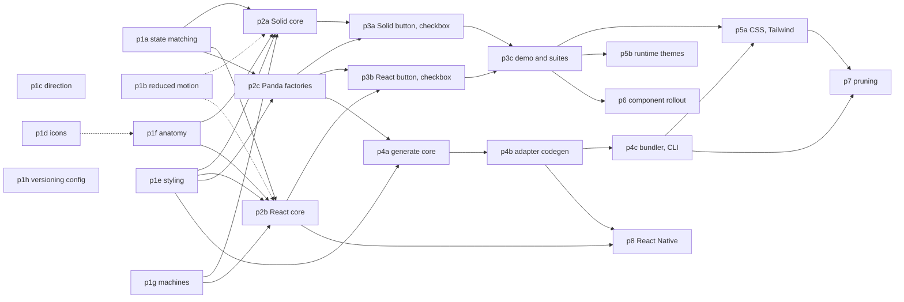

# Roadmap: components and style registry

Builds the architecture in [the design doc](../design/component-architecture.md), in
dependency order. Every phase follows the [conventions](conventions.md). Use the omni MCP's
tools as much as possible: `task_run` for builds and tests, the generators for new
packages, and the workspace queries for project facts
([details](conventions.md#use-the-omni-mcp-first)).

**How to use this file**

- A **phase** is a coherent, committable unit. It doesn't have to be finished product:
  stubs are allowed when the phase says so.
- **Subphases** under one phase have no dependencies on each other and can run in
  parallel, each by its own agent.
- Each phase file says what to read, what to build, and when it's done.
- **Every phase must write an output context** to `context/<phase-id>.md` when it's done
  (format in [conventions](conventions.md#finishing-the-output-context-required)). The
  phases after it read that file first. A phase can't start until the output contexts of
  everything it depends on exist.
- Tick a phase and link its output context when it lands.
- **Keep context small, even with subagents.** A phase can run long. When a session's
  context is getting large (long tool output, many files read, a long debugging loop),
  compact it rather than waiting for the automatic compaction near the limit:
    1. First write down progress, so the summary can't lose it: commit finished work and
       draft the output context (`context/<phase-id>.md`, marked as a draft).
    2. Then compact: `opencode api post /api/session/<session-id>/compact --data '{}'`
       (it runs at the next safe point; see
       [compaction](https://opencode.ai/v2/docs/compaction/)).
    3. After it, reread the phase file and the draft before continuing.

    Orchestrators do the same: hand each phase to a fresh subagent with the phase file and
    its dependencies' output contexts, not the orchestrator's own history.

## Already done

- Solid 2 port of Zag's Solid adapter, `packages/solid/src/internal/zag`, with
  `@zag-js/solid` v1's exports (design doc §8). No output context; read the design doc's
  §8 and the package's tests.

## Dependency graph

Dotted lines are soft dependencies: the later phase can start, and picks the earlier
one's work up when it lands.

## Phases

### Phase 1: foundations

All subphases are independent and can run in parallel. p1a to p1d all change preset
snapshots: land them one at a time, regenerating snapshots after each rebase.

|     | Subphase                                                                          | Depends on               | Output context                     |
| --- | --------------------------------------------------------------------------------- | ------------------------ | ---------------------------------- |
| [x] | [p1a: match states on native, ARIA, then `data-pf`](phases/p1a-state-matching.md) | none                     | [`context/p1a.md`](context/p1a.md) |
| [x] | [p1b: reduced motion stops movement only](phases/p1b-reduced-motion.md)           | none                     | [`context/p1b.md`](context/p1b.md) |
| [x] | [p1c: styles that flip with direction](phases/p1c-direction.md)                   | none                     | [`context/p1c.md`](context/p1c.md) |
| [x] | [p1d: icon fill, mirror, toggle icon button](phases/p1d-icons.md)                 | none                     | [`context/p1d.md`](context/p1d.md) |
| [x] | [p1e: `@pureform/styling`](phases/p1e-styling.md)                                 | none                     | [`context/p1e.md`](context/p1e.md) |
| [x] | [p1f: `@pureform/anatomy`](phases/p1f-anatomy.md)                                 | none (refresh after p1d) | [`context/p1f.md`](context/p1f.md) |
| [x] | [p1g: `@pureform/machines`](phases/p1g-machines.md)                               | none                     | [`context/p1g.md`](context/p1g.md) |
| [x] | [p1h: versioning configuration](phases/p1h-versioning-config.md)                  | none                     | [`context/p1h.md`](context/p1h.md) |

### Phase 2: binding foundations

Parallel subphases. p2a and p2b should talk: anything both write without a framework
moves into a shared package.

|     | Subphase                                                                      | Depends on                     | Output context                     |
| --- | ----------------------------------------------------------------------------- | ------------------------------ | ---------------------------------- |
| [x] | [p2a: Solid binding core](phases/p2a-solid-core.md)                           | p1a, p1e, p1f, p1g (soft: p1b) | [`context/p2a.md`](context/p2a.md) |
| [x] | [p2b: React binding core](phases/p2b-react-core.md)                           | p1a, p1e, p1f, p1g (soft: p1b) | [`context/p2b.md`](context/p2b.md) |
| [x] | [p2c: Panda factories for button and checkbox](phases/p2c-panda-factories.md) | p1a, p1e                       | [`context/p2c.md`](context/p2c.md) |

### Phase 3: first components end to end

p3a and p3b run in parallel; p3c follows them.

|     | Subphase                                                                            | Depends on | Output context                     |
| --- | ----------------------------------------------------------------------------------- | ---------- | ---------------------------------- |
| [x] | [p3a: Solid button and checkbox](phases/p3a-solid-button-checkbox.md)               | p2a, p2c   | [`context/p3a.md`](context/p3a.md) |
| [x] | [p3b: React button and checkbox](phases/p3b-react-button-checkbox.md)               | p2b, p2c   | [`context/p3b.md`](context/p3b.md) |
| [x] | [p3c: demo wiring and shared browser suites](phases/p3c-first-components-suites.md) | p3a, p3b   | [`context/p3c.md`](context/p3c.md) |

### Phase 4: generation (can run alongside phase 3)

Phase 4 needs only `@pureform/styling` and the factory shape from p2c, so it can run
while phase 3 builds components.

|     | Subphase                                                                  | Depends on             | Output context                                       |
| --- | ------------------------------------------------------------------------- | ---------------------- | ---------------------------------------------------- |
| [x] | [p4a: `@pureform/generate` core](phases/p4a-generate-core.md)             | p1e, p2c               | [`context/p4a.md`](context/p4a.md)                   |
| [x] | [p4b: adapter codegen](phases/p4b-adapter-codegen.md), split in parallel: | p4a's interface commit |                                                      |
| [x] | &nbsp;&nbsp;p4b-panda                                                     |                        | [`context/p4b-panda.md`](context/p4b-panda.md)       |
| [x] | &nbsp;&nbsp;p4b-css                                                       |                        | [`context/p4b-css.md`](context/p4b-css.md)           |
| [x] | &nbsp;&nbsp;p4b-tailwind                                                  |                        | [`context/p4b-tailwind.md`](context/p4b-tailwind.md) |
| [x] | &nbsp;&nbsp;p4b-rn                                                        |                        | [`context/p4b-rn.md`](context/p4b-rn.md)             |
| [x] | [p4c: bundler and CLI](phases/p4c-bundler-cli.md), split in parallel:     | p4a, p4b               |                                                      |
| [x] | &nbsp;&nbsp;p4c-bundler                                                   |                        | [`context/p4c-bundler.md`](context/p4c-bundler.md)   |
| [x] | &nbsp;&nbsp;p4c-cli                                                       |                        | [`context/p4c-cli.md`](context/p4c-cli.md)           |

### Phase 5: targets and runtime themes

Parallel subphases.

|     | Subphase                                                           | Depends on | Output context                     |
| --- | ------------------------------------------------------------------ | ---------- | ---------------------------------- |
| [x] | [p5a: CSS and Tailwind targets](phases/p5a-css-tailwind-parity.md) | p3c, p4c   | [`context/p5a.md`](context/p5a.md) |
| [x] | [p5b: runtime themes](phases/p5b-runtime-themes.md)                | p3c        | [`context/p5b.md`](context/p5b.md) |

### Phase 6: component rollout

Parallel subphases, by component group. Each builds Solid and React and adds its
components to the shared suites. Non-Panda targets need p5a.

|     | Subphase                                                                                                     | Depends on | Output context                     |
| --- | ------------------------------------------------------------------------------------------------------------ | ---------- | ---------------------------------- |
| [x] | [p6a: toggles](phases/p6-component-rollout.md) (switch, radio group, chip, icon button, FAB)                 | p3c        | [`context/p6a.md`](context/p6a.md) |
| [x] | [p6b: text inputs](phases/p6-component-rollout.md) (text field, text area, select)                           | p3c        | [`context/p6b.md`](context/p6b.md) |
| [x] | [p6c: overlays](phases/p6-component-rollout.md) (menu, dialog, tooltip, snackbar)                            | p3c        | [`context/p6c.md`](context/p6c.md) |
| [x] | [p6d: navigation and lists](phases/p6-component-rollout.md) (tabs, navigation bar and rail, list, list item) | p3c        | [`context/p6d.md`](context/p6d.md) |
| [x] | [p6e: display](phases/p6-component-rollout.md) (progress, slider, card, the rest)                            | p3c        | [`context/p6e.md`](context/p6e.md) |

### Phase 7 and 8: pruning and React Native

Independent of each other.

|     | Phase                                                     | Depends on  | Output context  |
| --- | --------------------------------------------------------- | ----------- | --------------- |
| [ ] | [p7: usage-based pruning](phases/p7-pruning.md)           | p4c, p5a    | `context/p7.md` |
| [ ] | [p8: `@pureform/react-native`](phases/p8-react-native.md) | p2b, p4b-rn | `context/p8.md` |

## Waves

The most that can run at once, assuming each wave's phases finish before the next:

1. **Wave 1:** p1a, p1b, p1c, p1d, p1e, p1f, p1g, p1h.
2. **Wave 2:** p2a, p2b, p2c.
3. **Wave 3:** p3a, p3b, p4a.
4. **Wave 4:** p3c, p4b-panda, p4b-css, p4b-tailwind, p4b-rn.
5. **Wave 5:** p4c-bundler, p4c-cli, p5b, p6a to p6e, p8.
6. **Wave 6:** p5a, then p7.
